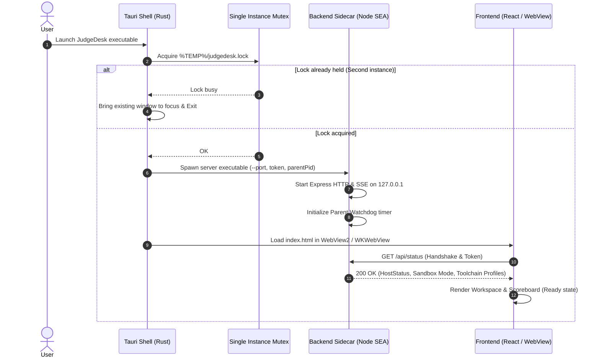
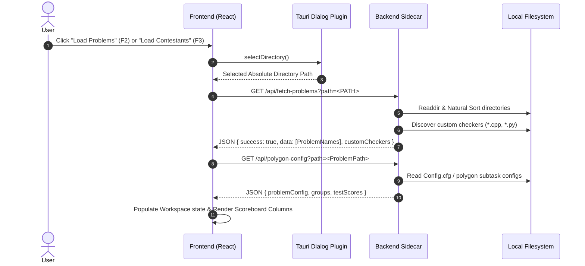
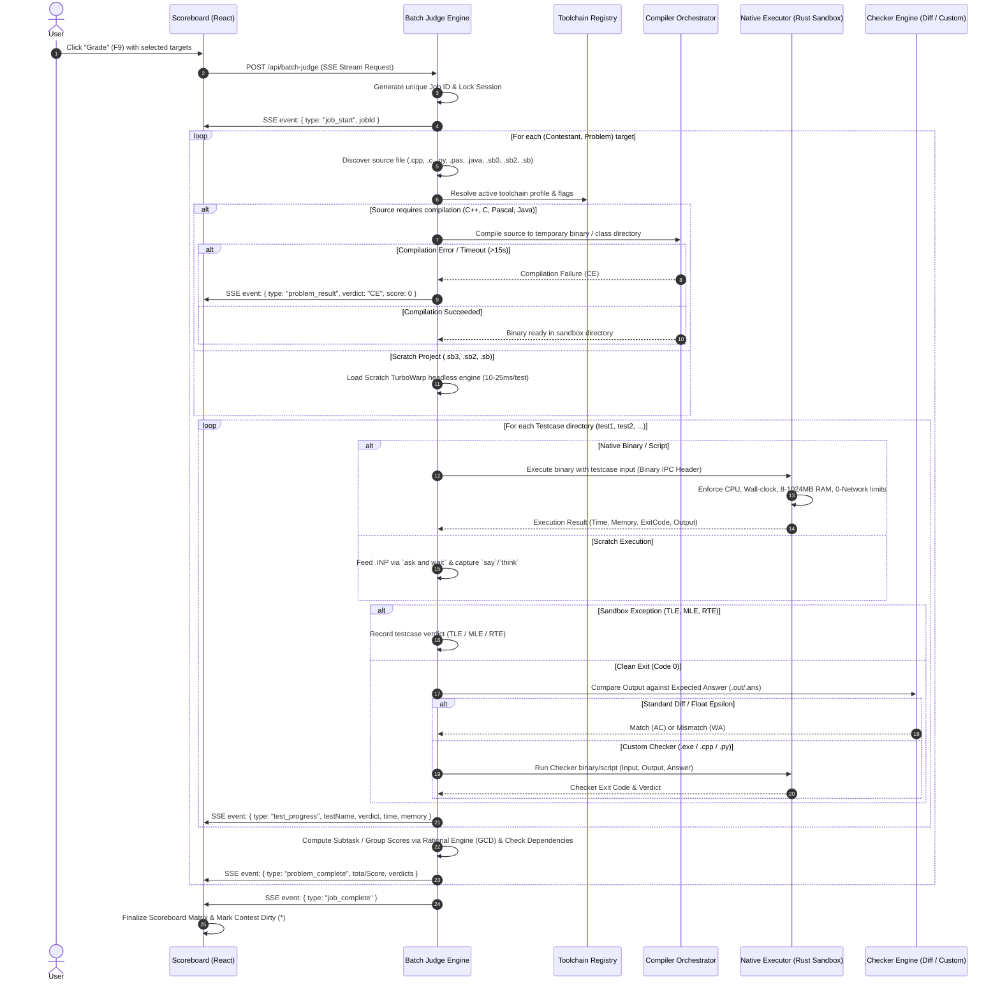
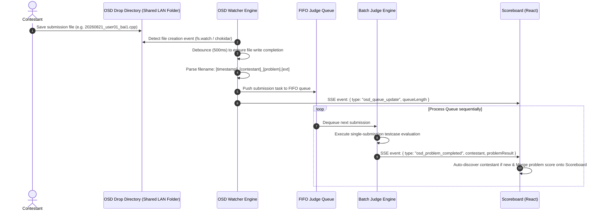
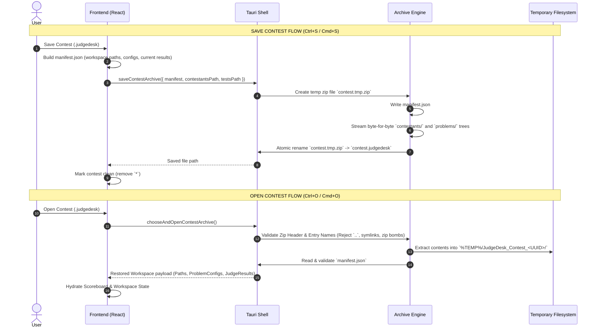
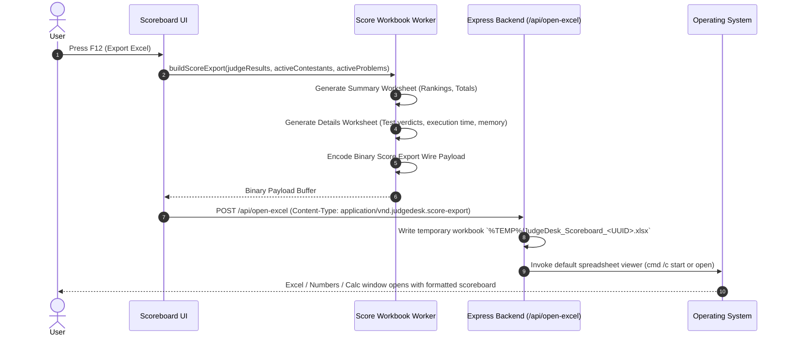
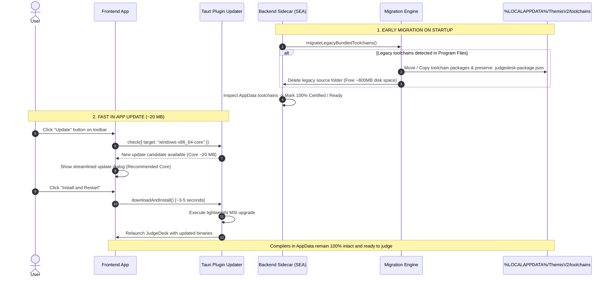
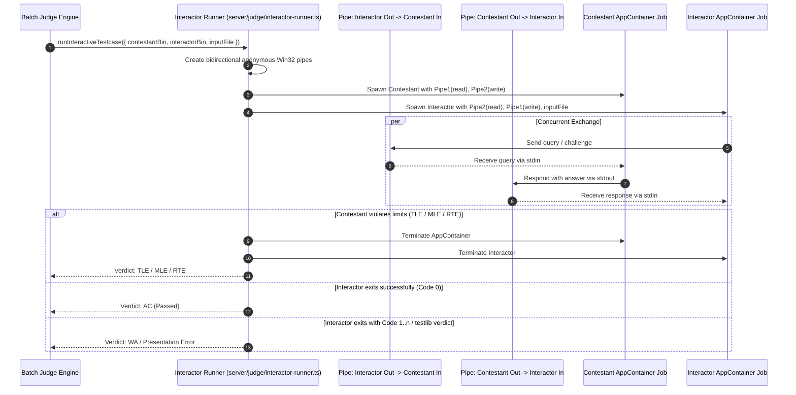
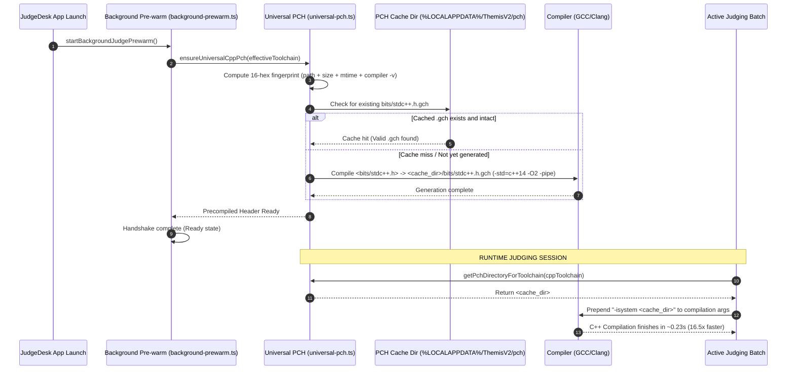

# App Flow & Sequence Diagrams — JudgeDesk

**Project Name**: JudgeDesk  
**Document Status**: Official / Approved  
**Classification**: System Architecture & Flow Specification  

---

## 1. Application Launch & Startup Guard Flow

The launch sequence ensures single-instance integrity, spawns the Node.js backend sidecar, and establishes a secure heartbeat connection.

---

## 2. Workspace Loading & Folder Discovery Flow

---

## 3. Batch Judging Pipeline Flow

The judging pipeline evaluates selected contestants against selected problems inside the native sandbox.

---

## 4. Online Judge (OSD) Submission Watcher Flow

---

## 5. Contest Container (`.judgedesk`) Save & Open Flow

---

## 6. Score Export to Excel Flow (`F12`)

---

## 7. Early Toolchain Migration & Fast In-App Update Flow

---

## 8. Interactive Problem Evaluation Flow

---

## 9. Universal Precompiled Header (PCH) & Background Pre-warming Flow

