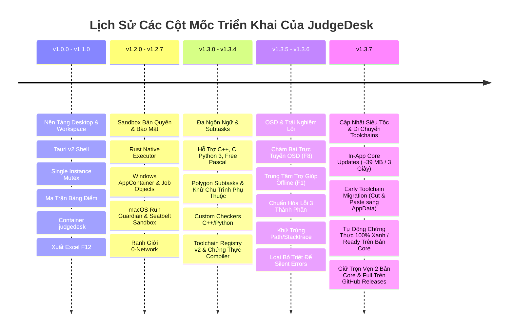

# Master Implementation Plan — JudgeDesk

**Project Name**: JudgeDesk  
**Current Version**: `v1.3.6+` (Production Stable)  
**Document Status**: Official / Approved  
**Classification**: Implementation History & Engineering Standards  

---

## 1. Executive Implementation History

JudgeDesk đã trải qua 4 giai đoạn triển khai cốt lõi để hoàn thiện từ một nguyên mẫu ứng dụng chấm bài cơ bản thành hệ thống chấm bài thi lập trình thi đấu ngoại tuyến đa nền tảng hoàn chỉnh:

---

## 2. Chi Tiết Các Hạng Mục Đã Triển Khai Hoàn Tất

### Cột Mốc 1: Khung Ứng Dụng & Không Gian Làm Việc (v1.0.0 - v1.1.0)
* [x] **Kiến trúc 4 tầng (4-Tier Architecture)**: Phân tách rõ ràng React 19 UI $\rightarrow$ Tauri v2 Shell $\rightarrow$ Node.js SEA Sidecar $\rightarrow$ Rust Native Executor.
* [x] **Tương thích cấu trúc thư mục Themis**: Tự động nhận diện `[Contestants]/[Thí sinh]/[Tên bài].[ext]` và `[Tests]/[Tên bài]/[Test ID]/[Tên bài].inp`.
* [x] **Định dạng đóng gói Contest (`.judgedesk`)**: Container ZIP chuẩn hóa chứa `manifest.json`, lưu file an toàn nguyên tử (atomic save), chống tấn công Zip bomb và Path traversal.
* [x] **Xuất bảng điểm Excel (`F12`)**: Sử dụng Web Worker sinh workbook song song, định dạng màu sắc theo verdict và tự động mở trình đọc bảng tính của hệ điều hành.

### Cột Mốc 2: Sandbox Bản Địa & Bảo Mật Hệ Thống (v1.2.0 - v1.2.7)
* [x] **Windows AppContainer & Job Objects**: Cô lập triệt để quyền đọc/ghi ổ đĩa, chặn 100% kết nối mạng (0-network invariant), giới hạn RAM tối đa 512 MB và chống tạo tiến trình con vô hạn.
* [x] **macOS Run Guardian & Seatbelt Sandbox**: Sử dụng nhóm tiến trình POSIX (`setpgid`) để dọn dẹp sạch tiến trình con, thực thi chính sách `sandbox_init` an toàn.
* [x] **Single-Instance Mutex & Process Supervisor**: Ngăn chặn mở trùng lặp ứng dụng (`%TEMP%/judgedesk.lock`) và đảm bảo tắt sạch tiến trình nền (sidecar) khi đóng app.

### Cột Mốc 3: Đa Ngôn Ngữ & Cấu Hình Subtasks (v1.3.0 - v1.3.4)
* [x] **Hỗ trợ đa ngôn ngữ lập trình**: Biên dịch và thực thi C++ (C++11/14/17/20), C, Python 3 và Free Pascal.
* [x] **Polygon Test Groups & Subtasks**: Hỗ trợ phân nhóm test, tính điểm từng test hoặc tính trọn gói subtask (all-or-nothing), kiểm tra và ngăn chặn đồ thị phụ thuộc vòng lặp (cycle detection).
* [x] **Bộ chấm tùy biến (Custom Checkers)**: Hỗ trợ checker viết bằng C++ (`testlib.h`) và Python chạy trong sandbox an toàn.
* [x] **Trình quản lý Toolchain v2 & Chứng thực (`F6`)**: Tự động quét compiler hệ thống, cung cấp gói compiler di động, kiểm tra hash mã hóa SHA256 và chạy test chứng thực tính tương thích với sandbox.

### Cột Mốc 4: Chấm Trực Tuyến OSD & Chuẩn Hóa Lỗi UX (v1.3.5 - v1.3.6)
* [x] **Chấm bài trực tuyến OSD (`F8`)**: Lắng nghe thư mục nộp bài theo thời gian thực (500ms debounce), xếp hàng đợi FIFO, tự động nạp thí sinh mới và cập nhật điểm trực tiếp lên bảng điểm qua SSE.
* [x] **Trung tâm trợ giúp ngoại tuyến (`F1`)**: Tra cứu hướng dẫn, bảng phím tắt và chức năng sao chép thông số chẩn đoán hệ thống an toàn.
* [x] **Chuẩn hóa thông báo lỗi 3 thành phần**: Hiển thị Toast/Banner nổi gồm: **What happened** (Chuyện gì xảy ra), **Why it happened** (Nguyên nhân), và **Action** (Hướng xử lý kèm nút bấm thao tác nhanh CTA).
* [x] **Bảo mật thông tin riêng tư**: Tự động khử toàn bộ đường dẫn máy tính cá nhân (`C:\Users\username\...`) và stack traces kỹ thuật khỏi giao diện.
* [x] **Loại bỏ triệt để Silent Errors**: Bắt và phản hồi toàn bộ các ngoại lệ ngầm khi nạp thư mục, duyệt file, lưu cấu hình bài tập và tiến trình chấm bài.

### Cột Mốc 5: Luồng Cập Nhật Siêu Tốc & Di Chuyển Toolchains An Toàn (v1.3.7)
* [x] **In-App Fast Core Updates**: Tinh giản luồng cập nhật trong app để ưu tiên tải gói Core nhẹ (~39 MB), hoàn tất trong 3–5 giây mà không cần tải lại các compiler không thay đổi.
* [x] **Cơ chế Early Cut-and-Paste Migration vĩnh viễn**: Tự động phát hiện và chuyển các toolchain cũ sang `%LOCALAPPDATA%\ThemisV2\toolchains\`, bảo lưu file receipt `.judgedesk-package.json`, và xóa sạch thư mục cũ tại `Program Files` để giải phóng ~800 MB đĩa.
* [x] **Tự động chứng thực 100% "Xanh / Ready" trên bản Core**: Đảm bảo toàn bộ toolchain đã migrate được nhận diện là Official Managed Package, chạy thẳng trong Native Sandbox mà không hiện cảnh báo bảo mật hay bắt người dùng tick chọn.
* [x] **Duy trì ĐỦ 2 bản Core & Full trên GitHub Releases**: Phục vụ người dùng tải lần đầu hoặc cài đặt offline cho phòng thi máy tính qua USB.

---

## 3. Hiện Trạng Kiểm Thử & Đo Lường Chất Lượng

| Tiêu Chí Đo Lường | Mục Tiêu | Hiện Trạng Thực Tế (v1.3.7) |
| :--- | :--- | :--- |
| **Hệ thống Unit & Integration Tests** | Toàn bộ pass 100% | **448 tests (438 Passed, 0 Failed, 10 Skipped)** |
| **Kiểm tra TypeScript Lint** | 0 lỗi biên dịch | **Clean (`tsc --noEmit`: Code 0)** |
| **Tốc độ build Frontend** | < 1 giây | **Vite Production Build: 590 ms** |
| **Độ tương thích nền tảng** | Windows x64 & macOS ARM64 | **Đạt chuẩn trên cả Windows 10/11 và macOS Apple Silicon** |

---

## 4. Kế Hoạch Tiếp Theo

Mọi tính năng mới hoặc kế hoạch mở rộng trong tương lai sẽ được thảo luận và thống nhất trực tiếp với tác giả trước khi bổ sung vào tài liệu triển khai.
