# Master Implementation Plan — JudgeDesk

**Project Name**: JudgeDesk  
**Application Source Baseline**: `v1.6.1` (8-file application lockstep plus `crates/judgedesk-core/Cargo.toml` at `1.6.1`)
**Development Target**: `v1.6.1`
**Document Status**: Official / Approved  
**Classification**: Implementation History & Engineering Standards  

---

## 1. Executive Implementation History

JudgeDesk đã trải qua 14 giai đoạn triển khai cốt lõi để hoàn thiện từ một nguyên mẫu ứng dụng chấm bài cơ bản thành hệ thống chấm bài thi lập trình thi đấu ngoại tuyến đa nền tảng hoàn chỉnh:

```mermaid
timeline
    title Lịch Sử Các Cột Mốc Triển Khai Của JudgeDesk
    v1.0.0 - v1.1.0 : Nền Tảng Desktop & Workspace : Tauri v2 Shell : Single Instance Mutex : Ma Trận Bảng Điểm : Container .judgedesk : Xuất Excel F12
    v1.2.0 - v1.2.7 : Sandbox Bản Quyền & Bảo Mật : Rust Native Executor : Windows AppContainer & Job Objects : macOS Run Guardian & Seatbelt Sandbox : Ranh Giới 0-Network
    v1.3.0 - v1.3.4 : Đa Ngôn Ngữ & Subtasks : Hỗ Trợ C++, C, Python 3, Free Pascal, Java : Polygon Subtasks & Khử Chu Trình Phụ Thuộc : Custom Checkers C++/Python : Toolchain Registry v2 & Chứng Thực Compiler
    v1.3.5 - v1.3.6 : OSD & Trải Nghiệm Lỗi : Chấm Bài Trực Tuyến OSD (F8) : Trung Tâm Trợ Giúp Offline (F1) : Chuẩn Hóa Lỗi 3 Thành Phần : Khử Trùng Path/Stacktrace : Loại Bỏ Triệt Để Silent Errors
    v1.3.7 : Cập Nhật Siêu Tốc & Di Chuyển Toolchains : In-App Core Updates (~20 MB) : Early Toolchain Migration : Tự Động Chứng Thực 100% Xanh / Ready Trên Bản Core : Giữ Trọn Vẹn 2 Bản Core & Full Trên GitHub Releases
    v1.3.8 - v1.3.82 : Hoàn Thiện Xuất Excel & Changelog : Sửa Dứt Điểm Xuất Excel Rỗng : Tự Động Nạp Run Metadata Môi Trường : Tra Cứu Changelog Song Ngữ Trong Trợ Giúp F1
    v1.4.0 - v1.4.43 : Nhận Diện Themis, Probes & Chấm Scratch : Tự Động Quét & So Sánh Toolchain Themis : Custom Checkers .exe/.cpp/.py Tự Nạp Header : Chẩn Đoán Compiler Self-Test Probes : Nút Sắp Xếp Điểm Động 3 Trạng Thái : Tích Hợp Chấm Scratch Chuẩn VNOI scratch-run (TurboWarp VM)
    v1.4.44 : Chấm Thi Scratch Tuyệt Đối : Khắc phục lỗi STATUS_DLL_INIT_FAILED bằng ResourceOnly Job Objects : Chứng thực ký Ed25519 cho gói Scratch
    v1.4.45 : Nâng Giới Hạn RAM 1024 MB : Mở rộng trần Memory Limit lên 1024 MB trên Windows/macOS : Tối ưu Compiler Staging
    v1.4.46 : Bài Tương Tác & Chấm Điểm Phân Số : Dual-Job Runner cho Bài Interactive : Rational Scoring Engine triệt tiêu sai số float : Precompiled Header C++14
    v1.5.0 : Universal PCH C++, Di Trú Chính Sách & Brand Refresh : Universal PCH cho mọi compiler C++ : Tự động di trú Execution Policy : In-App Core Updater & Nút Ủng hộ : Bộ nhận diện thương hiệu mới
    v1.5.1 - v1.5.5 : Chuẩn Hóa Giao Diện Native, Compile Profiles, OSD Themis Web & Nền Tảng Rust Core : Cấu hình Compile Profile C/C++ (Themis, IOI/ICPC 2025, World Finals, Custom) : Tương thích OSD Themis Web & Lịch sử nộp bài : Selective Prewarm : Hardening X-JudgeDesk-Session & Nền tảng Pure-Rust Core Bước 1-5
    v1.6.0 : Hoàn Tất Pure Rust Core & Hỗ Trợ Chính Thức Linux : Nhân điều phối Pure Rust (judgedesk-core) : Hỗ trợ Linux x86_64 (.deb, .rpm, .AppImage, GLIBC <= 2.34) : Linux Bubblewrap + cgroup v2 + seccomp-bpf Sandbox & Interactive Runner : Format-Isolated Updater
    v1.6.1 : Trung Tâm Thông Báo Admin & Bản Cài Linux Full : Trung tâm Thông báo có chữ ký số Ed25519 (Notification Center) : Bản cài Linux Full (.deb, .rpm, .AppImage) đóng gói sẵn đủ 6 ngôn ngữ offline : Tương thích tên tệp không phân biệt hoa/thường & lọc tệp rác hệ điều hành
```

---

## 2. Chi Tiết Các Hạng Mục Đã Triển Khai Hoàn Tất

### Cột Mốc 1: Khung Ứng Dụng & Không Gian Làm Việc (v1.0.0 - v1.1.0)
* [x] **Kiến trúc 4 tầng (4-Tier Architecture)**: Phân tách rõ ràng React 19 UI $\rightarrow$ Tauri v2 Shell $\rightarrow$ Node.js SEA Sidecar $\rightarrow$ Rust Native Executor.
* [x] **Tương thích cấu trúc thư mục Themis**: Tự động nhận diện `[Contestants]/[Thí sinh]/[Tên bài].[ext]` và `[Tests]/[Tên bài]/[Test ID]/[Tên bài].inp`.
* [x] **Định dạng đóng gói Contest (`.judgedesk`)**: Container ZIP chuẩn hóa chứa `manifest.json`, lưu file an toàn nguyên tử (atomic save), chống tấn công Zip bomb và Path traversal.
* [x] **Xuất bảng điểm Excel (`F12`)**: Sử dụng Web Worker sinh workbook song song, định dạng màu sắc theo verdict và tự động mở trình đọc bảng tính của hệ điều hành.

### Cột Mốc 2: Sandbox Bản Địa & Bảo Mật Hệ Thống (v1.2.0 - v1.2.7)
* [x] **Windows AppContainer & Job Objects**: Cô lập triệt để quyền đọc/ghi ổ đĩa, chặn 100% kết nối mạng (0-network invariant), giới hạn RAM và chống tạo tiến trình con vô hạn.
* [x] **macOS Run Guardian & Seatbelt Sandbox**: Sử dụng nhóm tiến trình POSIX (`setpgid`) để dọn dẹp sạch tiến trình con, thực thi chính sách `sandbox_init` an toàn.
* [x] **Single-Instance Mutex & Process Supervisor**: Ngăn chặn mở trùng lặp ứng dụng (`%TEMP%/judgedesk.lock`) và đảm bảo tắt sạch tiến trình nền (sidecar) khi đóng app.

### Cột Mốc 3: Đa Ngôn Ngữ & Cấu Hình Subtasks (v1.3.0 - v1.3.4)
* [x] **Hỗ trợ đa ngôn ngữ lập trình**: Biên dịch và thực thi C++ (C++11/14/17/20), C, Python 3, Free Pascal và Java (OpenJDK 21).
* [x] **Polygon Test Groups & Subtasks**: Hỗ trợ phân nhóm test, tính điểm từng test hoặc tính trọn gói subtask (all-or-nothing), kiểm tra và ngăn chặn đồ thị phụ thuộc vòng lặp (cycle detection).
* [x] **Bộ chấm tùy biến (Custom Checkers)**: Hỗ trợ checker viết bằng C++ (`testlib.h`) và Python chạy trong sandbox an toàn.
* [x] **Trình quản lý Toolchain v2 & Chứng thực (`F6`)**: Tự động quét compiler hệ thống, cung cấp gói compiler di động, kiểm tra hash mã hóa SHA256 và chạy test chứng thực tính tương thích với sandbox.

### Cột Mốc 4: Chấm Trực Tuyến OSD & Chuẩn Hóa Lỗi UX (v1.3.5 - v1.3.6)
* [x] **Chấm bài trực tuyến OSD (`F8`)**: Lắng nghe thư mục nộp bài theo thời gian thực (500ms debounce), xếp hàng đợi FIFO, tự động nạp thí sinh mới và cập nhật điểm trực tiếp lên bảng điểm qua SSE.
* [x] **Trung tâm trợ giúp ngoại tuyến (`F1`)**: Tra cứu hướng dẫn, bảng phím tắt và chức năng sao chép thông số chẩn đoán hệ thống an toàn.
* [x] **Chuẩn hóa thông báo lỗi 3 thành phần**: Hiển thị Toast/Banner nổi gồm: **What happened** (Chuyện gì xảy ra), **Why it happened** (Nguyên nhân), và **Action** (Hướng xử lý kèm nút bấm thao tác nhanh CTA).
* [x] **Bảo mật thông tin riêng tư**: Tự động khử toàn bộ đường dẫn máy tính cá nhân (`C:\Users\username\...`) và stack traces kỹ thuật khỏi giao diện.
* [x] **Loại bỏ triệt để Silent Errors**: Bắt và phản hồi toàn bộ các ngoại lệ ngầm khi nạp thư mục, duyệt file, lưu cấu hình bài tập và tiến trình chấm bài.

### Cột Mốc 5: Luồng Cập Nhật Siêu Tốc & Di Chuyển Toolchains An Toàn (v1.3.7)
* [x] **In-App Fast Core Updates**: Tinh giản luồng cập nhật trong app để ưu tiên tải gói Core nhẹ (~20 MB), hoàn tất trong 3–5 giây mà không cần tải lại các compiler không thay đổi.
* [x] **Cơ chế Early Cut-and-Paste Migration & Zero-Copy**: Tự động phát hiện và dọn dẹp các thư mục trùng lặp trong AppData giúp giải phóng ~800 MB đĩa; bản Full chạy trực tiếp từ tài nguyên ứng dụng.
* [x] **Tự động chứng thực 100% "Xanh / Ready" trên bản Core**: Đảm bảo toàn bộ toolchain đã migrate được nhận diện là Official Managed Package, chạy thẳng trong Native Sandbox mà không hiện cảnh báo bảo mật.
* [x] **Duy trì ĐỦ 2 bản Core & Full trên GitHub Releases**: Phục vụ người dùng tải lần đầu hoặc cài đặt offline cho phòng thi máy tính qua USB.

### Cột Mốc 6: Hoàn Thiện Xuất Excel & Tích Hợp Changelog (v1.3.8 - v1.3.82)
* [x] **Khắc phục triệt để lỗi xuất Excel**: Bộ phân giải selection case-insensitive và fallback thông minh đảm bảo xuất đủ 100% cột bài tập, điểm số và chi tiết testcase.
* [x] **Tự động nạp Run Metadata môi trường**: Ghi nhận đầy đủ thông số môi trường hệ thống trong file Excel kể cả khi mở từ kỳ thi đã lưu.
* [x] **Cửa sổ "Có gì mới" & Tra cứu Changelog**: Tự động hiển thị tính năng mới sau khi cập nhật; tra cứu lịch sử phát hành song ngữ trực tiếp trong Trợ giúp (`F1`).

### Cột Mốc 7: Nhận Diện Toolchain Themis, Probes, Sắp Xếp Điểm & Chấm Scratch (v1.4.0 - v1.4.43)
* [x] **Tự động nhận diện & Quét sâu Toolchain Themis**: Quét mọi ổ đĩa chuẩn (`C:\Themis`, `D:\Themis`, `E:\Themis`), mở rộng sandbox cho các binary 32-bit legacy và hiển thị bảng so sánh trực quan với Chuẩn Olympic 64-bit.
* [x] **Custom Checkers Đa Định dạng**: Hỗ trợ toàn diện `.exe`, `.cpp` và `.py`; tự động nạp toàn bộ header cục bộ trong thư mục bài tập (`testlib.h`, headers Themis) loại bỏ lỗi CE do thiếu header.
* [x] **Chẩn đoán Compiler Self-Test Probes**: Bổ sung tính năng tự kiểm tra trong Sandbox đo đạc thời gian biên dịch, thực thi và bộ nhớ tiêu thụ cho từng ngôn ngữ.
* [x] **Tối ưu Giao diện Toolbar & Sắp xếp Điểm**: Tối ưu nút Cập nhật gọn gàng («Đã mới nhất»), loại bỏ nút sort thừa trên Toolbar, giữ nguyên nút sort cạnh tiêu đề Tổng Điểm; file Excel xuất ra tuân thủ chính xác thứ tự hiển thị.
* [x] **Tích hợp Chấm Scratch Chuẩn VNOI (`scratch-run` / TurboWarp VM)**: Chấm trực tiếp các dự án Scratch (`.sb3`, `.sb2`, `.sb`) qua runner chính thức của VNOI-Admin, nạp test tự động qua `ask and wait` và xuất kết quả qua `say`/`think`, tích hợp sẵn trong bản Full và tải tự động ở bản Core.
* [x] **Tối ưu Khởi động Chấm & Làm ấm Sandbox**: Mở ngay cửa sổ tiến trình khi bấm Chấm bài (`F9`); làm ấm ngầm Native Sandbox và cache nhị phân Custom Checker.

### Cột Mốc 8: Hoàn Thiện Tuyệt Đối Chấm Thi Scratch (v1.4.44)
* [x] **Khắc phục lỗi STATUS_DLL_INIT_FAILED (0xC0000142)**: Áp dụng cơ chế cô lập an toàn `ResourceOnly` qua Windows Job Object, kiểm soát chặt chẽ Time Limit, Memory Limit và I/O stream.
* [x] **Đưa Scratch vào Phân phối Chính thức Ký số**: Đưa `scratch-windows-x64` và `scratch-macos-arm64` vào manifest ký số Ed25519, chấm dứt hiện tượng mất Scratch sau cập nhật.

### Cột Mốc 9: Nâng Giới Hạn Bộ Nhớ 1024 MB & Tối Ưu Trình Biên Dịch (v1.4.45)
* [x] **Mở rộng Memory Limit lên 1024 MB**: Cho phép cấu hình từ 8 MB đến 1024 MB trên cả Windows và macOS, mặc định 256 MB chuẩn Olympic / HSG / ICPC.
* [x] **Tối ưu hóa Compiler Staging & Diagnostics**: Xử lý an toàn các ký tự đặc biệt, rút gọn token UUID trong chẩn đoán giúp duy trì độ ổn định tuyệt đối.

### Cột Mốc 10: Bài Tương Tác, Điểm Phân Số & Tối Ưu Khởi Động (v1.4.46)
* [x] **Hỗ trợ bài thi tương tác (Interactive Problems)**: Tích hợp runner chấm tương tác qua AppContainer dual-job runner với hai đường ống ẩn danh hai chiều (bidirectional anonymous pipes), hỗ trợ interactor C++ (`testlib.h`) và Python, hỗ trợ bộ test chỉ có `.inp`.
* [x] **Công cụ chấm điểm phân số chính xác tuyệt đối (Rational Scoring Engine)**: Triệt tiêu hoàn toàn hiện tượng sai số trôi dấu phẩy động IEEE 754 trong tính điểm và tổng điểm bằng số hữu tỉ tối giản (GCD).
* [x] **Khởi tạo Precompiled Header C++14 & Background Judge Pre-warm**: Tăng tốc biên dịch C++ gấp ~16.5 lần; pre-warm ngầm khởi tạo sẵn sandbox trước khi người dùng bấm chấm bài.

### Cột Mốc 11: Universal Precompiled Header C++, Di Trú Chính Sách & Brand Refresh (v1.5.0)
* [x] **Universal Precompiled Header C++**: Tự động phát hiện và sinh PCH đa năng cho mọi trình biên dịch C++ (Managed GCC, MinGW, MSYS2, Apple Clang) với bộ băm canonical path, mtime, size và version digest.
* [x] **Tự động chuyển đổi Chính sách Thực thi (Toolchain Execution Policy Migration)**: Tự động di trú chính sách cũ sang cấu hình bảo mật chuẩn một cách minh bạch.
* [x] **Tinh gọn Giao diện Quản lý Trình biên dịch (F6)**: Loại bỏ các menu nâng cao rườm rà, tập trung vào trải nghiệm cấu hình trực quan.
* [x] **Cải tiến Trình Cập nhật & Nút Ủng hộ Toolbar**: Nút cập nhật nổi bật trên toolbar với tiến trình tải Core ngầm và khởi động lại 1-chạm; bổ sung nút mời cà phê / donate.
* [x] **Bộ Nhận diện Thương hiệu & Biểu tượng Mới**: Logo và bộ icon ứng dụng mới hiện đại, sắc nét trên cả Windows và macOS.

### Cột Mốc 12: Cấu Hình Compile Profiles, Tương Thích OSD Themis Web, Hardening & Nền Tảng Pure-Rust Core (v1.5.1 - v1.5.5)
* [x] **Cấu hình Compile Profile C/C++ theo từng bài toán (`ProblemConfigModal` — tab `compile`)**: Hỗ trợ 4 chế độ (`themis`, `modern_ioi_icpc_2025`, `icpc_world_finals`, `custom`) kèm bộ lọc `assertSafeCompileFlag` và tích hợp vào định danh cache Universal PCH.
* [x] **Tương thích hoàn toàn OSD Themis Web (`docs/osd-themis-compatibility.md`)**: Nhận diện tên file không dấu chấm (`0[HS01][SUM]cpp`), atomic claim `.judgedesk-osd-*`, kiểm tra ổn định file theo `fd`/`inode`/`mtime`/SHA-256, lưu trữ `$History`, và xuất log CRLF chuẩn Themis (`logs/<raw-filename>.log`).
* [x] **Selective Background Prewarm (`nativeCompilerKindsToPrewarm`)**: Chỉ prewarm compiler cho các ngôn ngữ thực tế có bài nộp trong phiên chấm.
* [x] **Khóa biên bảo mật Desktop API (`X-JudgeDesk-Session`) & Nền tảng Pure-Rust Core (`crates/judgedesk-core` Bước 1–5)**: Ràng buộc token theo phiên khởi chạy, kiểm tra `Host`/`Origin`, cô lập `OwnedWorkspace`, chuyển compiler/custom checker/interactor trong `judgedesk-core` qua `ExecutorClient` và nâng cấp `Rational` sang `BigUint`.

### Cột Mốc 13: Hoàn Tất Pure Rust Core & Hỗ Trợ Chính Thức Linux (v1.6.0)
* [x] **Nhân điều phối Pure Rust (`judgedesk-core`)**: Hợp nhất nhân xử lý kỳ thi, lập lịch chấm bài, tính điểm hữu tỉ, Universal PCH và quản lý trình biên dịch sang kiến trúc Pure Rust mặc định.
* [x] **Hỗ trợ chính thức Linux `x86_64` (`amd64`, Ubuntu 22.04 LTS+)**: Phát hành đồng thời 3 định dạng bộ cài `.deb`, `.rpm`, `.AppImage` đạt chuẩn tương thích ngược ELF `GLIBC <= 2.34`.
* [x] **Linux Native Sandbox (`linux-bwrap-cgroup-seccomp`) & Interactive Runner (`linux_interactive`)**: Cô lập thực thi bài nộp bằng Bubblewrap + systemd User Scope (`cgroup v2`) + `seccomp-bpf` và chấm bài tương tác hai chiều trên Linux.
* [x] **Format-Isolated In-App Updater**: Cách ly kênh cập nhật theo đúng định dạng gói đã cài đặt (`deb`, `rpm`, `appimage`).

### Cột Mốc 14: Trung Tâm Thông Báo Admin Có Chữ Ký Số & Bản Cài Linux Full (v1.6.1)
* [x] **Trung tâm Thông báo Admin có chữ ký số (`Signed Admin Announcements & Notification Center`)**: Biểu tượng chuông thông báo trên thanh công cụ với badge số tin chưa đọc, bảng tin neo trực tiếp (`NotificationPopover`) và hộp thoại đọc bài báo dạng editorial song ngữ (Tiếng Việt & Tiếng Anh), xác thực chữ ký Ed25519 độc lập (`announcements-v1`), chống hạ cấp `sequence` và lưu đệm offline an toàn.
* [x] **Bản cài đặt Đầy đủ (`Full Edition`) cho Linux (`x86_64`)**: Đóng gói sẵn toàn bộ 6 ngôn ngữ lập trình offline (`gcc-linux-x64` xPack GCC 14.2.0-2, `python-linux-x64` CPython 3.12.13, `fpc-linux-x64` Free Pascal 3.2.2, `temurin21-linux-x64` OpenJDK 21, `scratch-linux-x64` 0.1.7) trong cả 3 định dạng `_full_amd64.deb`, `-full-1.x86_64.rpm`, `_full_amd64.AppImage`, kèm xác minh chỉ mục `SHA-256` từng tệp và ánh xạ đường dẫn ngắn (`/jd-tools`, `/jd-work`) trong sandbox.
* [x] **Tương thích Đa nền tảng**: Tự động nhận diện tên tệp không phân biệt hoa/thường trên Linux/macOS, lọc bỏ tệp rác hệ điều hành (`__MACOSX`, `.DS_Store`, `._*`) và chuẩn hoá nhập điểm thập phân dấu phẩy.

---

## 3. Hiện Trạng Kiểm Thử & Đo Lường Chất Lượng

| Tiêu Chí Đo Lường | Mục Tiêu | Hiện Trạng Thực Tế (`v1.6.1`) |
| :--- | :--- | :--- |
| **Hệ thống Unit & Integration Tests (Node/Server)** | Toàn bộ pass 100% | **>700 tests (0 Failed)** |
| **Hệ thống Kiểm thử `crates/judgedesk-core` & `src-tauri`** | Toàn bộ pass 100% | **Pass 100% trên Windows x64, macOS ARM64 & Linux x86_64** |
| **Kiểm tra TypeScript & Quality Gate (`check:fast`)** | 0 lỗi biên dịch / 0 vi phạm | **Clean (`tsc --noEmit` & `check-quality-gate.js`: Code 0)** |
| **Tốc độ biên dịch C++ với PCH** | < 300 ms | **~230 ms (tăng tốc gấp ~16.5x so với không có PCH)** |
| **Độ tương thích nền tảng** | Windows x64, macOS ARM64 & Linux x86_64 | **Đạt chuẩn trên cả Windows 10/11, macOS Apple Silicon & Linux (Ubuntu 22.04 LTS+)** |

---

## 4. Kế Hoạch Tiếp Theo

Mọi tính năng mới hoặc kế hoạch mở rộng trong tương lai (bao gồm lộ trình hoàn tất Pure-Rust Core `v1.6.0` tại [`pure-rust-core-detailed-implementation-plan.md`](./pure-rust-core-detailed-implementation-plan.md)) sẽ được thảo luận và thống nhất trực tiếp với tác giả trước khi triển khai.
