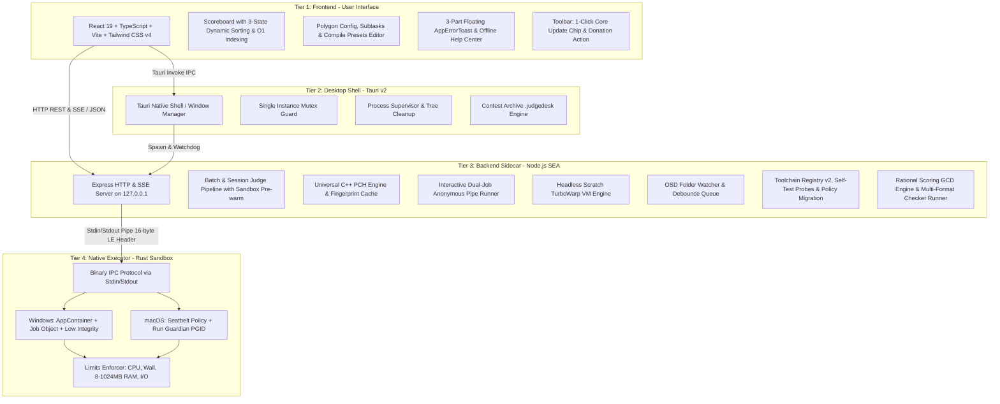

# Technical Requirements Document (TRD) — JudgeDesk

**Project Name**: JudgeDesk  
**Version**: `1.5.0` (`v1.5.x`)  
**Document Status**: Official / Approved  
**Classification**: Internal / Technical Specification  

---

## 1. System Architecture & 4-Tier Blueprint

JudgeDesk is engineered as an offline, multi-tier desktop application designed to ensure high performance, total isolation of untrusted code, and cross-platform consistency between **Windows (x64)** and **macOS (Apple Silicon ARM64)**.



---

## 2. Tier-by-Tier Specifications

### 2.1. Tier 1: Frontend (User Interface)
* **Technology Stack**: React 19, TypeScript (Strict mode), Vite, Tailwind CSS v4, `i18next` for internationalization, `lucide-react` for icons.
* **State Management**:
  * `useContestWorkspace`: Manages directory paths, loaded problems, contestant rosters, and problem configurations.
  * `useJudgeSession`: Controls batch judging lifecycle, SSE consumption, and real-time score reductions.
  * `useOsdSession`: Manages background online submission watcher, real-time event streaming, and queue updates.
  * `AppErrorToast`: Manages structured 3-part errors with auto-dismiss, hover pause, and CTA user actions.
* **Performance Optimizations**:
  * Offloads heavy Excel workbook compilation to Web Workers (`score-workbook.worker.ts`).
  * Scoreboard Matrix $O(1)$ lookup hash map for instant rendering and sorting on large rosters.
  * 3-state Scoreboard sorting (Highest $\rightarrow$ Lowest $\rightarrow$ Default) synced with header clicks.
  * Request animation frame (`requestAnimationFrame`) throttling for live judging progress updates.

### 2.2. Tier 2: Desktop Shell (Tauri v2)
* **Technology Stack**: Rust 1.97.1, Tauri v2 CLI & Plugins (`tauri-plugin-single-instance`, `tauri-plugin-dialog`, `tauri-plugin-process`, `tauri-plugin-opener`, `tauri-plugin-updater`).
* **Core Responsibilities**:
  * **Single Instance Guard**: Ensures only one instance of JudgeDesk runs simultaneously using OS mutex locks (`%TEMP%/judgedesk.lock`).
  * **Process Tree Supervisor**: Tracks spawned sidecar binaries (`server-<target>` and `judgedesk-native-executor`) and guarantees zero orphan processes on application exit or crash.
  * **Update Handoff**: Coordinates staging, validation, and in-place application restarts during 1-click update installation.
  * **Archive Engine**: Validates and extracts `.judgedesk` ZIP archives securely into temporary isolated directories.

### 2.3. Tier 3: Backend Sidecar (Node.js SEA)
* **Technology Stack**: Node.js 24.19.0 compiled into Single Executable Applications (SEA) via `esbuild` and `postject`.
* **Subsystems**:
  1. **Judge Engine**: Coordinates preflight verification, language adapter resolution, compilation, testcase discovery, execution queueing, background sandbox pre-warming (`background-prewarm.ts`), and standard/custom checker evaluations.
  2. **Universal C++ PCH Engine (`universal-pch.ts`)**: Generates and manages 16-hex fingerprinted precompiled headers for `<bits/stdc++.h>` across all C++ compilers, accelerating C++ build performance by up to ~16.5x.
  3. **Interactive Problem Runner (`interactor-runner.ts`)**: Runs submission binary and Interactor (C++ `testlib.h` / Python) concurrently inside isolated AppContainer jobs connected via bidirectional anonymous pipe pairs.
  4. **Rational Scoring Engine (`scoring.ts`)**: Computes exact test, subtask, and total points using fractional mathematics (`gcd(num, den)`), eliminating floating-point rounding errors.
  5. **Scratch Headless Runner (`scratch-runtime.ts`)**: Evaluates `.sb3`, `.sb2`, `.sb` projects in Turbo Mode (10-25ms/testcase) without web GUI overhead.
  6. **Multi-Format Custom Checker Runner**: Supports compiled binaries (`.exe`), C++ (`.cpp` with auto-included `testlib.h` and local problem headers), and Python (`.py`).
  7. **OSD Watcher**: Monitors submission directory with `chokidar`/`fs.watch`, debounces rapid file events (500ms), and enqueues jobs into a FIFO judge queue.
  8. **Toolchain Registry v2 & Policy Migration (`migration.ts`)**: Auto-probes host compilers, resolves managed toolchains, checks cryptographic SHA256 hashes, migrates legacy execution policies, and executes Zero-Copy deduplication.
  9. **Security & Watchdogs**: Validates parent process heartbeat (`parent-watchdog.ts`). Automatically terminates backend sidecar within 3 seconds if the parent Tauri shell exits unexpectedly.

### 2.4. Tier 4: Native Executor (Rust Sandbox)
* **Technology Stack**: Standalone Rust binary (`judgedesk-native-executor`).
* **Platform Security Implementations**:
  * **Windows (x64)**:
    * **AppContainer Profile Isolation**: Restricts filesystem access exclusively to the temporary test execution directory.
    * **Job Object Restrictions**: Enforces memory limit (configurable up to 1024 MB, default 256 MB), process count limit (prevents fork bombs), and active CPU time limits.
    * **Restricted Token**: Drops administrative privileges, network capabilities, and clipboard access.
  * **macOS (Apple Silicon ARM64)**:
    * **Seatbelt Sandbox (`sandbox_init`)**: Restricts syscalls, disallows all network sockets, and restricts file writes to sandbox output paths.
    * **Run Guardian**: Enforces wall-clock and CPU limits via process groups (`setpgid`), ensuring all child threads and subprocesses are completely reaped upon timeout or exit.

---

## 3. Inter-Process Communication (IPC) Protocols

### 3.1. Frontend $\leftrightarrow$ Backend Sidecar (HTTP REST & SSE)
* **Base URL**: `http://127.0.0.1:<PORT>` (ephemeral port passed during sidecar launch via `--port` or environment variable).
* **Authentication / Handshake**: Secured via `X-JudgeDesk-Token` header generated at startup.
* **Event Streaming**: Server-Sent Events (`text/event-stream`) used for `/api/batch-judge` and `/api/osd/stream`.

### 3.2. Backend Sidecar $\leftrightarrow$ Native Executor (Binary IPC Protocol)
Communication across standard input/output (`stdin`/`stdout`) uses a 16-byte Little-Endian fixed header followed by a JSON or raw payload:

| Offset | Field Name | Type | Size | Description |
| :--- | :--- | :--- | :--- | :--- |
| `0x00` | `Magic` | `u32` (LE) | 4 Bytes | Magic identifier: `0x4A444558` (`JDEX`) |
| `0x04` | `Version` | `u16` (LE) | 2 Bytes | Protocol version: `1` |
| `0x06` | `Type` | `u16` (LE) | 2 Bytes | Message type (1=Execute, 2=Result, 3=Cancel, 4=Ping) |
| `0x08` | `PayloadLength` | `u32` (LE) | 4 Bytes | Byte length of the following JSON/binary payload |
| `0x0C` | `Reserved` | `u32` (LE) | 4 Bytes | Reserved for future compression / encryption flags |

---

## 4. Resource & Limits Enforcement

| Parameter | Limit | Enforcement Mechanism |
| :--- | :--- | :--- |
| **Memory Limit per Submission** | 8 MB to 1024 MB (Default: 256 MB) | Job Object `JOBOBJECT_EXTENDED_LIMIT_INFORMATION` (Win) / `setrlimit(RLIMIT_AS)` (Mac). |
| **Default Time Limit** | 1000 ms (Configurable 100ms - 15000ms) | Microsecond-accurate CPU timer in native executor. |
| **Compilation Timeout** | 15 seconds | Node.js process timer with `SIGKILL` termination. |
| **Max Compiler Binary Output** | 32 MiB | File size watcher on compiled executable artifact. |
| **Max Output File / Stdio** | 64 MiB | Stdio buffer cap; truncated with `FL` (File Limit Exceeded) if violated. |
| **Network Access** | **0 KB/s (Blocked)** | Windows AppContainer network capability omission / macOS Seatbelt `(deny network*)`. |

---

## 5. Security & Privacy Model

1. **Zero Data Telemetry**: No tracking, no external API calls, no network pings.
2. **Local Path Sanitization**: All error messages presented to the user pass through `sanitizeErrorMessage` to eliminate local file paths (e.g. `C:\Users\username\...` replaced with `...`) and V8 stack traces.
3. **Safe Contest Zip Archive Unpacking**:
   * Rejects path traversal (`..` or absolute paths).
   * Rejects symbolic links (`symlinks`) and hard links.
   * Enforces 500 MB total uncompressed size limit to prevent Zip Bomb attacks.
   * Enforces 10,000 maximum file entry count.

---

## 6. Build & Compilation Pipeline

### 6.1. Build Order & Artifact Generation
```
1. npm run build:frontend     --> Bundles React + Vite into dist/
2. npm run build:executor     --> Compiles native-executor into binary
3. npm run build:server       --> Bundles Node.js SEA sidecar into standalone executable
4. tauri build                --> Assembles final native installer (MSI / DMG)
```

### 6.2. 8-File Version Synchronization Invariant
Every release version bump must match across:
1. `package.json`
2. `package-lock.json`
3. `src/version.ts`
4. `src-tauri/Cargo.toml`
5. `src-tauri/Cargo.lock`
6. `src-tauri/tauri.conf.json`
7. `native-executor/Cargo.toml`
8. `native-executor/Cargo.lock`
*(Verified automatically via `npm run release:check-version`)*.

---

## 7. Decoupled Toolchain Management & Fast Updater Architecture

### 7.1. Storage Isolation & Deduplication
* **Application Binary Path (`RESOURCE_ROOT`)**: Contains core application files and built-in read-only toolchains in Full edition (`resources/toolchains`).
* **Managed Toolchains Path (`getDownloadedToolchainsDir()`)**:
  * Windows: `%LOCALAPPDATA%\ThemisV2\toolchains\`
  * macOS: `~/Library/Application Support/ThemisV2/toolchains/`
* **Zero-Copy & Deduplication**: If a toolchain exists in `resources/toolchains`, it is used directly (Zero-Copy) without duplicate extraction. Any redundant copies previously saved in `AppData` are automatically cleaned up on startup.

### 7.2. Early Cut-and-Paste Migration Engine (`server/toolchains/migration.ts`)
* **Trigger**: Executes automatically at server startup during `loadToolchainPreferenceSnapshot()`.
* **Mechanism**: Migrates legacy toolchain copies from historical application directories to user storage `%LOCALAPPDATA%\ThemisV2\toolchains\<packageId>` and preserves receipts.
* **Core Certified Recognition**: Packages with valid receipts in AppData are automatically resolved as `source: "managed"`, `provenance: "managed-package"`, and `isCertified: true`, allowing instant execution in the Native Sandbox without security warnings.

### 7.3. Dual Distribution Model
1. **In-App Updater**: Defaults to lightweight Core update packages (~20 MB), downloading and updating in 3–5 seconds. Regardless of original edition, updating applies the Core payload while retaining existing compilers and configurations.
2. **GitHub Releases**: Publishes both Full all-in-one installers (~813 MB) for offline USB setup and Core installers (~20 MB).

### 7.4. Universal Precompiled Header Subsystem (`server/judge/universal-pch.ts`)
* **Objective**: Eliminate repetitive compilation overhead of `<bits/stdc++.h>` (which contains over 50,000 lines of standard C++ templates).
* **Fingerprint Digest**: 16-hex SHA-256 hash computed over:
  1. Resolved canonical compiler binary path.
  2. Executable byte size and modification timestamp (`mtimeMs`).
  3. Compiler identity stdout/stderr output (`compiler -v` or `--version`).
* **Cache Management**: Precompiled headers are written to `%LOCALAPPDATA%\ThemisV2\pch\<hash>\bits\stdc++.h.gch` (Windows) or `~/Library/Application Support/ThemisV2/pch/<hash>/bits/stdc++.h.gch` (macOS). Recompilation is bypassed whenever an intact, matching `.gch` binary already exists.
* **Injection Rule**: `-isystem <cached_dir>` is automatically inserted into compilation arguments for C++ submissions and checkers, while strictly excluded when executing test-harness routines.

### 7.5. Toolchain Execution Policy Auto-Migration (`server/toolchains/migration.ts`)
* **Objective**: Remove historical multi-tier security checkboxes ("Advanced execution policy", "Experimental versions") and replace them with a unified, transparent, secure-by-default execution policy.
* **Mechanism**: On startup, `migrateLegacyExecutionPolicy` inspects existing toolchain preference snapshots, cleans deprecated configuration keys, and aligns all recognized compilers with certified sandbox execution policies.
