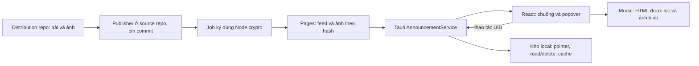

# Implementation Plan — Admin announcements

Ngày lập: 2026-10-23. Cập nhật: 2026-10-24. Service native, persistence, UI và publisher đã được triển khai. Public key `announcements-v1` của chủ dự án đã được pin; environment ký có duyệt thủ công và chỉ nhánh main đã được tạo/đọc lại. P8 chưa kích hoạt đầy đủ: private-key secret, source commit pin, bảo vệ nhánh và Pages bootstrap/smoke vẫn còn thiếu; P7 còn nghiệm thu nền tảng/tài nguyên. Trạng thái/bằng chứng hiện tại: [STATUS](verification/admin-announcements/STATUS.md); hướng dẫn Admin: [publishing](admin-announcements-publishing.md).

Đặc tả UX: [admin-announcements-plan.md](admin-announcements-plan.md). Tài liệu này cụ thể hoá mã nguồn, dữ liệu, publisher, test và điều kiện hoàn thành. Các quyết định kỹ thuật dưới đây thay thế những phương án còn để mở trong bản UX; không thay đổi các hành vi người dùng đã xác nhận.

## 1. Hợp đồng phạm vi

- Repo mã ứng dụng và công cụ: `ducminh25/judgedesk-source`, chính là origin của workspace hiện tại.
- Repo nội dung, workflow Pages và site nhận thông báo: `ducminh25/judgedesk`, nhánh `main`.
- Endpoint dự kiến: `https://ducminh25.github.io/judgedesk/announcements/v1/feed.json`. Đây là URL thiết kế theo quy tắc project Pages, chưa phải endpoint đang hoạt động. Xác nhận URL thực trước khi đóng gói app.
- Bài HTML VI, EN tuỳ chọn; JPG/JPEG/PNG; chuông giữa Hướng dẫn và Donate; badge 0/1–9/9+; popover và modal chỉ mở sau thao tác người dùng.
- Không tự hiện banner/toast/modal, âm thanh hoặc OS notification. Fetch nền chỉ thay đổi dữ liệu/badge.
- UID bất biến; sửa revision giữ trạng thái đã đọc/xoá; muốn nhắc lại phải dùng UID mới. Trạng thái theo OS user và root dữ liệu hiện có.
- Cùng một feed và implementation cho Windows/macOS/Linux, Core/Full, Linux deb/rpm/AppImage. Không có platform-specific schema hoặc nguồn tin khác nhau.
- Bản đầu không có tài khoản, analytics người đọc, đồng bộ giữa máy, soạn bài trực tiếp trong app, remote CSS/JS, bộ lọc audience hoặc auto-update phát lệnh từ bài. `audience` trong bản UX là khả năng về sau, chưa đưa vào schema v1; vì vậy chưa cần dependency semver cho tính năng này.

## 2. Evidence đã kiểm tra

Các kết quả là snapshot ngày 2026-10-23, cần kiểm tra lại trước khi thực thi vì workspace có nhiều thay đổi chưa commit của công việc khác.

| Kiểm tra | Kết quả / hệ quả |
| --- | --- |
| Local `git rev-parse HEAD` | `e70dcbfb7cae54df5ab28cc5f88cdd1dd67c305f`; có dirty tree, không reset/ghi đè thay đổi không thuộc tính năng |
| Distribution `main` | `d775dcffdffc6093cd3691263f22dc1a2ba5fc61`; public; hiện chỉ có tài liệu và issue templates |
| `gh api repos/ducminh25/judgedesk` | `has_pages: false`; Pages API trả 404, phù hợp với việc chưa có site; chưa có workflow Pages |
| `gh api .../branches/main` | `protected: false`; cần thiết lập chính sách phát hành tin cậy trước khi dùng signing secret |
| `src-tauri/src/backend.rs` | Mặc định Rust core, còn lựa chọn Node sidecar; không đặt service thông báo riêng trong Express |
| `src-tauri/src/lib.rs` | Có managed state và invoke handler để thêm một native service dùng chung |
| `src-tauri/tauri.conf.json` | Frontend connect-src không mở Internet, img-src đã có blob; không cần mở host từ xa cho render bài |
| `src-tauri/src/host_tools.rs` | Opener đối chiếu URL chính xác trong capability; chưa mở được mọi link bài viết |
| `src/features/shortcuts/useAppShortcuts.ts` | Tự xử lý Escape và isAnyModalOpen; cần tích hợp, không chỉ thêm dialog vào AppModals |
| `src/components/AppToolbar.test.tsx` và test modal hiện tại | Chủ yếu SSR markup; không đủ chứng minh click, focus, DOM sanitizer hoặc định vị popover |
| `scripts/run-all-tests.js` | Quét src/server/scripts/shared; thêm test đúng cây sẽ được nhận tự động |
| `scripts/run-rust-gates.js` | Gate fmt/clippy/test cho cả executor, Rust core và src-tauri; check:full có thể chạy cả phần không sửa |
| `get_app_data_dir()` | Có override, XDG và legacy Linux; phải gọi helper này, không suy ra đường dẫn mới từ tên gói |
| `contest_archive::replace_archive()` | Có bước rename đích sang backup trước khi thay; không tái sử dụng như một primitive commit atomic có khả năng phục hồi crash |

## 3. Quyết định kiến trúc và file map

Một `AnnouncementService` do Tauri sở hữu quản lý network, xác minh và persistence. React chỉ trình bày và gọi IPC; executor, scoring, toolchains và REST server không tham gia.



| Vùng | File mới dự kiến | File hiện có cần nối |
| --- | --- | --- |
| Hợp đồng | `shared/announcements.ts`, `shared/announcements.schema.json`, `shared/announcement-html-policy.ts`, `shared/announcements-trust.json`, fixture JSON/signature/media | `tsconfig.json` chỉ khi thực sự cần include |
| Native | `src-tauri/src/announcements/{mod,model,verify,transport,store,media,commands}.rs` | `src-tauri/src/lib.rs`, `src-tauri/Cargo.toml`, `src-tauri/Cargo.lock` |
| UI domain/controller | `src/features/announcements/{announcement-model,announcement-client,useAnnouncements}.ts` và test | `src/App.tsx` chỉ khởi tạo, truyền props và phối hợp shortcut |
| UI views | `NotificationBell.tsx`, `NotificationPopover.tsx`, `NotificationRow.tsx`, `NotificationArticleModal.tsx`, `AnnouncementArticle.tsx` | `AppToolbar.tsx`, `AppModals.tsx`, `src/index.css`, `src/locales/{vi,en}.json` |
| Shortcut | Test thêm cho thông báo; helper trạng thái cục bộ nếu cần | `src/features/shortcuts/useAppShortcuts.ts` và test phù hợp |
| Publisher | `scripts/announcements/{new-post,build-feed,validate-source}.ts`, `sign-feed.mjs`, test; `docs/admin-announcements-publishing.md` | package scripts, package.json/lockfile sau khi dependency được duyệt |
| Dist repo | `announcements/publication.json`, `announcements/catalog.json`, `announcements/posts/<uid>/...`, `announcements/publisher.lock.json`, `.github/workflows/announcements-pages.yml` | Thêm liên kết hướng dẫn vào README; giữ nguyên releases và tài liệu hiện có |

Không tạo framework chung về notifications, plugin HTTP mới hoặc thêm các nhánh xử lý vào scoring/toolchains. Tìm primitive có sẵn trước khi tạo helper; shared chỉ chứa hợp đồng/policy dữ liệu thuần, không chứa native IO hay component.

## 4. Dependency proposal và trạng thái phê duyệt

Các phiên bản dưới đây được đối chiếu lockfile, registry hoặc tài liệu chính thức trong phiên nghiên cứu. Trước khi thêm phải review changelog, license, audit, lockfile delta và xin xác nhận theo AGENTS.md; không nâng hàng loạt dependency khác.

Người dùng đã duyệt rõ các dependency trực tiếp `serde =1.0.228` (derive), `ring =0.17.14`, `base64 =0.22.1`, và sau đó xác nhận thêm `chrono =0.4.45` (chỉ std) cùng `percent-encoding =2.3.2`. P1 chỉ bổ sung năm cạnh dependency của package app, không thêm/nâng phiên bản package trong lockfile. Bật feature `float_roundtrip` của `serde_json` đang có sau khi test chứng minh parser mặc định lệch giá trị với Node ở biên số; feature này không thêm crate. Ngày 2026-10-24, người dùng tiếp tục duyệt cả sáu dependency HTTP/ảnh/DOM bên dưới; đã install và kiểm tra graph riêng sau P2. Image bổ sung sáu package Cargo; không nâng phiên bản hoặc đổi cạnh của các package có sẵn.

| Dependency | Phân loại / phiên bản đề xuất | Lý do |
| --- | --- | --- |
| `dompurify` | npm runtime, pin `3.4.17` | Lọc HTML trong WebView; có type đi kèm |
| `jsdom` | npm dev/tooling, pin `30.1.3` | DOMPurify ở publisher, test DOM và tương tác; không đưa vào frontend bundle |
| `@types/jsdom` | npm dev/tooling, pin `30.0.0`, đã duyệt/cài | Type cho publisher/DOM tests nghiêm ngặt; jsdom không khai báo bundled types trong registry metadata |
| `reqwest` | cargo direct, pin `0.13.4` đã có trong Tauri lock | HTTP/TLS; dùng cùng thế hệ client updater, không tự viết network/TLS |
| `rustls` | cargo direct, pin `0.23.42` đã có trong Tauri lock, provider ring | Khởi tạo provider trước client; không phụ thuộc updater đã từng check hay chưa |
| `ring` | cargo direct, pin `0.17.14` đã có trong lock | Ed25519 verify và SHA-256; không cần thêm sha2 chỉ cho service này |
| `base64` | cargo direct, pin `0.22.1` đã có trong lock | Decode envelope theo chuẩn, không tự viết decoder |
| `serde` | cargo direct, pin `1.0.228`, derive | DTO Rust; không coi transitive dependency là direct API |
| `chrono` | cargo direct đã duyệt, pin `0.4.45`, default-features=false, chỉ std | Kiểm tra ngày UTC thực và biểu diễn canonical; không cần clock |
| `percent-encoding` | cargo direct đã duyệt, pin `2.3.2` | Decode từng URL path segment bằng thư viện chuẩn đang có; URL parser dùng tauri::Url |
| `image` | cargo direct, pin `0.25.10`, default-features=false, chỉ jpeg/png | Decode/kiểm tra ảnh có giới hạn; đây là graph mới cần đánh giá riêng |

Node tại máy là 24.19.0; engines của jsdom đề xuất có hỗ trợ Node ^24.15.0. Không cần thêm @types/dompurify; nếu dùng phần API jsdom thiếu declaration, đánh giá riêng @types/jsdom thay vì dùng any hoặc suppression.

Diff dependency còn lại với feature flags chính xác và phạm vi kiểm tra: [REMAINING-DEPENDENCIES.md](verification/admin-announcements/REMAINING-DEPENDENCIES.md). Người dùng đã duyệt rõ cả sáu gói ngày 2026-10-24; đã install sau khi gate P2 qua. Không bật thêm system-proxy toàn graph chỉ cho service mới. Giới hạn max_alloc của image là best effort; cần kiểm tra output bytes/dimensions trước decode và đo thực tế, không coi đó là trần RAM do OS cưỡng chế.

Spike dependency phải kiểm tra feature graph TLS: reqwest 0.13 có `rustls-no-provider`, trong khi `rustls` có thể kéo provider khác. Chọn feature khớp graph updater, cấu hình provider đúng một lần nếu cần; không mặc định bật provider thứ hai, không tắt xác minh chứng thư để chạy được. Dùng `cargo tree -e features` và native HTTPS smoke trước khi chốt diff. Không bật cookies, HTTP/3, compression hoặc streaming feature không dùng. `Response::chunk()` phải được xác minh với phiên bản pin để đọc body có giới hạn mà không buffer toàn bộ.

Preflight khi đổi package.json: file này nằm trong input inventory của executor freeze. Chạy sớm test `scripts/build-native-executor.test.js`; nếu chỉ dependency đã duyệt đổi, đối chiếu tất cả raw inputs, recipe/version/toolchain, binary hash/size, native fingerprint và suite executor boundary rồi mới cập nhật receipt có ghi chú revalidation. Giữ nguyên literal pin/assertions và lịch sử clean-build; không chỉ chép hash mới để gate xanh. Thực hiện trước full gate để tránh phát hiện mismatch ở cuối suite server.

P0 xác minh từ registry source đang cài: reqwest 0.13.4 có chunk() không cần feature stream; updater 2.10.1 dùng rustls-no-provider + rustls/ring và chỉ install provider trong check(). Vì thông báo có thể khởi động trước check cập nhật, service phải chủ động đảm bảo provider bằng API chuẩn và xử lý race install; đây là lý do bổ sung rustls direct vào proposal, chưa phải dependency đã được duyệt/cài. Xem tiến độ thực tế tại [verification/admin-announcements/STATUS.md](verification/admin-announcements/STATUS.md).

## 5. Wire contract v1 và ký số

### 5.1. Envelope

```json
{
  "format": "judgedesk-announcements-v1",
  "keyId": "announcements-2026-a",
  "payloadBase64": "<standard-base64 of UTF-8 payload bytes>",
  "signatureBase64": "<standard-base64 of 64-byte Ed25519 signature>"
}
```

Thông điệp ký là byte UTF-8 `JudgeDesk announcements v1\n`, tiếp theo `keyId`, byte newline và payload nguyên bản. keyId chỉ ASCII chữ thường/số/dấu gạch ngang, tối đa 64 ký tự. Algorithm cố định Ed25519; public key 32 byte lấy từ trust store trong app, không nhận public key từ feed.

`\n` trong mô tả là một byte LF 0x0A, không phải hai ký tự backslash và n. `shared/announcements-trust.json` chứa endpoint, keyId và public key công khai đã duyệt; Node signer và Rust include cùng nguồn cấu hình để không có hai giá trị lệch nhau. Private key không nằm trong file này. UTF-8 payload không BOM; không thay newline hoặc Unicode normalization sau khi ký.

Publisher ký bằng Node `crypto.sign(null, message, privateKey)`, native verify bằng ring. Không ký một kiểu JSON rồi yêu cầu phía còn lại tự canonicalize lại. Base64 phải canonical; reject sai padding, độ dài, key lạ, format lạ, trường trùng/không hỗ trợ ở envelope. Test vector dùng key chỉ dành cho test, không tạo production key trong test.

Một key riêng cho thông báo, không dùng key updater/toolchain. Key rotation/revocation không được điều khiển từ nội dung bài. V1 giữ key ổn định; thay key phải có bản app/endpoint migration được thiết kế riêng. Chữ ký xác minh tác giả, không chứng minh feed là mới nhất trên máy mới cài.

### 5.2. Payload

```json
{
  "schemaVersion": 1,
  "feedId": "judgedesk-announcements",
  "sequence": 1,
  "generatedAt": "2026-10-23T00:00:00.000Z",
  "items": [
    {
      "uid": "2aac36f2-2dd9-4b6a-88eb-91ac11ba742c",
      "revision": 1,
      "publishedAt": "2026-10-23T00:00:00.000Z",
      "updatedAt": "2026-10-23T00:00:00.000Z",
      "content": {
        "vi": {
          "title": "Hướng dẫn sử dụng mới",
          "summary": "Các bước chuẩn bị trước khi bắt đầu chấm bài.",
          "html": "<p>Nội dung hướng dẫn.</p>"
        }
      },
      "images": [],
      "links": []
    }
  ]
}
```

- UID UUID v4 lowercase, duy nhất toàn feed; revision/sequence là integer dương trong Number.MAX_SAFE_INTEGER để TS/Rust cùng hiểu. Không tái dùng UID cho bài mới. publishedAt bất biến, updatedAt không được nhỏ hơn publishedAt; timestamp UTC canonical, không tự đổi tin theo clock giả của server.
- `content.vi` bắt buộc; `content.en` tuỳ chọn. title/summary là plain text, max lần lượt 200/500 ký tự; HTML tối đa 64 KiB mỗi locale. Missing EN → VI, không đổi UID hay read state.
- `expiresAt` tuỳ chọn, sau publishedAt; local clock chỉ là best effort. Hết hạn không tính badge, không xoá read/delete. Kiểm tra khi app/bảng trở lại foreground và theo timer phù hợp.
- `images[]`: `id`, `sha256`, `sizeBytes`, `mime`, `extension`, `role` (`article`/`thumbnail`). URL được native dựng từ hash/extension dưới prefix cố định, không có URL tự do trong metadata. Không cần ký width/height do Admin tự khai; native lấy kích thước thực từ decoder.
- HTML nguồn dùng ``; app chỉ tạo src từ image ID trong bài và byte đã kiểm tra. `thumbnailId` tuỳ chọn trỏ tới ảnh role thumbnail riêng.
- `links[]` là danh sách `{id, url}` do publisher trích từ link nguồn và kiểm tra; HTML phát hành dùng `data-announcement-link` để tham chiếu. Native chỉ resolve link ID trong signed payload, không cần tự parse HTML hoặc nhận URL tùy ý từ UI.
- Payload tối đa 1 MiB; envelope tối đa 1.5 MiB, áp dụng cả bytes đọc mạng và disk. Tối đa 100 bài, 8 ảnh article/bài, tối đa một thumbnail. Tối đa 5.000 node/32 mức cho mỗi bài HTML. Không nhận unknown schema bằng fallback mơ hồ.
- Feed rỗng có chữ ký là snapshot hợp lệ. HTTP lỗi, response HTML hoặc signature lỗi không được biến thành items rỗng.

## 6. Native service: lifecycle, IPC, transaction và media

### 6.1. Lifecycle và transport

- Tạo managed state nhẹ trong setup; không chờ Internet/scan cache nặng trước khi hiện cửa sổ. Hook luôn mount tại App gọi initialize/snapshot và refresh sau UI sẵn sàng; lazy-load renderer modal riêng. Hai việc này không được lẫn nhau. Init cache dùng một lần/single-flight; lỗi IO/cache của feature trả lỗi có cấu trúc trong panel, không propagate làm Tauri setup thất bại hoặc cản backend chấm khởi động.
- Khởi động/offline đọc cache; refresh một lần/phiên. Mở bảng nếu lần kiểm tra thành công quá 30 phút thì thử lại ở nền; nút Tải lại chủ động gọi refresh. React StrictMode/unmount/remount không tạo nhiều request: native single-flight là nơi bảo vệ cuối.
- HTTP client dùng endpoint cố định, HTTPS-only, TLS verification bật, không cookie/auth header local; timeout tổng 10 giây, connect 5 giây. Redirect bị tắt; URL chính thức phải trả trực tiếp. Không thêm query chống cache liên tục.
- Đọc body theo chunk có trần, kể cả Content-Length thiếu/sai. Tắt automatic decompression cho service; từ chối Content-Encoding không hỗ trợ để không có lỗ hổng size trước/sau giải nén. Giữ system proxy khi graph hỗ trợ, lỗi proxy/captive portal có trạng thái rõ; không hứa mọi môi trường PAC tự hoạt động.
- Conditional requests: lưu ETag/Last-Modified của đúng endpoint/cache. 304 chỉ cập nhật checkedAt nếu cache đó còn tồn tại và đã verify; nếu thiếu thì retry một GET không conditional, không loop.
- Network không giữ mutex persistence. Chỉ lấy lock lúc đọc snapshot/commit; HTTP được coalesce, thao tác read/delete được serialize. Image tải/đọc không chặn mark-read.
- Khi app exit/update handoff: huỷ tác vụ network và không phát state vào UI đã unmount. Không tạo process/helper chạy nền sau khi app đóng.

### 6.2. IPC cụ thể

| Command | Input | Output / yêu cầu |
| --- | --- | --- |
| `announcements_snapshot` | Không có URL/path | snapshot DTO, localRevision, lỗi cache/state nếu có |
| `announcements_refresh` | Không có endpoint tuỳ ý | cùng kiểu snapshot, trạng thái network; không ghi đè thao tác UID |
| `announcements_set_read` | uid, read: boolean | snapshot sau commit; readAt=null nghĩa chưa đọc |
| `announcements_mark_all_read` | danh sách UID từ snapshot lúc bấm | chỉ đánh dấu tập đó; tin mới vào sau vẫn chưa đọc |
| `announcements_delete` | uid | tombstone local sau commit, không sửa feed |
| `announcements_article_open` | uid, feedHash từ snapshot đang xem | Article DTO và viewId ngẫu nhiên; chỉ mở article thuộc snapshot đã verify; pin feed cho phiên đọc |
| `announcements_article_close` | viewId | release pin/tác vụ không còn người dùng; idempotent khi close lặp |
| `announcements_image` | viewId, imageId | `tauri::ipc::Response` binary; lỗi có cấu trúc, không trả path hoặc mảng số JSON; chỉ media thuộc phiên đọc đã pin |
| `announcements_thumbnail` | uid, feedHash từ snapshot inbox | binary, chỉ thumbnailId đã khai của bài và còn phù hợp trong inbox; không có imageId/URL tự do |
| `announcements_open_link` | viewId, linkId | native resolve signed links[] và validate lại URL trước mở ngoài app |

Snapshot mang localRevision tăng sau mỗi thay đổi commit; client bỏ response có localRevision cũ để refresh về trễ không làm sống lại tin đã xoá. Không có OS notification API trong service.

viewId do getrandom hiện có tạo, chỉ tồn tại trong service của phiên app. Một article session tại một thời điểm; mở bài mới đóng session trước. Image/link không nhận lại revision hay URL để suy đoán snapshot: luôn resolve qua viewId đã pin. Inbox thumbnail dùng command riêng, không thêm nhiều tham số optional hoặc nhận tuỳ ý feedHash từ disk. Nếu click hàng từ snapshot đã thu hồi và không còn hợp lệ để mở, trả STALE_SNAPSHOT, refresh danh sách và giữ chưa đọc.

Browser dev không có Tauri: dùng adapter fixture chỉ trong dev/test; production không âm thầm fallback sang fetch Internet trực tiếp. Không tạo một Node backend implementation thứ hai.

### 6.3. Persistence

```text
<get_app_data_dir()>/announcements/
  state.json                  # pointer, sequence/hash, read/delete, validators
  feeds/<payloadHash>.json     # envelope đã verify, immutable
  media/<sha256>.<jpg|png>     # bytes đã verify
```

`state.json` chứa schemaVersion, localRevision, activeFeedHash, highestSequence/payloadHash, ETag/Last-Modified, checkedAt và UID state. Mutable commit chỉ có một điểm tại state.json. Không dùng localStorage để làm nguồn thật song song.

P2 dùng private state schema v1 với `activeFeed: {payloadHash, sequence}` làm cả pointer lẫn high-water mark, thay vì lưu hai bản trùng nhau; feed rỗng có chữ ký vẫn giữ pointer/mốc này. `fetch` chứa checkedAt/ETag/Last-Modified. UID record giữ thêm publishedAt/revision/item hash để từ chối lùi revision hoặc sửa nội dung cùng revision, kể cả sau khi bài tạm vắng mặt. Các slot nullable phải hiện diện rõ trong JSON trạng thái; thiếu trường là lỗi, không tự diễn giải thành chưa đọc. Xem [persistence boundary](verification/admin-announcements/PERSISTENCE.md).

Commit feed: download → verify → ghi immutable envelope temp, sync_all, rename → lấy lock → đọc state mới nhất (bao gồm read/delete vừa xảy ra) → kiểm tra sequence/hash → commit state pointer và high-water mark cùng lần ghi → mới phát snapshot thành công. Crash trước pointer tạo orphan có thể dọn; sau pointer thì envelope phải đã tồn tại. Không ghi watermark trước khi nội dung hợp lệ được lưu.

Commit trạng thái: clone state hiện tại dưới lock → sửa đúng UID/tập UID → temp cùng directory + create_new + write_all + sync_all → đóng handle → `std::fs::rename` thay state → cập nhật memory/notify. Không rename state cũ ra chỗ khác trước. Tính atomic trên filesystem hỗ trợ và khả năng qua process crash phải có fault test; không cam kết tuyệt đối qua mọi mất điện/phần cứng. Test overwrite/file đang bị khoá trên Windows, quyền ghi và disk-full.

Cache đọc từ disk phải verify signature/hash/schema lại. State lỗi/corrupt không được tự reset rồi trình toàn bộ tin thành chưa đọc: hiển thị lỗi trong bảng, giữ file gốc để phục hồi. Không lấy backup cũ và hứa rằng mọi delete mới nhất vẫn còn. Hash/sequence rollback chỉ ngăn dữ liệu cũ sau mốc đã lưu, không chống việc local user chủ động xoá/chỉnh cả kho state.

Giữ read/delete tombstone độc lập vòng đời feed/media, không prune khi bài vắng mặt. Cap state 16 MiB; vượt cap thì lỗi ghi có kiểm soát, không tự xoá tombstone để đạt giới hạn. GC chỉ xoá blob orphan/cache không được pin; không chạy recursive delete trên path lấy từ feed. Root/filename được dựng nội bộ, từ chối symlink/reparse leaf bất thường trong kho feature trước truy cập.

### 6.4. Media

- Chỉ MIME image/jpeg, image/png và extension jpg/jpeg/png nguồn; published path chuẩn hoá jpg/png. So sánh hash/size đã ký, sniff format và decoder thực; từ chối HTML/SVG/GIF/WebP/APNG trá hình. Chính sách PNG v1 là ảnh tĩnh; thêm fixture APNG và kiểm tra khả năng phát hiện của decoder trong spike.
- Ảnh article tối đa 4 MiB, 12 megapixel, mỗi cạnh tối đa 8192 px; decoder max_alloc 64 MiB và kiểm tra pixel trước decode. Đây là giới hạn cụ thể hoá thấp hơn mức dự kiến 20 MP ở tài liệu UX để giảm áp lực bộ nhớ.
- Native decode validation chạy spawn_blocking có semaphore 1; network ảnh tối đa 2. Decoder CPU không được coi là huỷ được chỉ bằng timeout async; spike phải đo worst-case hợp lệ/ảnh lỗi trong caps và fail gate nếu không đạt ngân sách. Không gửi ảnh hợp lệ chỉ dựa vào header.
- Thumbnail optional riêng, tối đa 128 KiB và 320×320. Không dùng ảnh article 4 MiB để làm thumbnail; thiếu thumbnail thì dùng icon. Chỉ tải thumbnail của hàng đang hiện/gần viewport, không tải hàng trăm ảnh lúc khởi động.
- Binary IPC → Uint8Array/ArrayBuffer → Blob với MIME từ metadata đã verify → object URL. Có generation check cho bài đổi/đóng; revoke URL khi hết dùng. Không mở asset protocol với quyền đọc cả app data dir.
- LRU media khoảng 128 MiB, ảnh đang hiển thị được pin cho tới khi view đóng. Full HTML nằm trong feed cache nên offline vẫn đọc văn bản; ảnh chưa từng tải/đã evict hiển thị placeholder. Cache kiểm tra lại hash/format khi đọc, không tin bytes chỉ vì tên file là hash.

## 7. HTML pipeline và UI integration

### 7.1. Pipeline HTML

Publisher và app dùng chung policy dữ liệu, nhưng runtime luôn sanitize lại trong DOM engine đang chạy. Không coi sanitization ở Node là bằng chứng an toàn tuyệt đối cho mọi WebView.

1. Parse/lọc bằng DOMPurify với allowlist HTML-only, RETURN_DOM_FRAGMENT; không enable SVG/MathML/custom elements. Hạn chế tổng byte trước parse và số node/depth khi duyệt.
2. Chỉ chuyển node được phép thành React elements. Không serialize sạch rồi parse lại bằng innerHTML và không dùng dangerouslySetInnerHTML. Chỉ chuyển textContent/attribute đã chọn, không spread toàn bộ attributes/props từ bài.
3. `a`: tham chiếu data-announcement-link phải có trong signed links[]; URL parser kiểm tra HTTPS/host/path policy; gắn click handler app dùng viewId/linkId. Không chuyển trực tiếp target/download/onclick từ HTML. Block javascript/data/file/mailto/custom schemes ở v1.
4. `img`: không chuyển src/srcset/style từ bài; data-announcement-image phải khớp manifest và được component Image lấy byte qua IPC. alt text theo locale bài, không lấy HTML làm alt.
5. Container chỉ cho class bố cục đã định nghĩa và được map về class nội bộ; không cho id/name/tabindex/autofocus/contenteditable/position CSS, tránh DOM clobbering/focus theft và phá theme.

Renderer không được đưa raw HTML trở lại bất kỳ ngữ cảnh mới nào sau sanitize. Snapshot test phải kiểm tra output React, test DOM phải kiểm tra absence của remote resource/event handlers và payload mXSS. Ảnh/link bị loại không đồng nghĩa toàn bộ app lỗi; chặn nội dung nguy hiểm, giữ thông báo lỗi bài nếu không còn cấu trúc đọc hợp lệ.

Policy tag v1 cụ thể: p, h2, h3, h4, strong, em, ul, ol, li, blockquote, pre, code, a, figure, figcaption, img, br, hr, div, span. Attribute đầu ra chỉ giữ alt/title, class trong map bố cục, data-announcement-image/link đã đối chiếu. Publisher được đọc href nguồn để dựng links[] rồi bỏ href khỏi HTML phát hành. Tắt nhận data/aria attribute tổng quát; chỉ thêm tên attribute cần dùng. Không trộn cấu hình USE_PROFILES có thể ghi đè ALLOWED_TAGS; test chính allowlist của phiên bản đã pin. Chỉ những tag cố định mới được React.createElement, không dùng tên tag/prop tùy ý từ feed.

### 7.2. Link policy

Mở link bằng command riêng `announcements_open_link(viewId, linkId)` để native resolve URL từ signed links[] của bài đã pin. App/publisher chỉ chấp nhận URL HTTPS dưới các prefix được compile/duyệt: distribution repo và Pages project; không wildcard toàn github.io/github.com. Kiểm tra origin/port/userinfo và path == prefix hoặc bắt đầu bằng prefix + slash, không startsWith chuỗi URL thô; reject encoded separator/traversal. Fragment-only link nội bộ chưa nằm trong v1, được giữ như text thay vì mở sai trang.

Không mở rộng global `open_external_url` thành arbitrary URL. Tách validator dữ liệu URL thuần để dùng chung nếu thật sự giúp giảm trùng, giữ nguyên các caller Help/Donate hiện có. Native command mới dùng API opener/xdg-open theo cơ chế hiện có, args riêng và URL policy chặt; không shell string. Nếu đường native command không dùng plugin IPC thì giải thích rõ authority ở command, không giả định capability tự kiểm tra thay nó. Bài không chứa link hợp lệ thì hiển thị text và giải thích ngắn khi cần; thêm domain khác là thay cấu hình được review, không do feed cấp quyền cho chính nó.

### 7.3. State UI và focus

- `useAnnouncements` ở App sở hữu snapshot, request status và UI navigation; client layer inject được trong test. article renderer có thể lazy-load; chuông/count phải có ngay khi cache sẵn.
- Popover portal vào root thích hợp, fixed theo anchor rect, clamp viewport và reposition khi scroll/resize/zoom. Đóng nếu anchor bị cuộn ra ngoài viewport. Chỉ một utility popover mở; đóng menu toolbar khác khi mở chuông và ngược lại.
- Tiêu đề/summary/time là text React, hàng không nested button. Read text dùng token muted có contrast; nút menu không bị dim cùng hàng. Badge đúng 9+ và accessible name chứa số thật.
- Bấm hàng đóng popover, giữ scrollTop/UID, mở modal. Sau commit/render văn bản thành công mới set_read; chống effect chạy lại khiến tin đã chủ động mark-unread bị tự đọc lại. Không auto-mark chỉ do selection/restoration.
- Modal trap focus/inert background; Escape xử lý thứ tự menu hàng → article → popover và không đồng thời đóng dialog khác. Khi modal đang mở, bổ sung vào isAnyModalOpen trong useAppShortcuts để shortcut chấm/xoá không chạy xuyên modal. Shortcut đang gắn capture trong Help/changelog cũng phải kiểm tra sibling callers.
- Không bind chuông mù quáng vào interactionLocked (hiện có cả isJudging) nếu muốn đọc trong lúc chấm. V1 cho đọc/tác vụ local trong lúc chấm, khoá mở mới khi updateHandoff/OS blocking modal; media background không chạy ồ ạt và phải đo dưới tải chấm. Không thay availability nút Run.
- Khi thoát article, restore popover/scroll và focus hàng nếu còn; nếu bị xoá/thu hồi/hết hạn thì focus chuông hoặc hàng kế tiếp. Thay feed trong lúc đang đọc giữ view snapshot đang mở tới khi đóng; thêm nhãn “Bài đã được cập nhật/thu hồi” trong modal, không tự đóng bài hay bật popup mới. Image IPC chỉ phục vụ snapshot revision đang được view pin, không chọn nhầm bytes revision mới.
- Empty/loading/error/cache-status đều nằm trong panel. Refresh giữ danh sách, failed write không báo thành công. Nội dung EN thiếu dùng VI; UI vẫn theo i18next.

## 8. Publisher trong distribution repo

### 8.1. Nguồn và quyền sở hữu

```text
ducminh25/judgedesk (main)
  announcements/publication.json           # sequence, generatedAt
  announcements/catalog.json               # UID/revision/status và lịch sử identity
  announcements/publisher.lock.json         # source repo + full 40-hex commit
  announcements/posts/<uid>/metadata.json
  announcements/posts/<uid>/vi.html
  announcements/posts/<uid>/en.html         # optional
  announcements/posts/<uid>/images/*.{jpg,jpeg,png}
  .github/workflows/announcements-pages.yml
```

Source repo giữ một implementation publisher có test, distribution repo không copy thêm bộ validator khác. publisher.lock pin commit đã review trong judgedesk-source, không checkout main/tag trôi nổi hoặc ref do workflow input cung cấp. Vì source repo public, không cần PAT cross-repo để đọc code công cụ.

Catalog giữ UID kể cả draft/archived; không tái dùng identity đã từng phát hành. So với trạng thái main trước đó: publishedAt không đổi; đổi nội dung đã publish phải tăng revision; mọi thay đổi artifact phải tăng publication.sequence. `new-post` dùng crypto.randomUUID và không tái sinh UID khi sửa tên file. Rollback nội dung cũ cũng là publication có sequence mới, không hạ sequence.

### 8.2. Workflow

1. PR validation không có secret/Pages write: checkout content ở commit PR, checkout toolchain ở pin tin cậy từ base main (không pin bị PR thay), npm ci theo source lock, validate/build/test. Không dùng pull_request_target để chạy nội dung PR có secret.
2. Push main và workflow_dispatch trên main được serialize cùng một concurrency group, cancel-in-progress=false. Dùng path filters vừa đủ nhưng source publisher pin/workflow/catalog/media đều phải trigger.
3. Build job không có signing secret, contents:read. Verify source paths, reject symlink/hardlink/path traversal và extension khác; HTML chạy như dữ liệu, jsdom không bật scripts/resources. Publisher dùng DOMPurify+jsdom để lọc/validate HTML; không regex sanitizer.
4. Node build kiểm tra kích thước/hash/loại MIME sơ bộ; không tự viết decoder JPEG/PNG trong JavaScript. Decode đầy đủ và caps được thực hiện ở app. P6 chạy corpus output publisher qua native tests trong CI source/desktop preflight có toolchain phù hợp; workflow đăng bài sau này không cần build toàn Tauri chỉ để xuất bản. Chấp nhận trade-off: nếu một ảnh mới hỏng vượt qua kiểm tra sơ bộ thì app chặn ảnh, hiện placeholder và vẫn đọc văn bản. Không ghi nhận build Node là bằng chứng đã decode mọi ảnh mới hoặc âm thầm thêm sharp/Pillow/helper crate thứ hai.
5. Trước khi ký/deploy, kiểm tra run commit vẫn là main HEAD và sequence lớn hơn publication đã phát hành (hoặc cùng payload khi rerun idempotent). Validation chạy trên push main cũng phải đối chiếu catalog/publication với first parent, không chỉ tin PR check; các commit không đổi artifact không cần tăng sequence. Concurrency không được coi là FIFO. Đọc deployed signed feed với cache-aware retry và đối chiếu catalog main; nếu không xác định được mốc production thì dừng publish, không mặc định về 0. Lần bootstrap dùng trạng thái “chưa từng deploy” được xác nhận riêng, không tái sử dụng cờ bootstrap để bỏ qua kiểm tra một site đã phát hành.
6. Sign job riêng không npm install và không chạy HTML/dependency script. Node built-ins từ source commit pin đọc payload bytes, ký bằng secret `ANNOUNCEMENTS_SIGNING_PRIVATE_KEY`; xác nhận public key dẫn xuất khớp keyId/public key đã duyệt. Không in key/env/payload riêng tư ra log. Private key chỉ cấp cho job này từ branch/environment tin cậy.
7. Deploy job chỉ nhận artifact đã ký, pages:write + id-token:write, environment github-pages, needs job ký; không cần signing secret hoặc contents:write. Actions pin commit SHA đã review. Đối chiếu lại main HEAD ngay trước deploy; workflow cũ rerun không được triển khai đè bản mới.
8. Deploy artifact gồm `index.html` tối giản, `.nojekyll`, `announcements/v1/feed.json`, media theo hash. Không publish nguyên repository hoặc raw author HTML thành trang thực thi. Giữ media của tất cả bài từng publish trong artifact v1 (chưa GC server), để client offline lâu không gặp 404 khi đọc lại cache cũ. Kiểm tra Pages size budget trước deploy, không tự xoá media để đủ quota.
9. Post-deploy GET endpoint chính xác với bounded retry, verify signature/payloadHash/sequence và fetch media mẫu. Pages cache có thể chậm: pending propagation là trạng thái cần báo rõ, không nói “mọi máy đã nhận”. Không tự revert signed sequence nếu smoke thất bại.

Vì hiện chưa có site, thiết lập Pages source=GitHub Actions và HTTPS khi thực sự deploy. Không thay latest.json, release tag, updater endpoint hoặc allowlist release assets. File source HTML trong public repo vẫn là dữ liệu công khai, không chứa thông tin học sinh hay secret.

## 9. Work packages và exit gates

Mỗi gói đi theo RED → GREEN → REFACTOR. Không viết toàn bộ implementation trước rồi mới bổ sung test. Không đánh dấu hoàn thành chỉ dựa trên SSR markup hoặc code review.

| Gói | Công việc / test RED phải có | Điều kiện ra |
| --- | --- | --- |
| P0 — Baseline/dependency | Re-read dirty diff liên quan; xác nhận Pages URL, source pin, signing key custody; spike binary IPC/TLS/image caps/DOMPurify; trình dependency diff riêng | Dependency được duyệt, API/feature flags xác minh, không có dependency ngầm chưa duyệt; không cài key vào CI khi quyền phát hành chưa ổn |
| P1 — Contracts/vectors | TS schema/DTO và Rust structs; fixture HTML/photo; Node→ring signed golden vector, tamper/wrong-key/wrong-domain/base64/duplicate UID/oversize/schema tests | TS/Rust reject cùng invalid fixtures, signed empty snapshot hợp lệ, keys chỉ test |
| P2 — Store/domain | Initial state/read/unread/delete/mark-all; sequence/pointer; process crash tại các boundary; write failure/corrupt state/Windows replace | Không resurrect deleted hoặc mất thao tác do race; không silently reset; unit tests chạy temp root biệt lập |
| P3 — Network/media | Mock transport 200/304/404/HTML/redirect/chunk oversize/proxy timeout; hash mismatch/PNG/JPEG/APNG; decoder limits; binary IPC | Không ghi cache trước verify, không giữ mutex qua network, không trả file path hoặc JSON image array; đo memory/latency |
| P4 — Panel/controller | Badge 0/1/8/9/10; open panel không mark; hover/focus menu; mark-all snapshot race; delete/restart/refresh; fake client response order | DOM interaction tests pass; toolbar order đúng; lỗi nằm trong panel; no auto-open |
| P5 — Article/shortcuts | mXSS/DOM clobbering/raw-src/link scheme tests; read after render; ảnh xen đoạn/offline/error; focus trap/Escape/return/keyboard shortcut block | Sanitizer+React output pass trên DOM test, binary image path pass; native QA cho từng engine, không chỉ jsdom |
| P6 — Publisher | New-post/catalog/revision/sequence/path checks; sanitized article; native decode corpus của output publisher; unsigned PR vs trusted signing; stale run/rerun/empty feed | Artifact reviewable, Node→Rust verify, valid content example và publish guide; phân biệt test corpus với decode mọi bài mới; chưa coi validate là deploy |
| P7 — Integration/desktop QA | Branch checks, dev desktop, actual package installs; online/offline/upgrade/edition switch; light/dark VI/EN normal/narrow | Các gate bắt buộc pass, 10 biến thể có bằng chứng thật hoặc ghi rõ chưa chạy; review đa trục không có blocker |
| P8 — Pages/bootstrap/release | Protected publisher workflow/key; deploy signed empty or approved first feed; live HTTPS smoke; app key/endpoint khớp | Public endpoint verified, key không lọt log/artifact, package QA xong; mới phát hành bản app chứa tính năng |

P0/P1 có thể bắt đầu trên source repo trước khi Pages được bật. P8 chỉ thực hiện sau khi artifact cụ thể được review và phạm vi deploy/release được xác nhận theo phiên làm việc; không cần bật site chỉ để viết/test app.

## 10. Test commands và bằng chứng nghiệm thu

Các tên test mới dưới đây là kế hoạch, chưa tồn tại và chưa được báo là pass:

```powershell
# Vòng RED/GREEN theo file mới, ví dụ:
node --import tsx --test shared/announcements.test.ts
node --import tsx --test scripts/announcements/build-feed.test.ts
node --import tsx --test src/features/announcements/announcement-model.test.ts
node --import tsx --test src/features/announcements/NotificationPopover.test.tsx
cargo test --locked --manifest-path src-tauri/Cargo.toml announcements

# Gate khi đã có implementation:
npm run check:fast
npm run test:server
npm run check:full

# Gate Rust bổ sung cho vùng đang sửa:
cargo fmt --check --manifest-path src-tauri/Cargo.toml
cargo clippy --locked --manifest-path src-tauri/Cargo.toml --all-targets -- -D warnings
cargo test --locked --manifest-path src-tauri/Cargo.toml
```

DOM tests chạy Node test runner + jsdom đã duyệt, không invent fake DOM. Viết harness mount React/createRoot, dispatch user events, flush với act và assert DOM/state thật; không gọi trực tiếp implementation rồi tự khẳng định UI tương đương. jsdom không có layout engine, nên viewport positioning/contrast/scroll/zoom vẫn cần native inspection. Các crate/pin đang dùng phải được test với Rust toolchain dự án, không dựa vào docs latest để chọn API.

| Package QA | Core | Full | Engine |
| --- | --- | --- | --- |
| Windows x64 MSI | Bắt buộc | Bắt buộc | WebView2 |
| macOS ARM64 DMG → app đã cài | Bắt buộc | Bắt buộc | WKWebView |
| Linux x86_64 deb | Bắt buộc | Bắt buộc | WebKitGTK |
| Linux x86_64 rpm | Bắt buộc | Bắt buộc | WebKitGTK |
| Linux x86_64 AppImage | Bắt buộc | Bắt buộc | WebKitGTK |

Mỗi ô kiểm tra: fresh data → nhận bài → badge → mở panel → mở article JPG/PNG → read/unread/all/delete → restart → fetch revision mới giữ state → offline cached → ảnh chưa cache → open external link → resize/toolbar scroll → Escape/focus → package upgrade. Kiểm tra thêm Core↔Full và đổi kiểu gói Linux trên cùng OS user/data root. Đọc LINUX_LOCAL.md trước Linux build/test/package và ghi rõ distro/engine phiên bản thực.

Đo baseline vs có tính năng trên cùng fixture khi app mở và khi chấm: thời gian UI sẵn sàng, số request, bytes, peak RSS lúc mở ảnh, latency thao tác panel và kết quả chấm. Không đổi runtime sandbox/resource scoring để “sửa” ảnh làm chậm. Ngân sách đề xuất: không thêm network vào startup critical path; feed một request khởi động, tối đa hai request ảnh đồng thời/một decode; xác minh worst-case decode trong cap không gây treo UI. Nếu chưa đo được thì để gate chưa hoàn tất, không tuyên bố không ảnh hưởng hiệu năng.

Evidence tương lai đặt `docs/verification/admin-announcements/` (STATUS, WORKLOG, results matrix, screenshot trước/sau, lệnh và exit code, signature vector hash). Cập nhật liên kết trong STATUS/WORKLOG frontend đang có khi chạm UI. Không commit dữ liệu môi trường riêng hoặc signing key. Lỗi do dirty tree khác phải tách chẩn đoán, không skip test/giảm gate.

Release version chưa đổi ở giai đoạn plan. Khi phát hành bản có tính năng, đồng bộ tám file và `npm run release:check-version`; không thêm notification assets vào allowlist release chỉ để né kênh Pages.

## 11. Tự phản biện và quyết định sau đối chiếu

Thực hiện tự rà soát trong cùng phiên theo yêu cầu người dùng; không hỏi model khác, không có review độc lập/fresh-context để viện dẫn. Cột bên dưới phân biệt vấn đề được sửa với trade-off được chấp nhận; đây không thay thế kiểm thử implementation.

| Giả định / cách phương án có thể hỏng | Phân loại | Quyết định đã đưa vào kế hoạch |
| --- | --- | --- |
| Repo phân phối đã có Pages, chỉ cần upload JSON | Actionable, có evidence | has_pages=false; P0/P8 có setup/live URL gate; không coi URL dự kiến là live |
| Sửa workflow trong source repo sẽ xuất bản đúng dist repo | Actionable | Workflow nằm dist repo; tools source repo pin full commit; không cần PAT đọc public source |
| Nhánh main đang được bảo vệ trước khi dùng key | Actionable, có evidence | protected=false; trust/branch policy phải được thiết lập trước cấp secret ký |
| Mọi dependency có trong lock đều dùng trực tiếp được | Actionable | Bảng direct dependency riêng; không tự add và không làm mới toàn lock |
| Bật rustls giống ở phiên bản reqwest trước | Actionable, có evidence | Feature spike kiểm tra provider; không thêm provider/tắt TLS validation mù quáng |
| SSR test đủ chứng minh UI và sanitizer an toàn | Actionable | jsdom test DOM + native QA cả ba engine; không coi layout jsdom là thật |
| Sanitize một lần ở CI là đủ cho mọi WebView | Actionable | Runtime sanitize lại; không reparse raw HTML hoặc spread attributes sau sanitize |
| Ảnh JPG/PNG tên đúng thì an toàn và nhỏ | Actionable | Hash/MIME/decoder/dimension/alloc limits; APNG test; binary IPC; cap trước buffer |
| Dùng ảnh bài làm thumbnail là tiện | Actionable | Thumbnail riêng nhỏ; thiếu thì icon; không auto-download full photo cho list |
| JSON Vec<u8> qua IPC đủ nhẹ | Actionable | Tauri binary Response + bounded in-flight bytes; spike thật trên WebKitGTK |
| Rename đích ra backup rồi thay file là atomic | Actionable, có evidence | Temp cùng directory + rename một bước; pointer/high-water/read state commit chung |
| Có backup thì có thể luôn giữ mọi deleted state sau corruption | Actionable | Không silent reset/restore cũ rồi hứa không resurrect; lỗi có kiểm soát, giữ file gốc |
| Chỉ file snapshot revision là đủ, response cũ không gây hại | Actionable | localRevision monotonic và client bỏ response cũ; mạng không giữ mutex mutation |
| UID + articleRevision luôn đủ để biết ảnh/link đang xem | Actionable | Phiên đọc viewId pin đúng feedHash; links[] trong signed payload; native không cần thêm parser HTML và không chọn lại snapshot từ revision |
| Mark-all lúc fetch chỉ cần boolean “mọi tin đã đọc” | Actionable | Truyền tập UID tại lúc bấm; tin mới hơn vẫn unread |
| Overlay mới chỉ cần thêm vào AppModals | Actionable, có evidence | useAppShortcuts/Escape/toolbar menu coordination/focus và sibling callers đều nằm file map |
| interactionLocked có thể dùng nguyên cho chuông | Actionable | Phân biệt isJudging và update handoff; cho đọc nhưng không thay judge availability |
| Cùng hệ điều hành thì các kiểu installer đương nhiên tương đương | Actionable | QA riêng 10 biến thể; XDG/AppImage legacy root và upgrade có fixture thật |
| Concurrency Actions bảo đảm thứ tự publish | Actionable | Serialize + HEAD/sequence checks; không phụ thuộc FIFO; stale rerun không được rollback |
| GitHub Pages deploy mới vẫn phục vụ media cũ | Actionable | Artifact giữ media đã publish, cap site trước deploy; không GC server trong v1 |
| Node build đã hash file nghĩa là ảnh decode thành công | Actionable/trade-off | Nói rõ giới hạn build; native decoder corpus là gate P6; ảnh bài mới vẫn phải qua decoder trong app, không thêm cả một stack build ảnh thứ hai |
| Signature nghĩa là thu hồi/newest feed tức thời ở mọi máy | Trade-off | Không thể bảo đảm offline/first-install freshness; sequence chỉ chặn rollback đã quan sát |
| Chống rollback local đồng nghĩa chống local user chỉnh state | Trade-off | Không bảo đảm trước local tampering; sandbox bảo vệ data khỏi submission, không khỏi OS user sở hữu dữ liệu |
| Timeout async chắc chắn dừng decoder blocking | Actionable/trade-off | Semaphore/caps + worst-case measurement; nếu không đạt thì block P0/P3, không nói decoder đã bị huỷ |
| Root signing key bị lộ có thể sửa chỉ bằng một bài thông báo | Trade-off | Key riêng và custody; revoke/rotate cần app release/migration, không remote self-trust |

Đã đối chiếu lại các quyết định sau vòng rà soát: không còn mâu thuẫn chủ ý với UX được xác nhận. Những điểm cần bằng chứng thực nghiệm được giữ thành gate P0/P3/P7, không bị viết thành lời đảm bảo. Không cần quyết định UX bổ sung để bắt đầu; dependency approval, production key/URL và quyền deploy vẫn là điều kiện triển khai thực tế.

### 11.1. Đối chiếu sau triển khai, 2026-10-24

- Giữ các giới hạn đã chốt; tám ảnh trong HTML được đếm theo số lần xuất hiện, kể cả lặp cùng ID, để không tạo hàng nghìn IPC từ một ảnh khai báo.
- Article view giữ snapshot và token huỷ riêng; đóng/thay view dừng network/queue, không tuyên bố huỷ được decoder blocking đã chạy. Semaphore vẫn giữ tới khi decode kết thúc.
- 304 chỉ retry không điều kiện một lần khi blob thực sự thiếu; dữ liệu hỏng phải báo lỗi và giữ bằng chứng, không bị coi như cache miss thông thường.
- Job environment của Pages tạo deployment record trước step. Bootstrap vì vậy cần receipt từ signing job sau kiểm tra never-deployed, ràng buộc run/attempt/commit/payload; predeploy vẫn đọc lại protected main và signed baseline. Không tự hiểu 404 là sequence 0.
- Đo decoder release-profile trên corpus tham chiếu 12 MP cho thấy working set process khoảng 130 MiB. `max_alloc=64 MiB` không phải quota RSS của OS; chưa có bằng chứng worst case cho mọi ảnh độc hại. Giữ giới hạn input/pixel/output và một decoder, đồng thời giữ phần nghiệm thu tài nguyên/platform còn thiếu ở P0/P3/P7.
- Gate tích hợp Windows đã pass trong một invocation; WebView2 và WebKitGTK có bằng chứng tám tổ hợp giao diện mỗi engine. Chưa có macOS, mười package chứa production trust cuối cùng hoặc live signed Pages, nên chưa đóng toàn bộ chín giai đoạn. Bằng chứng chi tiết nằm trong STATUS, REVIEW và PLATFORM-ACCEPTANCE.

## 12. Nguồn chính thức

- [GitHub project Pages URL](https://docs.github.com/en/pages/getting-started-with-github-pages/what-is-github-pages).
- [GitHub Pages custom workflow và quyền deploy](https://docs.github.com/en/pages/getting-started-with-github-pages/using-custom-workflows-with-github-pages).
- [GitHub Actions concurrency](https://docs.github.com/en/actions/how-tos/write-workflows/choose-when-workflows-run/control-workflow-concurrency).
- [DOMPurify: server DOM, policy và rủi ro sửa HTML sau sanitize](https://github.com/cure53/DOMPurify).
- [jsdom: DOM cho Node và giới hạn](https://github.com/jsdom/jsdom).
- [ring 0.17.14: Ed25519/signature API](https://docs.rs/ring/0.17.14/ring/signature/index.html).
- [reqwest 0.13.4: feature flags](https://docs.rs/crate/reqwest/0.13.4/features).
- [image 0.25.10: giới hạn decoder](https://docs.rs/image/0.25.10/image/struct.Limits.html).
- [Tauri IPC Response](https://docs.rs/tauri/latest/tauri/ipc/struct.Response.html).
- [Rust std::fs::rename: replace và hành vi theo OS](https://doc.rust-lang.org/std/fs/fn.rename.html).
- [Node crypto.sign](https://nodejs.org/api/crypto.html#cryptosignalgorithm-data-key-callback).

Tại thời điểm lập plan, registry npm chỉ được đọc metadata; các dependency đã được người dùng duyệt và cài sau đó (xem STATUS). API GitHub dùng read-only để kiểm tra repo/Pages/branch/main commit. Các nguồn mô tả khả năng nền tảng; lựa chọn module, ngân sách và UX là thiết kế JudgeDesk, còn phải qua các gate đã nêu.
