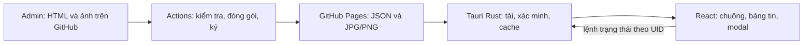

# Kế hoạch thông báo Admin cho JudgeDesk

Ngày: 2026-10-23. Trạng thái: thiết kế để triển khai; chưa có mã tính năng, dependency mới hoặc dịch vụ được triển khai.

Implementation Plan: [admin-announcements-implementation-plan.md](admin-announcements-implementation-plan.md). Repo xuất bản đã được người dùng chốt là `ducminh25/judgedesk`; mã ứng dụng/công cụ ở `ducminh25/judgedesk-source`. Các phương án kỹ thuật còn để mở và giới hạn dự kiến trong tài liệu UX này được cụ thể hoá tại Implementation Plan.

## 1. Phạm vi và lựa chọn đã được xác nhận

- GitHub Pages phục vụ JSON và ảnh; Admin đưa file HTML và ảnh lên GitHub để tự xuất bản.
- Thông báo nằm trong app. Không tự bật banner, toast, modal, thông báo hệ điều hành hoặc phát âm thanh khi có tin mới. Modal chỉ mở sau thao tác đọc của người dùng.
- Chuông nằm giữa Hướng dẫn và Donate. Badge biểu thị số thông báo chưa đọc: 1–9; từ 10 là `9+`; số 0 không có badge.
- Bấm chuông mở bảng tin neo vào chuông. Bấm một tin mở modal đọc bài trong app.
- Ảnh chỉ gồm JPG/JPEG (`image/jpeg`) và PNG (`image/png`).
- Mỗi tin có UID bất biến. Sửa nội dung giữ nguyên trạng thái đã đọc/xoá; muốn nhắc lại thì Admin đăng UID mới.
- Nội dung tiếng Việt trước, có thể bổ sung tiếng Anh. Giao diện nút, trạng thái, thời gian hỗ trợ VI/EN.
- Hỗ trợ Windows, macOS, Linux; Core/Full; Linux deb/rpm/AppImage.
- Không có tài khoản người dùng, đồng bộ trạng thái giữa máy hay thống kê người đã đọc trong phạm vi đầu tiên.

Các kích thước, giới hạn tải và tên lệnh dưới đây là mặc định thiết kế, sẽ được kiểm tra khi triển khai.

## 2. UX của chuông và bảng tin

### 2.1. Chuông

- Dùng icon Bell của Lucide đang có trong dự án, kích thước icon và nút cùng nhóm Hướng dẫn/Donate.
- Badge đỏ nhỏ ở góc trên phải; mở rộng vừa đủ cho `9+`, chữ có tương phản rõ và số dạng tabular.
- Tooltip/accessible name đọc được số thực, ví dụ “Thông báo, 15 chưa đọc”, dù badge ghi `9+`.
- Badge chỉ tính tin đang phù hợp, chưa xoá, chưa đọc. Tin đã đọc vẫn ở danh sách.
- Fetch nền không làm chuông nhấp nháy, nhảy, rung hoặc chuyển thành vòng quay tải.
- Mở bảng không đánh dấu tin đã đọc. Tắt rồi mở app giữ nguyên trạng thái.

### 2.2. Bảng tin neo theo chuông

- Bấm chuông để mở/đóng; đóng bằng bấm ngoài hoặc Escape. Không có lớp phủ che vùng làm việc.
- Dùng portal và vị trí theo bounding rect của chuông; không đặt bảng bên trong vùng toolbar cuộn ngang/overflow.
- Cạnh phải bảng gần thẳng cạnh phải chuông, mở xuống dưới; giới hạn vào viewport, cập nhật khi resize/scroll. Chiều rộng khoảng 380–420 px, thu nhỏ theo cửa sổ; chiều cao tối đa khoảng 70% vùng nhìn, danh sách cuộn bên trong.
- Đầu bảng cố định: tiêu đề “Thông báo”, nút “Đánh dấu tất cả đã đọc” và “Tải lại”. Nút có nhãn/tooltip VI/EN; màn hình hẹp được xuống dòng thay vì cắt chữ.
- Nút đánh dấu tất cả bị vô hiệu khi không có tin chưa đọc. Nút tải lại có trạng thái đang tải và chống bấm lặp; giữ danh sách hiện tại trong lúc tải.
- Cuối bảng có thời điểm kiểm tra thành công gần nhất và trạng thái cache/mất mạng nếu cần. Lỗi chỉ hiển thị trong bảng do người dùng mở.
- Sắp theo thời gian xuất bản mới nhất trước; UID là khoá phụ ổn định. Đổi đã đọc/chưa đọc không tự đảo thứ tự hay làm mất vị trí cuộn.
- Bản đầu không cần bộ lọc, tìm kiếm, nhóm “Hôm nay” hay avatar kiểu mạng xã hội. Các ảnh tham khảo xác định hành vi và phân biệt trạng thái; màu sắc/font vẫn theo JudgeDesk.

### 2.3. Mỗi dòng thông báo

- Hiển thị tiêu đề, mô tả văn bản ngắn, thời gian; có thể có thumbnail từ chính ảnh của bài. Không có ảnh thì dùng icon tin tức trung tính, không tải avatar bên ngoài.
- Chưa đọc: tiêu đề rõ hơn và chấm trạng thái. Đã đọc: chữ dùng màu phụ và trọng lượng nhẹ hơn nhưng vẫn đạt tương phản; không giảm opacity cả hàng vì sẽ làm mờ cả nút thao tác.
- Hover/focus làm sáng nhẹ nền hàng. Nút ba chấm bên phải xuất hiện khi hover, focus-within hoặc menu đang mở; trên thiết bị không hỗ trợ hover phải luôn truy cập được.
- Hàng có vùng mở bài và nút menu riêng, không lồng button trong button. Bấm menu không mở bài và không đánh dấu đã đọc.
- Menu chỉ gồm “Đánh dấu đã đọc” hoặc “Đánh dấu chưa đọc” theo trạng thái, và “Xoá thông báo”.
- Xoá là ẩn trên máy này, không xoá bài trên GitHub. Tin đã xoá không xuất hiện lại khi refresh, sửa bài, đổi ngôn ngữ hoặc nâng cấp app.
- Đánh dấu tất cả áp dụng cho tập UID hiện có lúc bấm. Tin đến từ fetch đồng thời sau đó vẫn chưa đọc.

### 2.4. Các trạng thái cần thiết kế

| Trạng thái | Hiển thị |
| --- | --- |
| Lần đầu, chưa có cache | Trạng thái đang tải chỉ bên trong bảng; chuông không badge cho tới khi biết có tin |
| Không có tin phù hợp hoặc đã xoá hết | “Chưa có thông báo”, vẫn có Tải lại |
| Toàn bộ tin đã đọc | Giữ danh sách với màu đã đọc, bỏ badge |
| Offline nhưng có cache hợp lệ | Hiện danh sách đã lưu và dòng “Đang xem dữ liệu đã lưu” |
| Offline/lỗi, chưa có cache | Giải thích ngắn và Tải lại; không biến lỗi thành dữ liệu rỗng hợp lệ |
| JSON/chữ ký không hợp lệ | Không nhận dữ liệu mới; giữ bản hợp lệ trước đó, báo lỗi trong bảng |
| Không lưu được trạng thái | Giữ trạng thái đã lưu trước đó và báo lỗi ngay trong bảng; không báo thành công giả |

## 3. Modal đọc thông báo dạng bài báo

- Chỉ mở khi người dùng bấm vào một tin. Đóng bảng tin khi mở modal, giữ vị trí cuộn và UID đã chọn.
- Header gồm tiêu đề, ngày xuất bản, nhãn cập nhật nếu có, nút đóng. Nội dung cuộn độc lập, vùng đọc khoảng 65–75 ký tự/dòng, chiều rộng modal tối đa khoảng 800–900 px và co theo cửa sổ.
- Hỗ trợ đoạn văn, tiêu đề phụ, chữ đậm/nghiêng, danh sách, trích dẫn, liên kết, đoạn mã, ảnh và chú thích ảnh.
- Ảnh có thể đứng giữa bất kỳ hai đoạn văn. Cung cấp mẫu bố cục ảnh toàn chiều rộng cột, ảnh căn giữa và ảnh cạnh đoạn văn; bố cục cạnh đoạn văn chuyển thành xếp dọc khi hẹp. Dùng một số class do app định nghĩa, không nhận CSS tuỳ ý từ bài.
- Không ép crop ảnh nội dung. Giữ tỷ lệ, giới hạn chiều rộng, có khoảng trống/chú thích rõ. Ảnh không tải được có placeholder và nút thử lại; vẫn đọc được bài.
- Khi văn bản hợp lệ đã hiển thị thành công và ghi trạng thái thành công thì đánh dấu đã đọc; không chờ toàn bộ ảnh tải xong. Nếu bài lỗi/không render được thì chưa tự đánh dấu đã đọc.
- Đóng modal trở về đúng bảng tin và vị trí cũ. Escape đóng lớp đang trên cùng; focus được khôi phục về dòng tin, hoặc chuông nếu dòng không còn.
- Text selectable, hỗ trợ sao chép; liên kết được xử lý qua cơ chế mở URL an toàn của app và mở trình duyệt ngoài sau thao tác bấm. Không tải trang ngoài vào modal.
- Focus trap trong modal, tên dialog rõ, bàn phím dùng được toàn bộ; nếu không mở lại bảng thì focus về chuông. Không để nội dung bài chiếm focus hay lấn sang toolbar.
- Khi app đang trong bước cài đặt/cập nhật hoặc modal độc quyền hiện có, tuân theo cơ chế khoá tương tác đang dùng. Fetch thông báo không khoá nút chấm bài.

## 4. Mô hình dữ liệu và trạng thái

### 4.1. Dữ liệu công khai

Feed chứa đầy đủ văn bản HTML của các bài đang phát hành để danh sách và bài có sẵn sau một lần tải. Ảnh tải riêng khi cần, không nhúng base64 vào HTML.

| Trường | Vai trò |
| --- | --- |
| `schemaVersion`, `sequence`, `generatedAt` | Phiên bản schema, thứ tự xuất bản tăng dần và thời gian phát hành feed |
| `items[].uid` | UUID tạo một lần; không dùng tiêu đề, đường dẫn file hoặc thứ tự làm định danh |
| `revision` | Tăng khi sửa bài; dùng cập nhật cache, không reset trạng thái người dùng |
| `publishedAt`, `updatedAt`, `expiresAt?` | Mốc UTC; hiển thị theo locale/múi giờ của người dùng |
| `audience?` | Tuỳ chọn giới hạn OS, edition hoặc phiên bản app; mặc định gửi tất cả bản hỗ trợ |
| `content.vi`, `content.en?` | Mỗi bản gồm `title`, `summary` dạng text và `html` |
| `images[]` | ID ảnh, đường dẫn theo hash, SHA-256, byte size, MIME, kích thước và alt text |

- Ngôn ngữ chọn theo app, thiếu tiếng Anh thì dùng nguyên bản tiếng Việt, không tự dịch. UID và trạng thái giữ nguyên giữa các ngôn ngữ.
- Nội dung HTML chỉ tham chiếu ảnh nằm trong danh sách ảnh của chính bài. Workflow chuyển đường dẫn ảnh nguồn thành tham chiếu đã kiểm tra; app chỉ chèn nguồn ảnh đã xác minh.
- `audience` mặc định không phân biệt deb/rpm/AppImage. Chỉ thêm điều kiện loại gói khi có nhu cầu thật; tính năng hoạt động giống nhau trên cả ba.
- Không so sánh phiên bản bằng chuỗi; tái sử dụng hoặc đưa primitive so sánh phù hợp về hợp đồng dùng chung sau khi đánh giá giới hạn của helper hiện có.

### 4.2. Dữ liệu cục bộ

- Một kho trạng thái dùng schema riêng: UID → `readAt | null`, `deletedAt | null`; thêm thông tin phiên bản schema phục vụ migration.
- UID chưa có trong kho thì mặc định chưa đọc. `revision` tăng không làm đổi read/deleted. UID đã xoá được giữ dưới dạng tombstone, độc lập với cache bài.
- Cập nhật feed chỉ thay nội dung công khai, không ghi đè kho trạng thái. Đồng bộ hoá các thao tác ghi để fetch/mark-all/delete không làm mất thay đổi của nhau.
- Danh sách hiện hành là snapshot của feed thành công gần nhất: tin bị Admin gỡ/thu hồi không còn trong inbox sau fetch thành công. Fetch thất bại không được suy ra rằng tất cả bài đã bị gỡ.
- Tin hết hạn không tính badge. Kiểm tra lại tính hợp lệ khi mở bảng và khi qua mốc hết hạn, kể cả chưa fetch; không tự biến thành “đã đọc”.
- Giữ tombstone khi bài tạm biến mất hoặc hết hạn để không tái xuất hiện ngoài ý muốn. Dọn cache byte không được xoá trạng thái người dùng.
- Ghi file bằng temp + replace có xử lý hành vi Windows; khôi phục bản hợp lệ khi lỗi ghi/crash. Kiểm tra và tái sử dụng primitive phù hợp, không sao chép tuỳ tiện helper OSD/toolchain vốn có ràng buộc riêng.
- Dùng thư mục dữ liệu hiện có do `get_app_data_dir()` trả về, thêm thư mục `announcements/`; không ghi trong thư mục cài đặt, gói deb/rpm hoặc mount AppImage. Không tự tạo root dữ liệu theo tên tính năng.
- Core/Full và các kiểu gói Linux dùng cùng identity dữ liệu hiện có. Không hứa giữ trạng thái nếu người dùng xoá dữ liệu ứng dụng hoặc dùng OS account khác.

## 5. Kiến trúc app và luồng tải



- Chọn một service thông báo ở Tauri Rust với command IPC hẹp. Hoạt động độc lập với việc app chọn Rust core hay Node sidecar; không tạo hai implementation cho cùng tính năng.
- Frontend gồm feature `src/features/announcements/`: hook điều phối, nút chuông, popover, menu hàng, modal, renderer bài và test tương ứng. Chỉ nối điểm gọi vào `AppToolbar`, `AppModals` và bộ điều phối modal hiện tại.
- DTO và fixture schema đặt trong `shared/` theo quy ước dự án; logic UI không đặt ở shared. Kiểm tra parity dữ liệu Rust/TypeScript.
- Các command dự kiến: `announcements_snapshot`, `announcements_refresh`, `announcements_set_read`, `announcements_mark_all_read`, `announcements_delete`, `announcements_image`. Command nhận UID/image ID, không nhận URL hoặc đường dẫn tuỳ ý.
- Command trạng thái chỉ sửa dữ liệu local. UI cập nhật theo kết quả được xác nhận; lỗi ghi phải nhìn thấy trong bảng.
- Sau khi UI sẵn sàng, đọc cache và fetch một lần bất đồng bộ. Bấm Tải lại thực hiện kiểm tra mạng mới qua conditional request nếu server hỗ trợ; không vượt cache máy chủ bằng cam kết giả “thấy ngay”.
- Khi mở bảng mà lần kiểm tra thành công đã quá 30 phút, thử kiểm tra lại ở nền. Không polling liên tục trong phiên đầu; app đóng thì không còn tác vụ.
- Một request feed tại một thời điểm; timeout dự kiến 10 giây. HTTP/TLS/proxy lỗi không ảnh hưởng chấm bài. Response cũ về trễ không được thay snapshot mới hơn hoặc reset lựa chọn người dùng.
- Cache chỉ cập nhật sau khi kiểm tra đầy đủ chữ ký/schema/giới hạn. `304` chỉ hợp lệ nếu có cache tương ứng đã xác minh. Lần kiểm tra thành công và lần xuất bản là hai thời điểm khác nhau.
- Bảo toàn `sequence` lớn nhất từng chấp nhận để từ chối rollback đã quan sát. Sequence bằng nhau chỉ chấp nhận cùng payload; sửa bài/thu hồi phải tăng sequence. Cơ chế này không xác định được feed mới nhất trên máy chưa từng tải; trạng thái offline cũng không biết được thu hồi mới.
- Giới hạn dự kiến: payload JSON giải mã tối đa 1 MiB, tối đa 100 bài, HTML tối đa 64 KiB/bản ngôn ngữ; giới hạn tổng payload vẫn được ưu tiên. Không dựa riêng vào Content-Length.
- Ảnh tối đa 4 MiB/file, 20 megapixel, tối đa 8 ảnh/bài. Tải khi mở bài hoặc thumbnail cần hiển thị, tối đa 2 ảnh đồng thời; cache ảnh khoảng 128 MiB theo LRU, không bao gồm trạng thái UID.
- Ảnh qua native service xác minh hash và định dạng trước khi chuyển thành blob URL cho UI; thu hồi blob URL khi hết dùng. Không đưa quyền đọc đường dẫn file tuỳ ý ra frontend. Cách truyền byte IPC phải được đo trên WebView2/WKWebView/WebKitGTK trước khi chốt nếu gây bản sao dữ liệu lớn.

## 6. HTML, ảnh và ranh giới bảo mật

- Chấp nhận HTML bài báo có giới hạn, vẫn đáp ứng chữ và ảnh xen giữa đoạn văn. Không coi chữ ký là lý do cho phép mã thực thi.
- Dùng thư viện sanitizer đã được kiểm chứng; đề xuất đánh giá DOMPurify. Lọc tag/attribute theo allowlist, sau đó render cây nội dung được phép thành React elements và xử lý link/ảnh bằng component app. Không đưa HTML chưa lọc vào DOM, không dùng regex tự viết làm sanitizer.
- Giới hạn số node và độ sâu cây HTML (dự kiến 5.000 node, 32 mức/bài) để tránh nội dung nhỏ về byte nhưng quá nặng khi parse/render; kiểm tra lại cache tải từ đĩa trước khi hiển thị, không coi file cache là tự động đáng tin.
- Cho phép nhóm tag nội dung như `p`, `h2`–`h4`, `strong`, `em`, `ul`, `ol`, `li`, `blockquote`, `pre`, `code`, `a`, `figure`, `figcaption`, `img`, `br`, `hr` và container bố cục giới hạn.
- Loại script, event handler, iframe, form, object/embed, SVG, MathML, meta refresh, stylesheet, font, CSS tuỳ ý, srcset và nguồn ảnh không nằm trong manifest. Chỉ cho phép tập class bố cục đã định nghĩa; không cho tên class tuỳ ý tác động CSS toàn app.
- Chỉ nhận URL nguồn đã cố định trong app: đúng HTTPS origin và prefix GitHub Pages; chống path traversal, encoded separators, đường dẫn tuyệt đối, query lạ và redirect ra ngoài phạm vi. Feed không được mở rộng allowlist của chính nó.
- Chỉ JPG/JPEG/PNG: đối chiếu phần mở rộng, MIME, chữ ký file và kích thước giải mã; không tin tên file `.png` cho một SVG hoặc HTML. Hash/byte size nằm trong payload đã ký. Chặn GIF, WebP, SVG và data URI trong bài ở phiên đầu.
- Liên kết trong bài có thể mở ngoài app theo allowlist được duyệt trong mã cấu hình. Phải thống nhất validator `open_external_url` và capability; validator hiện tại chỉ cho vài URL chính xác, không mặc nhiên hỗ trợ mọi link bài báo.
- HTTPS bảo vệ đường truyền. Chữ ký dùng key riêng cho bảng tin để kiểm tra nguồn phát hành; private key chỉ trong CI, app chỉ có public key. Ký một envelope gồm payload JSON và signature; verify đúng byte đã ký, không parse rồi stringify lại để đoán canonical JSON.
- Không gửi session token backend local, token GitHub hoặc dữ liệu cuộc thi ra Pages. Không nhúng token vào app hoặc ảnh.
- Giữ CSP frontend hạn chế, ảnh chỉ lấy qua cache/native và nguồn blob hợp lệ. Không mở `connect-src *`, remote script hoặc quyền IPC cho bài viết.
- Không thay quyền network của submission sandbox/native executor. Thông báo không có lệnh cập nhật app, mở file, tải compiler hay chạy shell từ xa.

## 7. Quy trình Admin và GitHub Pages

Cấu trúc nguồn gợi ý trong vùng xuất bản riêng, chưa cố định tên repository/URL:

```text
announcements/
  posts/<uid>/metadata.json
  posts/<uid>/vi.html
  posts/<uid>/en.html           # tuỳ chọn
  posts/<uid>/images/photo.jpg
  posts/<uid>/images/guide.png
```

1. Admin tạo bài từ template; script tạo UID bằng API UUID chuẩn và kiểm tra metadata/ảnh.
2. Đưa HTML, metadata, ảnh lên GitHub trong một thay đổi; hỗ trợ bản nháp chưa publish. Workflow kiểm tra nguồn, không chạy HTML hoặc script do nội dung cung cấp.
3. Khi merge/push vào nhánh phát hành được bảo vệ, Actions kiểm tra UID trùng, revision/sequence, thiếu ảnh, alt text, HTML bị cấm, link, size và schema.
4. Build feed JSON chứa bài, ảnh có tên theo hash; ký bằng key thông báo trong GitHub Actions Secrets. Chỉ nhánh/workflow tin cậy được ký; PR không tin cậy chỉ chạy kiểm tra không có secret.
5. Deploy toàn bộ artifact Pages gồm feed và ảnh. Giữ ảnh hash cũ trong thời gian giữ lịch sử/cached feed đã công bố để người dùng không gặp ảnh 404 vì chỉnh một bài mới.
6. Sửa bài giữ UID và tăng revision; muốn nhắc lại thì tạo UID mới. Thu hồi bỏ bài khỏi feed đang phát hành và tăng sequence; rollback nội dung cũng phải phát hành sequence mới.
7. Có hướng dẫn preview trước đăng, xác nhận URL feed thật, kiểm tra tải từ mạng thực và ghi nhận deployment thành công. Không dùng `releases/latest` hoặc sửa `latest.json` cho thông báo.

GitHub Pages là nguồn công khai và có cache. Không đưa dữ liệu riêng tư/học sinh vào bài; không bảo đảm thu hồi tức thời trên máy offline. App không cần gọi GitHub REST API để xem bảng tin.

## 8. Dependency và điểm triển khai cần đánh giá

- Dự án chưa có sanitizer HTML trực tiếp trong frontend. Cần đánh giá dependency như DOMPurify, phiên bản, license và hỗ trợ WebView mục tiêu trước khi thêm.
- Tauri đang có HTTP/TLS gián tiếp qua updater (lockfile có reqwest), nhưng chưa khai báo HTTP client trực tiếp cho service mới. Không coi dependency gián tiếp là API dùng được ngay hoặc là quyền tự thêm dependency.
- Chọn thư viện HTTP và xác minh chữ ký đã được kiểm chứng; ưu tiên tái sử dụng graph hiện có, không tự viết TLS/crypto. Nếu thêm khai báo npm/cargo thì trình danh sách và xin xác nhận theo AGENTS.md trước khi cài.
- Với ảnh, dùng decoder/parser đã được kiểm chứng để kiểm tra định dạng và giới hạn kích thước; không tự viết bộ giải mã ảnh. Đánh giá khả năng tái sử dụng thư viện sẵn có trước khi đề nghị dependency bổ sung.
- Việc chốt dependency và URL/Pages repository diễn ra ở bước chuẩn bị code/deploy. Chúng không làm thiếu quyết định UX nào trong kế hoạch này.

## 9. Thứ tự triển khai và kiểm thử

1. Chốt schema/DTO, primitive UID, fixture feed và template bài; viết test hành vi và dữ liệu độc hại trước mã xử lý.
2. Native service: HTTP, signature/schema, snapshot, ghi trạng thái, cache ảnh, timeout/concurrency. Test với fixture/mock HTTP, không phụ thuộc mạng công khai trong unit test.
3. UI: chuông → bảng tin → menu hàng → modal/render bài. Tích hợp toolbar/modal coordinator, token theme và VI/EN.
4. Publisher: build/validate/sign, workflow Pages, template và tài liệu đăng/sửa/thu hồi. Chưa publish thật trước khi kiểm tra artifact cụ thể và quyền deploy.
5. TDD và kiểm thử tích hợp; native desktop QA trên gói thực, hoàn thành review chức năng, kiến trúc, bảo mật, hiệu năng, khả năng bảo trì trước bàn giao.

Các case bắt buộc: badge 0/1/8/9/10; mở bảng không đánh dấu; mở bài thành công mới đánh dấu; mark unread/all; sửa revision; UID mới; delete rồi restart/refresh; fetch đồng thời với mark-all/delete; feed rỗng hợp lệ so với lỗi mạng; sequence cũ/trùng nhưng khác payload; HTTP 304 không có cache; corrupted state/cache và lỗi disk; hết hạn khi bảng đang mở; theme/locale đổi; nội dung dài và ảnh thiếu; HTML/XSS/link/ảnh giả/traversal/redirect; timeout, oversize, offline; bàn phím, Escape, focus và menu không mở bài.

| Hệ điều hành | Gói cần kiểm tra thực tế | Edition |
| --- | --- | --- |
| Windows x64 | MSI đang được phân phối | Core, Full |
| macOS ARM64 | DMG và ứng dụng sau cài | Core, Full |
| Linux x86_64 | deb, rpm, AppImage (từng loại riêng) | Core, Full cho từng loại |

- Kiểm tra native qua WebView2, WKWebView và WebKitGTK: fetch TLS, render văn bản/ảnh, lưu trạng thái, mở URL ngoài, vị trí popover khi toolbar cuộn/resize và file cache có quyền ghi.
- Kiểm tra chuyển Core/Full, nâng cấp và đổi kiểu gói Linux khi dùng cùng root dữ liệu; phát hiện riêng XDG/AppImage/env khác nhau thay vì giả định.
- Light/dark × VI/EN × cửa sổ thường/hẹp × keyboard; chữ bình thường đạt 4.5:1, control/focus đạt 3:1.
- Gate sau khi có mã: `npm run check:fast`, test mới liên quan, `npm run test:server`, `npm run check:full`; test/clippy crate Rust có sửa theo cấu hình locked của dự án. Chỉ chạy gate executor khi executor bị sửa; thiết kế này không yêu cầu sửa executor.
- Khi có version/release thay đổi, đồng bộ 8 file và chạy `npm run release:check-version`. Khi làm Linux build/test/package, đọc `LINUX_LOCAL.md` và xác minh môi trường trực tiếp.
- Lưu ảnh bằng chứng QA và cập nhật STATUS/WORKLOG frontend theo skill hiện có khi thực sự triển khai. Kế hoạch tài liệu này không chứng minh rằng ứng dụng/gói đã qua QA.

## 10. Nguồn đối chiếu

- [Tauri: gọi Rust từ frontend](https://v2.tauri.app/develop/calling-rust/).
- [Tauri: CSP](https://v2.tauri.app/security/csp/).
- [DOMPurify: tài liệu chính thức và cấu hình sanitizer](https://github.com/cure53/DOMPurify).
- [GitHub Pages: custom Actions workflow](https://docs.github.com/en/pages/getting-started-with-github-pages/using-custom-workflows-with-github-pages).
- [GitHub Actions: quản lý secrets](https://docs.github.com/en/actions/how-tos/write-workflows/choose-what-workflows-do/use-secrets).

Các nguồn mô tả khả năng nền tảng; cách chia module, giới hạn tài nguyên và hành vi UX là đề xuất riêng cho JudgeDesk. Những lựa chọn đã được người dùng xác nhận nằm ở mục 1.
