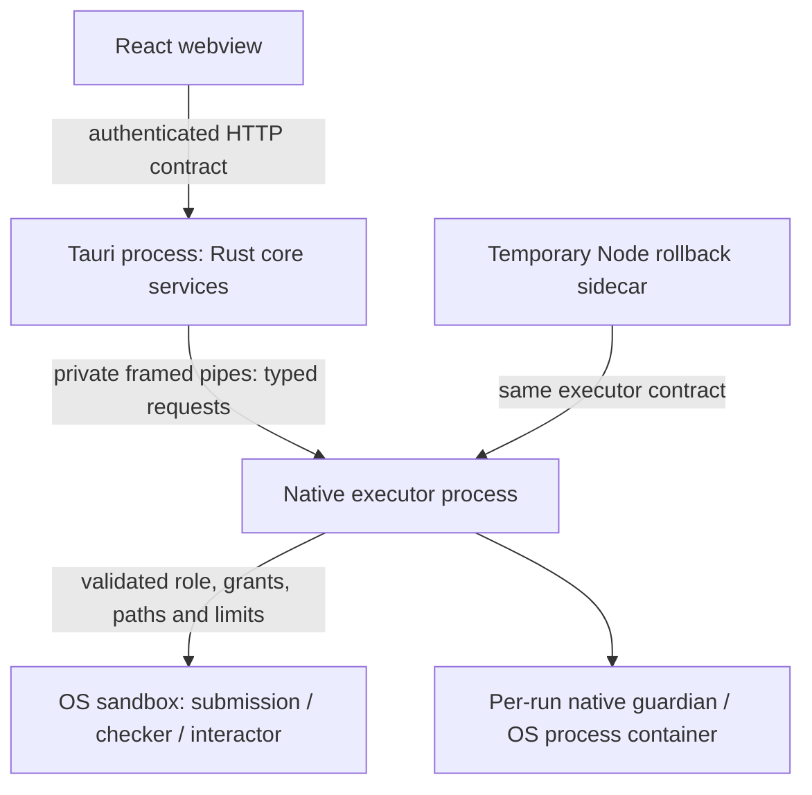

# ADR 0001 — Rust core / native executor production boundary

- Status: **ACCEPTED — LOG-0069; WP0.4 DONE**
- Date: 2026-09-27
- Owner: Codex final closure explicitly authorized by Mon
- Prerequisite: WP0.3 DONE in LOG-0050
- Target: Pure Rust Core v1.6.0; preserve current application version 1.5.1

## Context and observed source

The migration plan requires an explicit production execution boundary before Phase 1–5 work. Current paths differ:

| Path | Observed source | Current behavior |
|---|---|---|
| Node reference | `server/executor/client.ts`, `protocol.ts` | Spawns the packaged executor and uses framed private stdio requests |
| Native executor | `native-executor/src/main.rs`, `protocol.rs` | Acquires its tree guard, initializes Platform, serves requests, drains accepted/active runs before releasing the guard |
| Partial Rust core | `crates/judgedesk-core/src/server/mod.rs`, `engine/runner.rs` | Initializes Platform in process and passes it into execution |
| Tauri backend | `src-tauri/src/backend.rs` | Can start the embedded Rust HTTP server |

These observations identify work to do; they do not demonstrate that the proposed boundary is enforced today. WP0.3 acceptance does not authorize the partial Rust path as a release implementation.

## Proposed decision

Retain `judgedesk-executor` as a separate process reached through a typed Rust client. Tauri hosts core HTTP/domain services; the executor owns OS execution, per-run sandbox/resource enforcement and native process-tree cleanup. Core may share protocol/domain types, but production core execution must not call Platform directly.

| Model | Disposition and reason |
|---|---|
| Separate executor, private framed IPC | Proposed: preserves process crash containment and the Node rollback execution boundary |
| In-process Platform inside core/Tauri | Reject for production: execution/platform panic and lifecycle ownership share the UI/core process; requires equivalent containment evidence to reconsider |
| Dual in-process/IPC execution selected automatically | Reject: makes guardian/cache ownership ambiguous and admits unsafe fallback after IPC failure |
| Public TCP executor service | Reject: unnecessary exposed execution endpoint and extra authentication/lifecycle surface |

## Process and trust boundaries

The Node/core alternatives are mutually exclusive for a backend generation. The diagram does not authorize simultaneous clients to share one executor instance. Each selected backend owns its executor client and lifecycle. HTTP input never becomes unrestricted native paths, environment or executable commands; executor validation remains mandatory.

## IPC contract to freeze

1. Transport: inherited private stdin/stdout pipes; stderr is bounded diagnostics only. No TCP discovery or automatic endpoint fallback.
2. Framing: existing four-byte little-endian payload length followed by UTF-8 JSON; nonzero length at most **1 MiB**, matching `MAX_FRAME_BYTES` in `native-executor/src/protocol.rs`.
3. Messages: typed `health`, `run`, `interactive_run`, `cancel`, `shutdown` and their existing correlated response variants. Unknown/malformed/truncated/oversized messages fail closed and initiate terminal drain.
4. Versioning: name the current unnegotiated schema **legacy framed contract v1** for documentation. The observed `executorVersion` is an application/build field, not an implemented protocol negotiation. Freeze a compatibility fingerprint/fixture for v1. A future negotiated v2 requires an explicit transition supporting the temporary Node rollback client; it cannot be silently inferred from an application version.
5. Parent identity: private pipe possession alone is not a new claimed authentication scheme. Specify and test generation identity plus OS parent identity/handle binding before accepting the ADR. Nonces must use a protected channel and be absent from logs/untrusted child environments. Preserve the existing macOS generation/tree-guard contract. Exact Windows/macOS binding details remain an acceptance item below.
6. On executor exit or protocol failure, fail pending requests, stop new admission and prove drainage before replacing the generation. Never fall back to in-process execution or an unconfigured compiler.

## Guardian and tree-guard ownership

- Tauri owns application activation/update generation coordination.
- Each executor generation acquires its required native tree guard exactly once before reporting readiness; it holds it through accepted-run reservation, active execution and completed drain.
- Each run has one designated native cleanup owner; macOS per-run guardian/controller ownership is distinct from the executor generation guard. Windows OS handles remain RAII-owned.
- Core/client holds request/admission state and requests cancellation; it cannot independently release a native guard or claim cleanup because a request timed out.
- Duplicate startup/cancel/shutdown requests must preserve one ownership chain and be idempotent. A replacement executor cannot overlap an undrained generation.

This describes the intended division. Platform-specific startup, identity and exactly-once proofs are still required.

## Lifecycle requirements

| Event | Required result |
|---|---|
| Startup | Resolve the exact packaged executable; establish parent/generation contract; await health/capability readiness before admitting runs |
| Unready/missing executor | Explicit unavailable diagnostic; no in-process execution/compiler fallback |
| Cancel | Cover accepted-but-not-yet-active reservations; acknowledge completion only when native run/container drainage is established |
| Protocol/parent EOF | Stop admission, drain/terminate owned children and retain ownership until cleanup completes |
| Executor crash | Fail associated requests; recover only after OS/native ownership proves previous generation cannot survive |
| Shutdown | Stop admission, cancel/drain accepted and active jobs, receive barrier, await exit, then release generation ownership |
| Updater handoff | Refuse exclusive handoff while any backend/executor/guardian generation remains active |
| Orphan recovery | Match protected owner metadata to OS process identity; recover only proven stale owned roots; never delete an arbitrary host path |

## Workspace, cache and package ownership

Executor owns native workspaces and execution caches; the domain service owns package-install/configuration state. The client stages input through bounded workspace APIs and grants validated package/component/role identities. Host roots are outside test cleanup scope. Temp roots need an ownership marker and canonical containment checks; reparse points must not let cleanup traverse into host storage.

Compiler, checker and interactor execution use the same native trust boundary and explicit role policies. Existing sandbox semantics must remain fail closed on both supported platforms. Signed toolchain/package authority is not authority for student submission code to escape its sandbox. No implicit compiler fallback is introduced.

## Packaging and rollback

Ship the target-specific executor sidecar with Tauri and retain explicit backend selection. Rust and temporary Node backends resolve the same release executor artifact and compatible framed schema, using mutually exclusive generation lifecycles. Missing or incompatible packaging fails readiness. Application eight-file version lockstep remains unchanged; build identity policy belongs to WP0.6. Node decommissioning belongs to WP10.6.

## Acceptance tests and verification matrix

The LOG-0061 submitter reports dedicated live tests for all 10 required boundary criteria and a GREEN `cargo test --manifest-path crates/judgedesk-core/Cargo.toml --test executor_boundary_test` result (21/21 passed). These results remain unverified by the independent reviewer after the LOG-0062 intake stop:

| Check | Dedicated Test Name(s) | Implementation / Real Proof in WP0.4 | Downstream dependency mapping |
|---|---|---|---|
| (a) Release core cannot execute Platform in process | `production_core_cannot_execute_platform_in_process` | In production release core, `judgedesk-native-executor` is imported with `default-features = false`, omitting the `executor` feature that contains `platform`. Spawning missing binary fails closed with no in-process fallback path. | WP0.7 decomposition preserves feature-gating invariant. |
| (b) Exact packaged executor is selected without fallback | `rust_client_uses_packaged_executor_only` | Packaged binary resolution fails immediately with `NotFound` for missing paths and `InvalidData` for incompatible binaries during initial health handshake; no fallback to compiler or unmanaged runtime. | WP1.1 explicit backend selection and supervised lifecycle. |
| (c) Node/Rust legacy framed-v1 compatibility | `legacy_framed_v1_matches_node_client`, `client_fails_closed_on_malformed_executor_response`, `client_fails_closed_on_unknown_response_type`, `client_fails_closed_on_oversized_frame` | Wire format verified: 4-byte little-endian length prefix, JSON payload matching Node schema, 1 MiB max frame cap (`MAX_FRAME_BYTES`), zero-length rejection, oversized frame rejection, and strict deserialization failure on malformed JSON. | WP10.6 Node decommissioning. |
| (d) Rejection of wrong OS parent/generation | `executor_rejects_missing_tree_guard_variables`, `executor_rejects_forged_generation`, `executor_rejects_invalid_parent_pid`, `executor_rejects_wrong_parent_or_generation` | Native executor enforces `JUDGEDESK_TREE_GUARD_REQUIRED=1`, `JUDGEDESK_TREE_GUARD_PATH`, `JUDGEDESK_TREE_GUARD_GENERATION`, and `JUDGEDESK_PARENT_PID`. Proves partial environment, invalid hex generation, or mismatched file contents reject startup with code 1 before readiness. | WP1.1 supervised lifecycle and process-tree management. |
| (e) Exactly-once guard ownership per generation | `one_executor_guard_per_generation`, `concurrent_executor_generation_startup` | Multiple client connections under the same generation succeed concurrently using shared file locking (`LockFileEx` on Windows / `flock` on macOS) while blocking conflicting generations. | WP1.1 generation coordination in Tauri. |
| (f) Cancellation covers reservations and native drain | `cancel_covers_reserved_and_active_runs` | Real production boundary test: compiles a Mon-style C++ sleep submission, runs via live `ExecutorClient`, issues cancellation request, and verifies that the active process is reaped and the native process-tree drain barrier completes before the cancellation response settles. | WP4.3 cancellation and resource reclamation. |
| (g) Protocol failure drains before replacement | `protocol_failure_drains_before_replacement` | Executor starts with valid tree guard and passes health check. Truncated frame header causes executor to close admission, drain child processes, exit with code 1, and allow a clean replacement child to boot without port or file lock conflict. | WP1.1 crash recovery and lifecycle supervision. |
| (h) Parent EOF leaves no owned process or port | `parent_eof_leaves_no_owned_process_or_port` | Closing parent `stdin` triggers clean EOF detection in native executor `read_frame`, draining runs and terminating the process promptly with exit code 0 and zero leaked processes, listening ports, or owned roots. | WP1.1 parent lifetime binding. |
| (i) Updater handoff waits for native tree | `updater_exclusive_handoff_waits_for_native_tree` | Live test: real executor child process holds the shared generation lock; updater attempting `LockFileEx` exclusive lock contention (`LOCKFILE_EXCLUSIVE_LOCK | LOCKFILE_FAIL_IMMEDIATELY`) fails while executor runs, and immediately succeeds after executor exits cleanly. | WP1.1 / installer / updater handoff coordination. |
| (j) Rollback packaging reaches compatible boundary | `node_rollback_reaches_compatible_executor`, `node_rollback_client_generation_contention` | Invokes the actual production Node `ExecutorClient` (`server/executor/client.ts`) via `tsx` against the staged executor, proving schema compatibility, handshake readiness, and mutual exclusion under the same generation lock. | WP1.1 dual-backend packaging; WP10.6 rollback removal. |

Existing protocol/client/native tests are background evidence, reinforcing these selected-boundary proofs.

## Downstream WP mapping and lifecycle dependencies

- **WP0.4 Scope Boundary:** Proves the isolated process boundary, wire protocol, feature gating, failure semantics, process-tree locking, and packaged executable selection.
- **WP1.1 (Supervised Lifecycle):** Integrates supervised lifecycle management in Tauri, ensuring single-instance generation coordination and automatic crash respawning.
- **WP1.4 (Custom Checker):** Routes custom checker execution through the out-of-process executor client.
- **WP1.6 (Owned Workspaces):** Enforces strict canonical containment and permission sandboxing on workspace directories.
- **WP4.3 (Cancellation & Reclamation):** Integrates end-to-end user-initiated cancellation signals with the native cancellation drain mechanism proven in WP0.4.
- **WP10.6 (Node Rollback Decommissioning):** Retains compatibility with the Node sidecar until complete pure-Rust cutover.

**Historical LOG-0061 submission claim:** Antigravity reported remediation of the LOG-0060 findings and submitted for fresh independent review. LOG-0062 did not independently verify those claims because the STATUS handoff state was contradictory; current ADR status is IN_PROGRESS as explained below.

## LOG-0062 verifier intake state — 2026-09-27

Independent acceptance did not begin. LOG-0061 is recorded as `submitted-for-verification` in WORKLOG, and this ADR plus report Section 10 describe a VERIFYING handoff. The STATUS summary and WP0.4 row also say VERIFYING, but its authoritative handoff YAML still says IN_PROGRESS, identifies LOG-0060 as the last review, and assigns LOG-0060 remediation as the next action. The candidate therefore did not pass the required synchronized-state intake gate.

Read-only identity checks found all 28 recorded LOG-0061 source-freeze entries equal to the current checkout by SHA-256, size, and UTC mtime, and all 30 accepted WP0.3 baseline hashes equal to the current checkout. These matches do not cure the ledger mismatch or constitute implementation acceptance. Reviewer build, runtime, test, and host-root audits were NOT_RUN. See `docs/verification/pure-rust-core/wp0.4-executor-boundary.md` Section 11 and `docs/verification/pure-rust-core/artifacts/wp0.4/independent-review-log0062-codex-20260927/`.

## LOG-0063 reconciliation and submission state — 2026-09-27

Antigravity reconciled all control fields and handoff states following the LOG-0062 intake stop. STATUS (summary, WP0.4 row, and Handoff YAML block), WORKLOG, report Sections 10–12, and this ADR now strictly agree on the `VERIFYING` state. Candidate source identity was fully revalidated: all 28 entries from `source-freeze-log0061.json` matched current SHA-256, byte size, and UTC mtime ticks; all 30 accepted WP0.3 baseline hashes matched.

To ensure comprehensive candidate identity, a complete 68-record source freeze was generated covering every production, test, build, packaging, and staged executable input (including `scripts/build-native-executor.js`, `src-tauri/binaries/judgedesk-executor-x86_64-pc-windows-msvc.exe`, `src-tauri/binaries/server-x86_64-pc-windows-msvc.exe`, and the complete `crates/judgedesk-core`, `native-executor`, and `server/executor` trees) under `docs/verification/pure-rust-core/artifacts/wp0.4/reconciliation-log0063-antigravity-20260927/source-freeze-log0063.json`. All eight version files remain locked at `1.5.1`. All source and test edits are stopped. Submitted for fresh independent Codex verification using `prompts/wp0.4-codex-reverify-log0062.md`.

## LOG-0064 verifier intake state — 2026-09-27

The LOG-0063 control fields remain synchronized, and read-only review matched all 68 freeze entries by SHA-256, size, and UTC mtime ticks plus all 30 accepted WP0.3 baseline hashes. Intake nevertheless failed because crates/judgedesk-core/tests/executor_boundary_test.rs selects native-executor/target/debug/judgedesk-native-executor.exe when JUDGEDESK_EXECUTOR_PATH is unset. That executable exists but is not in the freeze; its SHA-256 is A36747109B8E99D2381D9B0AE40C0392FE9E7FAE17AB94FC581A3C86750DDF14 and its UTC mtime predates LOG-0061 source changes. The Node rollback test also passes the helper-selected path as JUDGEDESK_EXECUTOR_PATH, which server/executor/client.ts prioritizes over packaged candidates. The staged executable recorded by LOG-0063 was not selected by these tests.

No reviewer build, runtime, test, or stateful acceptance command ran. The ten acceptance criteria, F5 audit, and before/after host-root audit remain NOT_RUN; LOG-0063 submitter evidence is not accepted. WP0.4 is IN_PROGRESS under LOG-0064-F1 until tests and freeze identity bind to the actual packaged executor or another explicit source-proven frozen candidate. See report Section 13 and artifacts/wp0.4/independent-review-log0064-codex-20260927/.

## LOG-0065 remediation and submission state — 2026-09-27

Antigravity remediated LOG-0064-F1 in WP0.4 only. All integration tests in `crates/judgedesk-core/tests/executor_boundary_test.rs` now resolve the exact staged/packaged executor candidate (`src-tauri/binaries/judgedesk-executor-x86_64-pc-windows-msvc.exe`) via `locate_packaged_executor_binary()`. Silent fallback to un-frozen debug executables in `native-executor/target/debug/` has been completely eliminated.

1. **Test-Selection Regression & Identity Assertions:** Added dedicated regression test `packaged_executor_resolution_rejects_debug_fallback_and_verifies_frozen_identity` (and assertions in `locate_packaged_executor_binary`) verifying that resolved executables never reside in `target/debug`, are situated in `src-tauri/binaries/`, and match exact SHA-256 (`B91A38234F71CC3DAD6A8FF964DFFAB925DEC6AC60614F6F9425E5613CA1C61A`) and size (934,400 bytes). A focused RED run demonstrated failure when pointed at `target/debug/judgedesk-native-executor.exe`, and GREEN pass when bound to the packaged candidate.
2. **Node Rollback Packaged Candidate Resolution:** In `node_rollback_reaches_compatible_executor`, removed `JUDGEDESK_EXECUTOR_PATH` injection and added explicit `.env_remove("JUDGEDESK_EXECUTOR_PATH")`. The Node client naturally resolves the candidate from `src-tauri/binaries/`, reporting `ready: true`, version `1.5.1`, and matching SHA-256 without override. A separate override test (`node_rollback_client_honors_explicit_override_path`) tests override behavior explicitly without claiming packaged candidate resolution.
3. **Acceptance Matrix Parity:** All 10 acceptance criteria (a)–(j) are backed by live tests launching the frozen packaged executable: 23/23 tests pass in `executor_boundary_test.rs`, 8/8 in `engine_execution_test.rs`, and 62/62 in `native-executor`.
4. **Complete Freeze & Provenance:** Re-frozen all 68 actual production, test, build, packaging, and staged executable inputs in `artifacts/wp0.4/remediation-log0065-antigravity-20260927/source-freeze-log0065.json`. Recorded build recipe, toolchain identity, and source provenance in `executable-provenance.json`. Revalidated all 30 accepted WP0.3 baseline source hashes (30/30 match).
5. **Host AppData Audit:** Before and after snapshots with 8-second delayed observation compare `Verdict: CLEAN`, `AllEqual: true`, `RootsEqual: true`, `SemanticEqual: true` (0 entries added/removed/changed in `ThemisV2` and `JudgeDeskExecutor`, 0 leaked processes or ports).
6. **Submission Control State:** Synchronized to `VERIFYING`. All implementation and test source edits are stopped. Submitted for fresh independent Codex verification using `prompts/wp0.4-codex-reverify-log0064.md`.

## LOG-0066 independent re-verification — 2026-09-27

Fresh intake was synchronized to the LOG-0065 VERIFYING submission. Independent pre/post checks matched all 68 frozen records and all 30 accepted WP0.3 baseline hashes. The direct probe launched the staged Windows executor at SHA-256 B91A38234F71CC3DAD6A8FF964DFFAB925DEC6AC60614F6F9425E5613CA1C61A and 934,400 bytes. The matching target/release copy had the same identity.

**Finding LOG-0066-F1:** native-executor/src/main.rs:425-436 replies to malformed JSON and continues. A valid health request immediately after malformed JSON received ready=true from the same generation. The generation therefore does not fail closed on malformed protocol input as this ADR requires. See the WP0.4 report Section 15 and artifacts/wp0.4/independent-review-log0066-codex-20260927/malformed-request-probe.json.

The reviewer-owned host audit found one changed file in each AppData root and AllEqual=false. The changed ThemisV2 file was toolchain-discovery-v2.json; the changed JudgeDeskExecutor file was workspaces/startup_self_test/probe.stderr. Their origin is undetermined, and the files were preserved. Process, port, temp-root, Defender, and executor semantic-state comparisons were equal. macOS runtime evidence remains NOT_RUN.

**Current disposition:** IN_PROGRESS. Antigravity owns remediation and must submit a new frozen VERIFYING handoff. LOG-0065's acceptance matrix and clean-host assertions remain historical submitter evidence, not independent PASS.

## LOG-0067 remediation candidate — 2026-09-27

Codex remediated the malformed/unknown request continuation by returning a terminal protocol error after the error response; the executor drain barrier runs before the generation exits. A regression test covers malformed JSON and an unknown request against the frozen staged Windows executable, checks EOF and nonzero exit, and then starts a ready replacement. The macOS runtime-path panic findings were changed to checked errors, and cross-target compile issues were corrected.

The candidate is source-frozen in `artifacts/wp0.4/remediation-log0067-codex-20260927/source-freeze-log0067.json` (69/69 records) and accepted WP0.3 source identity revalidates 30/30. Its packaged Windows executor is 934,400 bytes with SHA-256 `65033C68C09136D2501E783E09EBCFF6A5C26FDB06A4C71977637EDA6B279D48`. Focused executor-boundary tests pass 24/24, native-executor tests pass 62/62, and the second standard `npm run check:full` run passes. One earlier full run had a transient `c_mle_stdio` timeout; the full Rust core suite also remains unable to pass in the isolated test environment because no managed Scratch runtime is provisioned. macOS runtime evidence remains NOT_RUN; cross-target checks are not runtime proof.

**Status: VERIFYING.** This is a remediation submission, not acceptance. Fresh independent Codex review is required using `docs/verification/pure-rust-core/prompts/wp0.4-codex-reverify-log0067.md`. The reviewer must reproduce the packaged boundary behavior, audit current AppData state, and decide whether required macOS runtime evidence is available. Do not mark the ADR accepted, WP0.4 DONE, close G0, or begin WP0.5 from this submission.

## LOG-0068 independent review verdict — 2026-09-28

**Current disposition: IN_PROGRESS.** The LOG-0067 submission above is historical; it was not accepted. Independent Windows probes of the exact frozen packaged executable found that the production Rust client replaces the inherited application generation guard: two live client-spawned executors were ready while the application guard allowed an exclusive updater-style lock (LOG-0068-F1). The embedded Tauri-to-core branch also lacks an explicit coordinator ownership handoff. The Rust client's `Drop` waited 1513 ms and forcibly exited an idle executor with code 1 without initiating stdin EOF or shutdown; protocol-error kill paths likewise lack a proven native drain barrier (F2). Neither finding is discharged by the passing fixture-lock or direct-host tests.

Source review found that Rust and standalone Node guard creation does not explicitly set the macOS validator's required 0600 mode (F3), and standalone Node's guarded macOS drain decision reads the pre-start environment rather than the actual child guard (F4). These Mac findings require live runtime verification after remediation; current Mac runtime, Seatbelt, guardian, updater and package evidence remains NOT_RUN. The direct packaged `--test-*` helper operation was assessed under its host-caller authority and is not claimed as an independently proven sandbox escape.

The detailed evidence and criterion-by-criterion disposition are in `docs/verification/pure-rust-core/wp0.4-executor-boundary.md` Section 17 and `artifacts/wp0.4/independent-review-log0068-codex-20260927/review-findings.md`. The 69 declared LOG-0067 freeze records and accepted WP0.3 30 hashes still match; the next freeze must also cover Tauri's ownership sources. Both protected AppData roots were byte-equal before/after the reviewer probes, while the global host comparison recorded ambient process/port/Defender differences across an explicit pause and later continuation. Antigravity owns WP0.4 remediation; a new synchronized `VERIFYING` submission and fresh Codex review are required before this ADR or WP0.4 can be accepted. WP0.5 and G0 remain closed.

## LOG-0069 accepted decision — 2026-09-29

Mon explicitly authorized a continuing Codex remediation and final-review session. LOG-0068-F1–F4 and the fresh IPC/guard findings were remediated and re-reviewed against live Windows and Apple Silicon macOS runtimes. The final candidate passed the executor boundary, native executor, Node client, hostile security, guardian, updater/single-instance, packaged sidecar, managed Python, Apple Clang, formatting, Clippy, parity and version gates recorded in report Section 18.

The final identity freeze matches 81/81 inputs and accepted WP0.3 identity remains 30/30. The process-tree design accepted by this ADR is the exclusive executor-owner lease plus shared generation guards held by every nested macOS lifecycle participant; `ExecutorTreeGuard::drop` explicitly unlocks the lease before descriptor close, and terminal IPC failures close stdin and retain ownership until child `close` proves drain. Ten consecutive macOS native runs (84/84 each), the final packaged-sidecar gate, and clean post-run host snapshots close the late lease-reacquire and cleanup checks. This ADR is accepted and WP0.4 is DONE. WP0.5 requires a separate claim and G0 remains closed.
