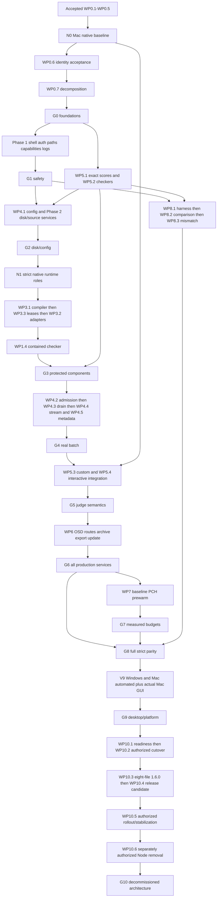

# JudgeDesk Rust core — proposed complete implementation plan

> Re-audit: 2026-10-01/02. **PROPOSED ROADMAP — adoption outstanding; implementation not authorized by this rewrite.**
> Repository: `D:\Minh\Code\judgedesk`. Current source: HEAD `8bc8ac9a2161a7468b633c421185d039c97e5a68` plus preserved dirty inputs; all eight application version files read as `1.5.1`.
> Accepted implementation: WP0.1–WP0.5 only. WP0.6 IN_PROGRESS; WP5.4 NOT_READY; no phase gate DONE. This file never changes those verdicts.
> Current limited adoption, 2026-10-02: N0 was directly authorized and claimed IN_PROGRESS; only N0 → WP0.6 ordering is adopted. Other roadmap changes remain proposed. See the continuation boundary below and live STATUS.

The end product is a compatible, fail-closed Rust backend on Windows x64 and macOS arm64. React retains its product behavior; Tauri owns desktop/window/archive/update coordination; Rust core replaces Node's HTTP/domain/orchestration responsibilities; the out-of-process native executor owns untrusted OS execution and guardians. Deployment may embed core in Tauri, but the four responsibility/trust tiers remain distinct. [ADR 0001](adr/0001-rust-core-executor-boundary.md) is accepted in LOG-0069: private framed IPC, out-of-process execution, exclusive executor-owner lease and generation guards through native drain. Historical proposed/in-progress ADR sections do not override its final accepted section.

Node stays the default until authorized WP10.2. Milestone A deliberately switches default with packaged explicit Node rollback. Stabilization precedes separately authorized Milestone B decommission. Retain six production languages, existing source/role/platform obligations, exact rational awards/ranking, no compiler fallback, zero-network strict isolation, owned resources/atomic persistence, UI/API compatibility, Core/Full editions and separate release/publication authorization. Application identifier, data directory and MSI UpgradeCode remain unchanged. Compiled Rust is still inspectable; memory/startup/IP claims require evidence.

## Evidence and authority at this checkpoint

Read [AGENTS](../AGENTS.md), [guidelines](../guidelines.md), [CONSTRAINTS](../CONSTRAINTS.md), [STATUS](verification/pure-rust-core/STATUS.md) and latest relevant [WORKLOG](verification/pure-rust-core/WORKLOG.md) first. Direct human instructions outrank this proposal. Apply applicable TDD/doubt/debugging/security/review/performance/shipping skills when future implementation is authorized. Never amend those three authority files to facilitate this workflow.

The [audit](verification/pure-rust-core/plan-rewrite-audit-20261001.md), [proposed mapped ledger](verification/pure-rust-core/proposed-ledger-20261001.md) and [machine-readable DAG](verification/pure-rust-core/proposed-roadmap-20261001.json) accompany this plan. Before-images are retained in the planning artifact directory. Historical WP reports, prompts, artifacts and append-only history remain retrievable.

Historical diagnostic archive: 3,177 regular members; 78,238,397 bytes; SHA256 `3B100EE59C20936D24CA173F882969DAB7ABB970C026E9AF8B294142B2F95B8A`. Its hash/size and current versions were freshly read for planning; this is neither a future repaired source nor a new runtime PASS.

[LOG-0091 continuation](verification/pure-rust-core/artifacts/wp0.6/remediator-log0091-continuation-codex-20261001/remediation.md) records Windows full PASS (706 total, 696 pass, 0 fail, 10 existing skips), live Mac full FAIL (706 total, 697 pass, 1 fail, 8 existing skips), nine Rust steps and fast/floor PASS on both hosts. Mac static parity/version separately passed after the full enclosure stopped at server failure. Both-host protected-state and delayed cleanup PASS are historical execution references. The sole current required Mac failure is unchanged `cpp_interactor` AC → JE because `native-executor/src/platform/mod.rs:114–116` rejects Mac interactive execution. The feature identity repair is remediator-verified; fresh independent WP0.6 acceptance is NOT_RUN. Earlier Windows fixture/compiler-prefix, Unicode extraction and cleanup problems are resolved and retained as history, not current blockers.

Current source inspection finds: Node default intent with implicit Rust fallback still in Tauri; discarded embedded serve task/readiness gaps; permissive core CORS; folder path script interpolation; direct PATH compilation/custom-checker execution; incomplete Java/Scratch batch adapters, job/global-cancel/config/event behavior; f64/saturating rational paths; in-memory/fixed-success package/OSD routes; ResourceOnly diagnostic choices. These are future contracts, not new executed defects or accepted features. Current Node exact carrier improvements from WP0.3 and IPC ownership from WP0.4 must be reused.

## Why the graph changes

The old effective cycle was: WP0.6 full Mac acceptance → existing interactive AC oracle → native Mac interactive implementation placed inside WP5.4 → WP3.2/WP4.3/WP5.1 and prior gates → G0 → WP0.6. The blanket “no later feature while a required gate fails” rule made that cycle operational even though the ledger's declared edges omitted the native requirement.

**Selected proposal:** introduce N0, a native Mac interactive baseline package with separate independent acceptance. It uses accepted foundations and the existing Node/IPC caller, with no dependency on accepted WP0.6 or future Rust orchestration. N0 may inspect/build the unaccepted identity candidate as input; that does not accept its identity contract. WP0.6 resumes only after N0 acceptance. Full gates remain required for both; extra completion cycles are an explicit cost of separating the security change from identity acceptance. N0 does not make WP5.4 DONE.

The earlier [within-WP0.6 amendment](verification/pure-rust-core/wp0.6-blocker-next-step-proposal.md) and draft pair remain an unselected historical option. This dedicated package does not activate those prompts. Without future adoption and explicit N0 scope/ordering authorization, the prior human instruction to leave the blocker pending remains in force.

Other repairs: move pure WP5.1/WP5.2 before consumers; move config normalization WP4.1 before compiler/session integration; move WP1.4 after real compiler/runtime/lease prerequisites; extract native six-language capability closure as N1 before adapters; define G3 as execution-component acceptance and G4 as actual batch acceptance; move WP8 harness/comparison/mismatch construction early while G8 retains complete strict parity; perform domain extraction once with WP2.1 evidence closure; retain all release/GUI/rollback gates.

## Dependency DAG and entry artifacts



This diagram groups nodes; the JSON and each task's exact entry list define all edges. Every edge records the upstream output and downstream use. Accepted prerequisites are required, not merely existing code. Proposed stage numbers give a suggested topological schedule; existing IDs remain searchable and need not run in numeric order. All 51 old implementation IDs, four validation IDs and 11 gates are mapped. N0/N1 are new proposed IDs, with no runtime state granted.

### Early prerequisite/capability catalog

At adoption/intake, assign one researcher to produce a read-only catalog in the first authorized package report: Windows x64 and live Mac arm64 availability; Node 24.19.0/npm 11.17.0/Rust 1.97.1 and required fmt/clippy; Windows VS/WebView2 and Mac Xcode/SDK; Cargo lock owners; exact staged executors/helpers; signed manifests/resources; registry revision and every release profile/source/role; current native interactive/strict-runtime gaps; early WP1.3 native dialog GUI access and later full V9.4 tester; package/signing/update prerequisites; benchmark hardware/definitions; stabilization/release owners. Provisioning is a separate approved action where needed. Before WP2.3, identify the vetted Rust/system signature-verification provider; current Rust source has no manifest Ed25519 verifier, so any necessary new dependency/provider needs a concrete separate approval before implementation. The catalog schedules missing capabilities early and distinguishes NOT_RUN from actual unavailability; it neither certifies a toolchain nor marks an unfinished package DONE.

Native missing capability → N0 or a named N1 subdivision. Core source resolution → WP2.6/2.7. Compiler orchestration → WP3.1. Job drain → WP4.3. Complete interactive scores/events → WP5.4. Early native-dialog GUI evidence → WP1.3; final full product GUI → V9.4. No gate may require an outcome that only a later implementation supplies. Mandatory regression/full gates test current reference behavior; discovering another such native baseline gap requires a concrete upstream scope decision, not a skip.

## Contract inherited by every task below

Each task's entry list, file boundary, ordered steps, falsifying cases, outputs, expected results and command codes below **include all of this contract**. A task is not just its heading.

- **Entry and owner:** roadmap adoption plus direct implementation authorization for that package; actual live READY/unowned claim or explicit ownership transfer; listed dependencies independently DONE with applicable artifacts; current source/status/toolchain/capability intake. One remediator owns overlapping production files/tests/goldens; one fresh independent reviewer owns acceptance. Accepted WP0.1–0.5 are retained, not reopened by this plan. Research can proceed read-only on unavailable prerequisites; dependent implementation cannot.
- **Environment:** code acceptance uses Windows x64 and live Mac arm64, matching source bytes and actual launched targets. Use existing locked packages; no new npm/crate dependency, version/policy/protocol/sandbox expansion without explicit scoped approval. Missing required host/runtime is BLOCKED and prevents acceptance. Documentation/evidence-only tasks use D and record runtime NOT_RUN; existing reports' historical limits remain.
- **Scope and subdivisions:** audit actual React → Node/core → Tauri → executor callers before edits; search existing shared/domain primitives. Modify only named responsibility and directly supporting tests; new routes/profiles/features/authority changes stop for a concrete scope decision. Substantial work is split into independently reviewable behavioral slices, normally 100–300 production lines; large inherent OS/lifecycle changes require a staged design rather than hidden expansion. Intermediate code remains fail-closed. Shared contracts belong in shared/protocol/domain interfaces, not cross-tier ad hoc imports.
- **RED/GREEN:** first state a falsifiable observable claim derived from the acceptance text, then run selected real tests proving the named failure. Preserve original RED; rerun the same assertion for GREEN before refactoring. Validate selection/inventory/no unexpected skips. Already-fixed historical defect uses retained RED plus applicable live characterization, not a fabricated new failure. Component tests do not claim integrated route execution.
- **Outputs:** future authorized code/API contract and executable tests/fixtures; one canonical `docs/verification/pure-rust-core/<id>-<name>.md`; immutable unique `artifacts/<id>/<round>/` with raw failed/successful logs, owned diff/before inputs, source/build/environment/command/coverage manifests and compact handoff. Add exact Node/frontend golden changes only under a documented canonical contract decision. No fake result or metric.
- **Resource contract:** for HTTP/disk/native tasks, record canonical owned roots/markers/owner outside attacker control, selected PIDs/start identities/containers, ports/handles/leases and protected-state baseline before first stateful operation. Cancel/crash/disconnect/deadline closes admission, cancels reservations and both native participants where relevant, kills/drains whole owned tree, waits for close/reap/container-empty, releases handles/ports/leases, then removes only verified owned descendants. Unproven drain retains ownership and fails closed; another run cannot start beside uncertain descendants. Harness logger/assertion/outer-timeout failures receive the same tree termination/drain scrutiny. Pure tasks declare no runtime resources; owned mutant fixture directories still require safe disposal.
- **Protected-state/host audit:** fully hash protected ThemisV2 and JudgeDeskExecutor contents plus type/link/semantic inventory before/after each uninterrupted role-owned stateful window; record processes/listeners/temp/Defender or Mac equivalents separately. Per-scenario cleanup plus final immediate and delayed 5–15 s observation must prove zero owned process/root/handle leaks and port rebind. No global host kill/arbitrary deletion. Raw ambient/reboot/service/rolling-query changes remain truthful; never force global equality. New baseline cannot erase interrupted-window damage.
- **Protected-state incident recovery:** pin original protected roots independently of private runtime environment before stateful work; changing TMPDIR must not change which original roots the audit observes. Retain original FAIL and immutable pre-incident evidence. Safely isolated in-scope source work/focused tests may continue after harness guards, but VERIFYING requires evidence-based closure: exact current/original inventory, trusted original restoration bytes, direct authorization for concrete protected-path operations, verified restoration/attribution and a fresh linked final audit window. No post-mutation rebaseline, cache wipe or preservation waiver. Follow the [N0 recovery clarification](verification/pure-rust-core/n0-plan-conflict-resolution-20261002.md).
- **Security ordering:** verify *the new production execution caller* rejects unsafe requests and fails closed on missing sandbox/partial startup with harmless probes before any hostile fixture. Toolchain certification/native unit health alone is insufficient. Hostile/destructive fixtures require verified disposable roots, no-link/no-follow staging, strict zero-network OS policies and a harness proven to terminate/drain descendants. ResourceOnly cannot satisfy untrusted submission/checker/interactor readiness.
- **Acceptance:** remediator passes focused/component and final command union, writes all matrix/results/provenance/cleanup, freezes candidate and claims ready for review → VERIFYING. Reviewer independently inspects and runs critical falsifying preconditions, then its own successful final union and distinct required checks on the frozen candidate. A green aggregate with missing coverage/new skips/orphan/unknown binary is rejected. Neither remediator nor planning reviewer grants DONE. Phase gate aggregates accepted evidence plus fresh integrations, never silently inherits remediator execution.
- **Failure, rollback and next eligibility:** retain failure; classify owning layer; fix within same authorized scope only. Unrelated native/shared-prerequisite failure suspends dependent work and requires explicitly authorized upstream repair, then new freeze/revalidation. No later-feature opportunism. Rollback before cutover restores only attributable owned diff/files or disposes candidate roots while preserving prior dirty state; use atomic journals for disk mutations and retain known-good selected state. No git reset/stash/clean. Runtime tests on rolled-back state must be rerun as needed. After independent DONE, only nodes whose complete entry lists are DONE may be considered, and each still needs implementation authorization. VERIFYING freezes production/test/script inputs and transfers acceptance ownership.

## Acceptance matrix and commands

The supported release profiles come from `server/languages/registry.ts` and `server/toolchains/release-scope.ts` (observed registry revision 6), not from every experimental schema. Build a row for **each declared supported combination**, and a refusal row for unsupported combinations. Preserve all six languages; do not pretend every source mode is supported by Scratch or local Python submission policy.

| Dimension | Required assertions |
|---|---|
| Platform/build | Windows x64, live Mac arm64; dev and packaged when build/identity/selection touched; Core/Full at package gates; target/features/backend/status/startup/NDJSON and actual executable/helper hash |
| Source | none disabled; managed exact signature/receipt; local_path exact certified selection; local_auto deterministic certified candidate; unavailable never fallback |
| Language/artifact | C++/C flags/profile; Python syntax/runtime and managed-submission/local-checker policy; Pascal binaries; Java class tree/main/JVM; Scratch actual sb3/sb2/sb validation and runtime |
| Role/trust | trusted bounded host discovery separate from protected compiler handling hostile source; all untrusted submission/checker/interactor strictly executor sandboxed; native transport/guardians not UI or core platform calls |
| Verdict/score | AC/WA/PE/PARTIAL/CE/RE/TLE/MLE/OLE/JE and FAIL where canonical; lexical exact award, groups/dependencies/totals/rank; executor reason priority; zero-point and invalid partial-score policy |
| Bounds | actual config time min/max; 1.001 s deadline edge where relevant; 8/1024 MiB and out-of-range; binary/diagnostic/output/write/process/thread/open-file quotas; bounded parser/stream/archive |
| Lifecycle | cancellation in staging/pinning/compile/link/run/checker/interactive; repeated/cancel-before-register; slow/disconnect; crash/EOF/protocol/generation loss; updater/parent shutdown; new admission only after drain |
| Product | canonical endpoint/error/persistence/stream contracts; Reload, scoreboard/rejudge/delete; OSD; config; archive/workbook/update; locale/theme/keyboard/dialog/focus |
| Evidence | every selected case actually ran; unchanged oracle; skip registry/inventory; full protected state and owned cleanup; NOT_RUN/BLOCKED explicit; independent role and immutable source/build closure |

Command codes used by each task:

| Code | Exact current command coverage or required future deliverable |
|---|---|
| D | Read-only documentation/reference/graph/ownership checks and `git diff --check`; runtime/build/security/platform NOT_RUN. No code acceptance. |
| F | During authorized edits `npm run check:fast` plus applicable Rust fmt/clippy. On frozen final candidate, one successful `npm run check:full` per remediator and reviewer per supported host; focused/component probes also required. |
| S | Distinct `npm run test:security` plus new focused caller/role/path/interactive security probes; full gate's native tests do not replace this. |
| I | `node scripts/test-build-feature-identity.mjs <fresh-absolute-evidence-dir> all` after harness/ownership/deadline review; real default/no-default/test-server/core/Tauri/Node/dev/packaged build/status mutations described by WP0.6. This script's internal spawnSync lacks a timeout; approved outer harness must terminate/drain descendants rather than assume its success path covers cancellation. |
| M | Mac: `npm run test:macos-process-supervisor`, `npm run test:macos-packaged-checkers` where their inspected staged-artifact prerequisites apply; dedicated live guardian/Seatbelt/interactive probes as named. |
| W | Windows: `npm run test:windows-resources`, `npm run test:windows-single-instance` when relevant; exact packaged target/prerequisites and distinct native interactive/ownership probes. |
| O | Static `npm run test:themis-parity` is enclosed by successful F; separate Windows `npm run test:themis-oracle` verifies unchanged baseline with actual DLL/reference inputs. Never run :update-baseline to green a failing migration. |
| P | `npm run benchmark:executor` / `npm run test:performance` cover existing executor benchmarks only. WP7 supplies complete app/compiler/overhead harness and raw sample contract; future script name recorded when implemented. |
| G | Actual platform GUI/checklist scenarios; `npm run test:desktop` currently builds Node SEA and is not a Rust-only launch. V9.1 must supply a verified isolated Rust launch command; preparing its prompt does not create that script. |
| R | Current `npm run build:windows:release:local`; `npm run build:macos:core:local`, `npm run build:macos:full:local`, `npm run verify:macos:local`; `npm run release:verify-public-assets -- <candidate-directory> v1.6.0` after bump. These stateful resource/network/package commands require owned staging and recorded approval scope; signing/publication authority remains separate. |

`check:full` currently executes **fast → test:rust → test:server → static Themis parity → release version**, short-circuiting at failed child. Rust wrapper attempts all nine steps sequentially (fmt, locked all-target clippy -D warnings, locked tests for native/core/Tauri) and fails aggregate; tests use --no-fail-fast and native/core --test-threads=1. Server child checks Node, builds/stages executor, checks corpus read-only, discovers/runs test files and skip policy. Successful identical children discharge duplicate commands. Failed/filtered/unexecuted/differently configured children do not. All-feature/no-default tests, security, live oracle, strict backend parity, stress, resources, real GUI and actual packages are distinct.

Focused examples verified against current runner interfaces:

```powershell
node scripts/run-all-tests.js --filter=corpus --dry-run
node scripts/run-all-tests.js --filter=corpus --test-timeout=30000
cargo test --locked --manifest-path crates/judgedesk-core/Cargo.toml --test executor_boundary_test -- --test-threads=1
cargo test --locked --manifest-path native-executor/Cargo.toml -- --test-threads=1
cargo test --locked --manifest-path src-tauri/Cargo.toml
```

The first command selects files only and is not executed test evidence. Rust exact-name filters need actual fully qualified name and selection inventory. A successful F on identical inputs supplies default Rust children; separately enabled features/target builds remain distinct. `npm run test:stress` needs a verified disposable copy of `STRESS_TEST_ROOT`; record copied corpus hashes and harness drain. Do not point destructive experiments at the user's canonical stress repository.

CI currently has separate lint/server, Windows/Mac Rust, static parity and Windows live oracle steps; release workflow and CodeMagic differ. Reconcile the exact current YAML/script union at relevant handoff, never equate a CI badge or CodeMagic package smoke to this plan's full security/GUI acceptance. Future necessary pipeline changes are named code scope, not implemented by this rewrite.

## Provenance, freezing and scheduling

Use [efficient execution](pure-rust-core-efficient-execution.md) for the full invalidation contract. Freeze source/tests/scripts/config/goldens/all governing locks, generated build inputs, signed resources, actual executables/helper outputs and recipe/feature/target/environment. Cargo native, core and Tauri owning manifests each have their governing lock; Tauri path dependency resolution belongs to its lock. Node root package-lock governs npm. Do not hand-edit locks or infer app identity from core crate version.

Archive exact regular-member closure including required untracked source and signed distribution resource. Declare excluded build/cache/toolchain outputs and recreate them through recorded recipe; a required resource cannot disappear merely because Git ignores it. Validate SHA/size/member uniqueness/safe type/path and literal Unicode names before and after extraction, with no linked ancestors. Source archive identity is not binary provenance; validate the selected actual launched binary/helpers/architecture and build-input manifest. No target/debug or stale frozen fixture silently substitutes for repaired production source. Preserve original Windows UTC-mtime records where that existing freeze requires them; source bytes and literal names remain authoritative across OS extraction.

Cache reuse requires proven exact relevant input/recipe/toolchain/environment closure and trusted executable ownership/ACL/no-reparse state. No mtime/size-only proof. Any source/test/fixture/script/feature/lock/resource/environment change invalidates affected evidence; absent dependency map means broader rerun. Remediator result cannot substitute for independent reviewer execution. Pure/component evidence may be referenced at phase aggregation only with original verifier/log hash/test inventory/assertions and applicability. Fresh integrated security/lifecycle/performance/GUI/package/release checks remain fresh.

Windows/Mac can run independently on separate hosts with verified identical source and isolated writable state. Within a host serialize stateful executor/core/security/desktop/cache/port/package suites. Performance trials use idle dedicated host and alternate sequential order. No unbounded polling, repeated immutable log reads or automatic chat/agent campaign. One canonical report, compact linked ledgers, one successful final union per role per freeze; failures/reruns preserve all evidence.

## Stage contracts

### Stage 0 — Accepted foundations, native baseline and stable source identity

#### WP0.1 — Accepted workspace/environment baseline

**Aim/placement and entry:** Historical starting identity and preservation report. Entry: accepted historical baseline; common authorization/owner/environment criteria apply.

**Scope/ordered work:** Existing snapshot report and artifacts only. Read accepted verdict; refresh current intake separately; do not replay the package or replace its baseline.

**Falsifiable claim and focused RED/GREEN:** Historical evidence; new drift is an intake finding, not a new RED. GREEN must satisfy the acceptance below through the appropriate real caller; inherit common edge/lifecycle/security-order requirements.

**Required outputs:** Existing wp0.1-workspace-snapshot.md and immutable evidence.

**Expected result/acceptance:** Retain DONE and original platform/environment limits.

**Checks/lifecycle/stop:** D; resource class none. Common protected-state, crash/cancel/deadline/drain, stop-on-expansion, rollback and independent acceptance rules apply. Only accepted downstream nodes in the JSON become eligible after DONE; none auto-start.

#### WP0.2 — Accepted API/stream contract inventory

**Aim/placement and entry:** Baseline anchors the frontend/Node route inventory. Entry: WP0.1; common authorization/owner/environment criteria apply.

**Scope/ordered work:** api-contract-matrix.md, api-contract-manifest.json, shared/contracts.ts and original fixtures. Reuse accepted inventory; each later task compares its actual route/caller delta and adds attributable contract tests.

**Falsifiable claim and focused RED/GREEN:** Missing/dynamic/unowned routes must be detected; no prose-only event substitution. GREEN must satisfy the acceptance below through the appropriate real caller; inherit common edge/lifecycle/security-order requirements.

**Required outputs:** Accepted route matrix/goldens; additive deltas in future owning package.

**Expected result/acceptance:** Retain DONE; canonical batch NDJSON is metadata/progress/problem_completed/done/error, with actual Node ordering.

**Checks/lifecycle/stop:** D; resource class none. Common protected-state, crash/cancel/deadline/drain, stop-on-expansion, rollback and independent acceptance rules apply. Only accepted downstream nodes in the JSON become eligible after DONE; none auto-start.

#### WP0.3 — Accepted corpus and exact-score oracle

**Aim/placement and entry:** Endpoint semantics define expected case outcomes. Entry: WP0.2; common authorization/owner/environment criteria apply.

**Scope/ordered work:** corpus-manifest.json/schema, server/test-fixtures/corpus, accepted Node exact carriers. Reuse 25 immutable cases and accepted rational/ZIP repairs; capture future fixture additions before their implementations; keep generator check read-only.

**Falsifiable claim and focused RED/GREEN:** Mutate owned copies to prove schema/hash and real semantic rejection; supported missing runtime cannot silently pass. GREEN must satisfy the acceptance below through the appropriate real caller; inherit common edge/lifecycle/security-order requirements.

**Required outputs:** Accepted manifest, hashes, raw tamper/oracle evidence.

**Expected result/acceptance:** Retain DONE and bounded historical same-session exception; no new acceptance authority.

**Checks/lifecycle/stop:** D; resource class none. Common protected-state, crash/cancel/deadline/drain, stop-on-expansion, rollback and independent acceptance rules apply. Only accepted downstream nodes in the JSON become eligible after DONE; none auto-start.

#### WP0.4 — Accepted out-of-process executor boundary

**Aim/placement and entry:** Environment anchors OS generation/ownership proofs. Entry: WP0.1; common authorization/owner/environment criteria apply.

**Scope/ordered work:** ADR 0001, executor_client.rs, native IPC/guardian/tree guards, Node client. Read accepted LOG-0069 closure rather than historical ADR proposal wording; preserve framed v1 and executor-owner lease.

**Falsifiable claim and focused RED/GREEN:** Protocol/parent/generation refusal and native drain proofs remain required downstream. GREEN must satisfy the acceptance below through the appropriate real caller; inherit common edge/lifecycle/security-order requirements.

**Required outputs:** Accepted ADR and exact packaged/client evidence.

**Expected result/acceptance:** Retain DONE; production core cannot call Platform or substitute a debug executor.

**Checks/lifecycle/stop:** D; resource class none. Common protected-state, crash/cancel/deadline/drain, stop-on-expansion, rollback and independent acceptance rules apply. Only accepted downstream nodes in the JSON become eligible after DONE; none auto-start.

#### WP0.5 — Accepted Rust gates and expected-skip policy

**Aim/placement and entry:** Baseline supplies test inventory and tool prerequisites. Entry: WP0.1; common authorization/owner/environment criteria apply.

**Scope/ordered work:** run-rust-gates.js, expected-skips.json, gates/CI reports. Reuse LOG-0084 acceptance; inspect today's composition; reconcile CI/CodeMagic coverage separately at release.

**Falsifiable claim and focused RED/GREEN:** Changed gate coverage or unaccounted skip is a new finding; do not weaken the policy. GREEN must satisfy the acceptance below through the appropriate real caller; inherit common edge/lifecycle/security-order requirements.

**Required outputs:** Accepted nine-step gate, source scans and profile diagnostic evidence.

**Expected result/acceptance:** Retain DONE; accepted gate implementation is distinct from all platform features being complete.

**Checks/lifecycle/stop:** D; resource class none. Common protected-state, crash/cancel/deadline/drain, stop-on-expansion, rollback and independent acceptance rules apply. Only accepted downstream nodes in the JSON become eligible after DONE; none auto-start.

#### N0 — Mac native interactive baseline prerequisite

**Aim/placement and entry:** Accepted preservation, unchanged AC oracle, framed IPC ownership, and gate discipline allow native repair without Rust orchestration prerequisites. Entry: WP0.1, WP0.2, WP0.3, WP0.4, WP0.5; common authorization/owner/environment criteria apply. Direct N0 dispatch at 2026-10-02T06:15:45Z already superseded the prior Mac deferral for this bounded repair and adopted only N0 → WP0.6 ordering; WP0.6 source edits remain suspended. Do not request that same decision again or adopt the rest of the graph by implication.

**Scope/ordered work:** native-executor/src/platform/{mod,macos}.rs; existing macos_launcher/run_controller/run_guardian, request validation and directly related native/Node tests. (1) Inventory actual Node/client/native callers, certified participant roles/sources and fixed-owned roots; prove pre-edit validator/harness refusals, not the nonexistent dual-launch behavior. (2) Preserve live cpp_interactor RED. (3) Implement bounded fail-closed dual-process launch/pipe/guardian lifecycle in separately reviewed slices using existing OS primitives. (4) On the implemented new caller, prove harmless denial and partial-start/second-launch ownership before any hostile fixture. (5) Exercise every newly reachable supported strict pair via production Node IPC and Windows regressions; freeze all affected binaries and inputs.

**Private native transport boundary:** preserve accepted public Node/core → executor framed-v1 request/response/schema and sandbox authority. Required coordinated private launcher/controller/guardian stdio/message changes belong to N0's named native scope; they require reviewed authenticated run/generation/parent ownership, matching helper provenance and explicit mismatch/stale-peer refusal, bounded messages/descriptor lifecycle, and single-run regressions. No public arbitrary-FD capability, new grant/dependency/fallback or silent helper-version reinterpretation. The [continuation clarification](verification/pure-rust-core/n0-plan-conflict-resolution-20261002.md) distinguishes this boundary from wider protocol/policy expansion.

**Falsifiable claim and focused RED/GREEN:** Unchanged Mac cpp_interactor AC currently yields JE; add separate-side timeout/crash, second-spawn failure, cancel-before/after registration, EOF, pipe deadlock/flood and denied-path/network regressions. GREEN must satisfy the acceptance below through the appropriate real caller; inherit common edge/lifecycle/security-order requirements.

**Required outputs:** New n0-native-interactive-baseline.md, role/source matrix, RED/GREEN and safety tests, complete frozen source/build manifest, both-host logs and cleanup.

**Expected result/acceptance:** Both participants remain strictly isolated with independent limits; no participant/descendant survives terminal paths; AC/WA/PE/PARTIAL/TLE/MLE/RE/JE mappings and exact Node award carrier stay unchanged. Full Mac and Windows gates pass. Independent N0 DONE gives no WP5.4 or WP0.6 acceptance.

**Current incident/continuation:** the first Mac RED's protected executor-root delta remains open. Private-TMPDIR later equality does not close it. Guard root/environment propagation and prepare exact read-only recovery inputs; continue bounded dual-launch source work/focused tests safely while restoration authorization is pending. Close attributable damage against the corrected original baseline before the final required union/VERIFYING. Use the [continuation prompt](verification/pure-rust-core/prompts/n0-continuation-20261002.md); no state promotion follows this documentation amendment.

**Checks/lifecycle/stop:** F S M W; resource class native. Common protected-state, crash/cancel/deadline/drain, stop-on-expansion, rollback and independent acceptance rules apply. Only accepted downstream nodes in the JSON become eligible after DONE; none auto-start.

#### WP0.6 — Build identity/version/lockfile acceptance

**Aim/placement and entry:** Baseline proves version authority; independently accepted N0 removes the existing Mac full-gate prerequisite while identity remains a distinct claim. Entry: WP0.1, N0; common authorization/owner/environment criteria apply.

**Scope/ordered work:** core build.rs/build_support.rs/build_metadata.rs, Tauri build.rs, build-metadata/build-packaged scripts, status/stream identity tests. (1) Reconcile LOG-0090 F1 and LOG-0091 repair; do not redo unrelated fixes. (2) Verify actual compiler-selected features under forged declared/undeclared parent variables. (3) Prove development/packaged, default/no-default/real test-server, core/Tauri/Node/frontend and build-input refresh. (4) Re-freeze combined post-N0 source; rerun invalidated coverage; submit separate frozen identity handoff.

**Falsifiable claim and focused RED/GREEN:** Existing original Windows and reconstructed Mac RED may be referenced with exact applicability; runtime spoof, stale cache, missing/mismatched locks and missing packaged provenance must fail using real Cargo/build/launch callers. GREEN must satisfy the acceptance below through the appropriate real caller; inherit common edge/lifecycle/security-order requirements.

**Required outputs:** Updated canonical wp0.6 report with attributable new section, lock-owner matrix, metadata/target/features/backend/binary manifests and independent reviewer logs.

**Expected result/acceptance:** Eight files remain 1.5.1; core crate version does not set app version; startup/status/NDJSON agree with actual target/features. Both-host full gates and required identity mutation/live cases pass. Fresh independent DONE required; repaired remediator results are insufficient.

**Checks/lifecycle/stop:** F I; resource class native. Common protected-state, crash/cancel/deadline/drain, stop-on-expansion, rollback and independent acceptance rules apply. Only accepted downstream nodes in the JSON become eligible after DONE; none auto-start.

#### WP0.7 — One characterized server/domain decomposition

**Aim/placement and entry:** Accepted route matrix and stable identity make structural before/after comparison meaningful. Entry: WP0.2, WP0.6; common authorization/owner/environment criteria apply.

**Scope/ordered work:** core src/server/mod.rs, route/domain modules, response/error helpers and tests. (1) Freeze route/error characterization. (2) Extract auth/status/lifecycle/workspace/judge/toolchains/OSD ownership in behavior-preserving slices. (3) Compare inventory/goldens and callers. (4) List WP2.1 boundaries already delivered.

**Falsifiable claim and focused RED/GREEN:** Characterization catches missing route or changed status/framing; inject an owned missing-route mutant to prove coverage. GREEN must satisfy the acceptance below through the appropriate real caller; inherit common edge/lifecycle/security-order requirements.

**Required outputs:** Domain/owner map, before/after route manifests, characterization tests and report.

**Expected result/acceptance:** No behavior or route drift; existing unsafe behavior is documented for Phase 1, never called secure by refactoring. No broad security fix is bundled.

**Checks/lifecycle/stop:** F; resource class none. Common protected-state, crash/cancel/deadline/drain, stop-on-expansion, rollback and independent acceptance rules apply. Only accepted downstream nodes in the JSON become eligible after DONE; none auto-start.

#### G0 — Foundation gate

**Entry/artifacts:** WP0.1, WP0.2, WP0.3, WP0.4, WP0.5, N0, WP0.6, WP0.7 independently DONE with applicable reports. One fresh gate owner verifies the final identity and row-level executed/reference union.

**Ordered acceptance/outputs:** Reconcile upstream inventories and invalidation; run cheap critical preconditions; execute fresh integrated assertions: Aggregate accepted reports on current source; fresh integrated source/build/route inventory and executor identity/start-stop proof. No complete Rust judge feature required. Emit g0-gate.md with executed/reference row map and independent verdict plus source/build/coverage/audit manifests and raw logs. Checks: F I; resource class native, so common cleanup applies. A missing row, wrong source, weakened assertion or failed drain rejects the gate. Restore only owned candidate state; report the owning prerequisite and next eligible nodes. No gate is DONE today.


### Stage 1 — Safe backend boundary, early exact contracts and parity instrumentation

#### WP1.1 — Explicit backend selection and supervised lifecycle

**Aim/placement and entry:** Accepted identity/decomposition/executor foundation supplies real readiness and ownership contracts. Entry: G0; common authorization/owner/environment criteria apply.

**Scope/ordered work:** src-tauri/src/backend.rs, process_supervisor*, startup_guard, core server lifecycle/status. (1) Characterize Node default/Rust opt-in. (2) Remove implicit fallback after missing/spawn/handshake failure. (3) Bind actual loopback port before ready; retain task/error/shutdown handles. (4) Integrate admission-close/cancel/drain/socket-release/update ordering.

**Falsifiable claim and focused RED/GREEN:** Missing/broken Node sidecar, spoofed handshake, occupied/racing port, duplicate/stop-during-start, late serve error, parent/core/executor crash and restart. GREEN must satisfy the acceptance below through the appropriate real caller; inherit common edge/lifecycle/security-order requirements.

**Required outputs:** Selection policy, lifecycle state machine, Tauri/core integration tests, runtime identity and port/process reports.

**Expected result/acceptance:** Node stays default; failures are visible and never auto-select Rust. Ready owns listener/task; stop and updater wait for drain; no orphan or stale ready state.

**Checks/lifecycle/stop:** F M W; resource class native. Common protected-state, crash/cancel/deadline/drain, stop-on-expansion, rollback and independent acceptance rules apply. Only accepted downstream nodes in the JSON become eligible after DONE; none auto-start.

#### WP1.2 — Loopback HTTP authentication/origin/input boundary

**Aim/placement and entry:** Supervised startup delivers a distinct HTTP credential and authoritative listener identity. Entry: G0, WP1.1; common authorization/owner/environment criteria apply.

**Scope/ordered work:** core server auth/routes, src/api.ts and Node equivalent boundary, shared errors. (1) Inventory protected routes. (2) Separate parent handshake secret from per-request HTTP auth. (3) Define exact origins/no-origin/null/development/OPTIONS policy and header delivery for fetch/streams. (4) Enforce bounds, denial, rotation and redaction across both backends.

**Falsifiable claim and focused RED/GREEN:** Hostile origins, CSRF/simple forms, duplicate/missing/expired/replayed auth, invalid method/JSON, body/header/query/path overflow, IPv4/IPv6 binding and reconnect. GREEN must satisfy the acceptance below through the appropriate real caller; inherit common edge/lifecycle/security-order requirements.

**Required outputs:** Threat table, authorization matrix, real HTTP negative fixtures and shared response tests.

**Expected result/acceptance:** Denied request performs zero mutation; canonical 401/403/error schema; secrets never appear in URLs/logs. Intentional Node security corrections must be explicit compatibility decisions.

**Checks/lifecycle/stop:** F; resource class http. Common protected-state, crash/cancel/deadline/drain, stop-on-expansion, rollback and independent acceptance rules apply. Only accepted downstream nodes in the JSON become eligible after DONE; none auto-start.

#### WP1.3 — Native folder selection without script interpolation

**Aim/placement and entry:** Startup/dialog ownership and authenticated route delivery preserve request/error behavior. Entry: WP1.1, WP1.2; common authorization/owner/environment criteria apply.

**Scope/ordered work:** core folder route, existing Tauri dialog bridge, frontend workspace callers. (1) Capture cancel/success contract. (2) Route through native dialog APIs. (3) Remove path-to-script interpolation. (4) Validate safe initial directory and focus return on both GUI hosts.

**Falsifiable claim and focused RED/GREEN:** Quotes/semicolon/newline/backtick/dollar-substitution/UNC/reserved/long/Unicode paths; harmless marker must never execute; dialog cancel/denied/error. GREEN must satisfy the acceptance below through the appropriate real caller; inherit common edge/lifecycle/security-order requirements.

**Required outputs:** Safe dialog contract/tests, required early actual Windows/Mac native dialog/cancel/focus GUI evidence, and report.

**Expected result/acceptance:** No command evaluation; exact safe path/cancel response. Required actual Windows and Mac native dialog/cancel/focus proof must execute before WP1.3 DONE; if Mac GUI access is unavailable, WP1.3/G1 remain blocked pending that early human session. V9.4/G9 later repeat full product GUI validation on final packages; SSH is never dialog/focus evidence.

**Checks/lifecycle/stop:** F G; resource class http. Common protected-state, crash/cancel/deadline/drain, stop-on-expansion, rollback and independent acceptance rules apply. Only accepted downstream nodes in the JSON become eligible after DONE; none auto-start.

#### WP1.5 — Truthful capabilities and guarded incomplete execution

**Aim/placement and entry:** Actual backend readiness/auth and owned-path policy define what routes may advertise or invoke. Entry: WP1.1, WP1.2, WP1.6; common authorization/owner/environment criteria apply.

**Scope/ordered work:** core capability/status/toolchain/OSD/judge routes, shared contracts and UI capability consumers. (1) Inventory every success stub/direct execution caller including diagnose. (2) Derive capability from build/backend/platform/verified disk state. (3) Deny unsafe/incomplete judge/checker/compiler routes with stable unavailable responses and zero side effects. (4) Re-enable only in later accepted owning task.

**Falsifiable claim and focused RED/GREEN:** Missing executor/feature/runtime, fake installed directory, OSD start without watcher, unsupported source/role, stale capability and restart; attempt blocked invocation through real routes. GREEN must satisfy the acceptance below through the appropriate real caller; inherit common edge/lifecycle/security-order requirements.

**Required outputs:** Capability/route ownership manifest, unavailable-response/UI tests and live no-side-effect evidence.

**Expected result/acceptance:** No fake success or diagnostic badge licenses untrusted execution. Phase 1 can close with explicitly unavailable migration features; final G6/G9 cannot. Node product default remains functional.

**Checks/lifecycle/stop:** F; resource class http. Common protected-state, crash/cancel/deadline/drain, stop-on-expansion, rollback and independent acceptance rules apply. Only accepted downstream nodes in the JSON become eligible after DONE; none auto-start.

#### WP1.6 — Owned workspace and hostile-path lifecycle

**Aim/placement and entry:** Accepted IPC and route boundaries identify trusted coordinator and untrusted path inputs. Entry: G0; common authorization/owner/environment criteria apply.

**Scope/ordered work:** core owned workspace API; native request validation; Node workspace reference; Tauri archive callers audited. (1) Search/reuse existing ownership primitives. (2) Specify protected root/owner identity and no-follow handles. (3) Stage/validate/IPC using race-resistant OS paths. (4) Implement RAII and crash scavenging only for authenticated owned descendants.

**Falsifiable claim and focused RED/GREEN:** Leaf/ancestor link/junction/reparse/hardlink, ancestor swap, root-as-target, ADS/device/control/long/case/Unicode paths, forged marker, stale root, cancel at each stage and concurrent cleanup. GREEN must satisfy the acceptance below through the appropriate real caller; inherit common edge/lifecycle/security-order requirements.

**Required outputs:** Containment API contract, owned-root threat fixtures and both-platform cleanup evidence.

**Expected result/acceptance:** No string-only canonicalize-then-delete authorization; cannot mutate neighbor/protected state. Destructive probes stay below verified disposable root. All real execution and installs depend on this API.

**Checks/lifecycle/stop:** F S; resource class native. Common protected-state, crash/cancel/deadline/drain, stop-on-expansion, rollback and independent acceptance rules apply. Only accepted downstream nodes in the JSON become eligible after DONE; none auto-start.

#### WP1.7 — Structured observability and redaction

**Aim/placement and entry:** Build identity/domain and startup/auth supply correlation and secret boundaries. Entry: WP0.6, WP0.7, WP1.1, WP1.2; common authorization/owner/environment criteria apply.

**Scope/ordered work:** core/Tauri/Node log adapters, status/errors and log rotation; no new telemetry service. (1) Define request/job/run/executor/build labels. (2) Bound logs and stable codes. (3) Capture failure/cancel/drain/crash/update transitions. (4) Add secret/source/path canaries; extend job probes when Phase 4 becomes available.

**Falsifiable claim and focused RED/GREEN:** Auth/compile/checker errors, shutdown/crash, rotation overflow, raw token/ticket/signing/source/answer/path canary leak. GREEN must satisfy the acceptance below through the appropriate real caller; inherit common edge/lifecycle/security-order requirements.

**Required outputs:** Structured event schema, sanitized correlation fixtures, rotation tests and reports.

**Expected result/acceptance:** Trace one operation across tiers without private contents; future events are contract-tested initially and actually executed at G4/G6, never claimed live from a synthetic log.

**Checks/lifecycle/stop:** F; resource class http. Common protected-state, crash/cancel/deadline/drain, stop-on-expansion, rollback and independent acceptance rules apply. Only accepted downstream nodes in the JSON become eligible after DONE; none auto-start.

#### WP5.1 — Exact rational model before its consumers

**Aim/placement and entry:** Accepted Node exact carriers define parser/arithmetic/ranking semantics independently of execution. Entry: G0, WP0.3; common authorization/owner/environment criteria apply.

**Scope/ordered work:** core rational/scoring and config/result types; shared/rational.ts and Node scoring reference. (1) Inventory every parser/multiplier/total/rank caller. (2) Define lexical decimal/fraction and safe numeric/string carriers. (3) Replace f64 approximation/saturating corruption with checked exact reductions. (4) Property-test and route through consumers before they are integrated.

**Falsifiable claim and focused RED/GREEN:** 1/3+2/3, .5/-.5/1., 0.35*10, MAX_SAFE_INTEGER/3, large cross-products, overflow, invalid denominator/nonfinite, partial award and permutation/rank ties. GREEN must satisfy the acceptance below through the appropriate real caller; inherit common edge/lifecycle/security-order requirements.

**Required outputs:** Exact scoring/carrier contract, Node goldens/property tests and error policy.

**Expected result/acceptance:** No floating-point score/rank arithmetic; explicit config/JE error rather than silent saturation; presentation conversion only at existing boundary. Overflow beyond available representation requires scoped design/dependency decision, not rounding.

**Checks/lifecycle/stop:** F; resource class none. Common protected-state, crash/cancel/deadline/drain, stop-on-expansion, rollback and independent acceptance rules apply. Only accepted downstream nodes in the JSON become eligible after DONE; none auto-start.

#### WP5.2 — Pure standard-checker parity before integration

**Aim/placement and entry:** Exact award carriers let checker decisions feed scores without approximation. Entry: G0, WP5.1; common authorization/owner/environment criteria apply.

**Scope/ordered work:** core checkers, Node standard-checkers and existing Themis oracle inputs. (1) Enumerate all identifiers/aliases/defaults. (2) Compare token/line/binary/integer/float-tolerance/yesno behavior. (3) Bound input/UTF-8 errors. (4) Produce canonical verdict/message/award fixtures.

**Falsifiable claim and focused RED/GREEN:** Empty/huge tokens and integers, signed zero/exponent/NaN/Infinity policy, mixed newline/trailing whitespace/NUL/invalid UTF-8, PE and aliases. GREEN must satisfy the acceptance below through the appropriate real caller; inherit common edge/lifecycle/security-order requirements.

**Required outputs:** Table/property/golden tests, static parity links and live DLL oracle report where required.

**Expected result/acceptance:** Exact verdict/alias/default behavior; float tolerance compares contestant numeric output only and never score/rank math. Static checker parity alone does not prove a new live oracle run.

**Checks/lifecycle/stop:** F O; resource class none. Common protected-state, crash/cancel/deadline/drain, stop-on-expansion, rollback and independent acceptance rules apply. Only accepted downstream nodes in the JSON become eligible after DONE; none auto-start.

#### WP8.1 — Early isolated sequential parity harness

**Aim/placement and entry:** Secured backend launching and frozen contracts/corpus allow measurement of gaps before complete integration. Entry: G1, WP0.2, WP0.3; common authorization/owner/environment criteria apply.

**Scope/ordered work:** Future parity harness plus backend adapters/owned roots; no production semantic repair. (1) Allocate separate writable state/ports/preferences/executor/cache/logs per backend. (2) Run sequential immutable-input copies. (3) Verify actual identity and drain. (4) Exercise currently available real contracts and preserve expected nonzero gaps.

**Falsifiable claim and focused RED/GREEN:** Wrong backend/hash, shared root, absent runtime, timeout/descendant leak and harness failure must fail; incomplete Rust case cannot count as success. GREEN must satisfy the acceptance below through the appropriate real caller; inherit common edge/lifecycle/security-order requirements.

**Required outputs:** Harness safety/isolation tests, runner/build manifests and early gap report.

**Expected result/acceptance:** Harness correctness accepted separately from backend parity. An expected negative test can prove failure detection; observed migration mismatch remains FAIL until G8. No temporary broad allowlist.

**Checks/lifecycle/stop:** F S; resource class native. Common protected-state, crash/cancel/deadline/drain, stop-on-expansion, rollback and independent acceptance rules apply. Only accepted downstream nodes in the JSON become eligible after DONE; none auto-start.

#### WP8.2 — Strict comparison contract

**Aim/placement and entry:** Isolated executions plus exact score/checker fixtures define comparison semantics. Entry: WP8.1, WP5.1, WP5.2; common authorization/owner/environment criteria apply.

**Scope/ordered work:** Parity normalizer/comparator; WP0.2 route/stream and WP0.3 result fixtures. (1) List only contractual volatile fields. (2) Compare HTTP/body/events/order/identity/compile/verdict/exact award/groups/rank/disk/lifecycle. (3) Capture raw time/memory with declared tolerances. (4) Mutation-test comparator.

**Falsifiable claim and focused RED/GREEN:** Verdict/score/order/language/source/version/error/event mutation rejected; only timestamps/job IDs/temp roots and approved measured tolerances normalize. GREEN must satisfy the acceptance below through the appropriate real caller; inherit common edge/lifecycle/security-order requirements.

**Required outputs:** Comparison schema/table, mutation tests and minimal paired diffs.

**Expected result/acceptance:** No semantic masking; a faster wrong verdict fails; startup/OSD stream contracts each use their own framing.

**Checks/lifecycle/stop:** F; resource class none. Common protected-state, crash/cancel/deadline/drain, stop-on-expansion, rollback and independent acceptance rules apply. Only accepted downstream nodes in the JSON become eligible after DONE; none auto-start.

#### WP8.3 — Mismatch artifact and failing exit

**Aim/placement and entry:** Comparator provides precise failing dimension and raw request/result. Entry: WP8.2; common authorization/owner/environment criteria apply.

**Scope/ordered work:** Parity artifact writer/CLI exit, evidence manifest and triage schema. (1) Emit minimal case/backend/source/request/expected/actual diff. (2) Assign owning layer. (3) Exit nonzero for unexplained mismatch or missing execution. (4) Prove artifact safety and cleanup on failed writer.

**Falsifiable claim and focused RED/GREEN:** Missing result, empty selection, unexpected skip, mismatched artifact hash, log-write failure and deliberate semantic mutant. GREEN must satisfy the acceptance below through the appropriate real caller; inherit common edge/lifecycle/security-order requirements.

**Required outputs:** Machine-readable mismatch/coverage schema and exit/artifact tests.

**Expected result/acceptance:** No silent successful zero-case run; gap records are evidence, never package completion for the failed feature.

**Checks/lifecycle/stop:** F; resource class native. Common protected-state, crash/cancel/deadline/drain, stop-on-expansion, rollback and independent acceptance rules apply. Only accepted downstream nodes in the JSON become eligible after DONE; none auto-start.

#### G1 — Shell/HTTP/path safety gate

**Entry/artifacts:** WP1.1, WP1.2, WP1.3, WP1.5, WP1.6, WP1.7 independently DONE with applicable reports. One fresh gate owner verifies the final identity and row-level executed/reference union.

**Ordered acceptance/outputs:** Reconcile upstream inventories and invalidation; run cheap critical preconditions; execute fresh integrated assertions: Live both-backend startup/auth/path/capability denial and shutdown/update drain. Unsafe unfinished execution is unavailable with zero side effects. Native checker compilation is deliberately later; verify no direct path remains reachable before hostile fixtures. Emit g1-gate.md with executed/reference row map and independent verdict plus source/build/coverage/audit manifests and raw logs. Checks: F S M W; resource class native, so common cleanup applies. A missing row, wrong source, weakened assertion or failed drain rejects the gate. Restore only owned candidate state; report the owning prerequisite and next eligible nodes. No gate is DONE today.


### Stage 2 — Durable toolchain state, configuration and exact source plans

#### WP2.1 — Domain ownership delta review

**Aim/placement and entry:** Accepted decomposition and Phase 1 changes reveal any remaining cross-domain ownership gaps. Entry: G1, WP0.7; common authorization/owner/environment criteria apply.

**Scope/ordered work:** Domain map/route modules already extracted by WP0.7; owning service interfaces. (1) Compare WP0.7 boundaries with toolchain/compiler/services needs. (2) Prove covered boundaries by exact accepted evidence. (3) Extract only missing boundaries with characterization; no repeated whole-server move.

**Falsifiable claim and focused RED/GREEN:** Route inventory and characterization fail on a missing domain/changed behavior. GREEN must satisfy the acceptance below through the appropriate real caller; inherit common edge/lifecycle/security-order requirements.

**Required outputs:** Explicit evidence decision for every domain; structural delta tests only if needed.

**Expected result/acceptance:** Retain required ownership outcome. A no-code evidence closure needs independent verdict; it is not an assumed skipped WP.

**Checks/lifecycle/stop:** D or F; resource class none. Common protected-state, crash/cancel/deadline/drain, stop-on-expansion, rollback and independent acceptance rules apply. Only accepted downstream nodes in the JSON become eligible after DONE; none auto-start.

#### WP2.2 — Revisioned preferences and execution policy persistence

**Aim/placement and entry:** Authenticated owned service boundaries make atomic preference mutation safe. Entry: G1, WP2.1; common authorization/owner/environment criteria apply.

**Scope/ordered work:** core toolchain preference/policy models and routes; Node preferences/migration reference. (1) Capture schema/revision/legacy migration. (2) Implement per-profile source preferences and concurrency conflicts. (3) Atomic same-directory persist/recover. (4) Read after restart and derive UI state.

**Falsifiable claim and focused RED/GREEN:** Truncated/corrupt JSON, old schema, invalid mode/path, write/flush/rename failure, revision race, crash between stages. GREEN must satisfy the acceptance below through the appropriate real caller; inherit common edge/lifecycle/security-order requirements.

**Required outputs:** Preference/policy schema, migration fixtures, durable round-trip/recovery tests and report.

**Expected result/acceptance:** Restart observes only valid complete revision; conflict/error matches Node; no silent default or raw path leak.

**Checks/lifecycle/stop:** F; resource class disk. Common protected-state, crash/cancel/deadline/drain, stop-on-expansion, rollback and independent acceptance rules apply. Only accepted downstream nodes in the JSON become eligible after DONE; none auto-start.

#### WP2.3 — Signed package/manifest/receipt disk truth

**Aim/placement and entry:** Owned service boundaries and accepted corpus trust model define immutable inputs. Pre-implementation catalog identifies a vetted existing/system signature-verification provider; any necessary new dependency/provider must be separately approved before coding. Entry: G1, WP2.1; common authorization/owner/environment criteria apply.

**Scope/ordered work:** core package models; server/toolchains/{manifest,receipts} references; signed distribution resource fixture. (1) Resolve the early verification-provider prerequisite using vetted existing/system capabilities or separately approved minimal dependency; do not hand-roll cryptography. (2) Capture canonical signed-v2 schema/keys and verify signature, size/hash/platform/arch/provenance/licenses. (3) Define canonical receipt and tamper/restart validation. (4) Refuse unverified entry before mutation.

**Falsifiable claim and focused RED/GREEN:** Unknown key/algorithm, wrong hash/size/OS/arch, duplicate/ambiguous entry, unsigned metadata, receipt tamper and downgrade policy violation. GREEN must satisfy the acceptance below through the appropriate real caller; inherit common edge/lifecycle/security-order requirements.

**Required outputs:** Trusted local signed fixtures, manifest/receipt contract and negative tests.

**Expected result/acceptance:** Disk truth derives from covered signature and verified bytes; missing signed resource is a closure error, never an excuse to fetch/use a trust bypass.

**Checks/lifecycle/stop:** F; resource class disk. Common protected-state, crash/cancel/deadline/drain, stop-on-expansion, rollback and independent acceptance rules apply. Only accepted downstream nodes in the JSON become eligible after DONE; none auto-start.

#### WP2.4 — Bounded extraction and atomic installation

**Aim/placement and entry:** Owned staging, revision policy and verified package inputs are required to publish safely. Entry: WP1.6, WP2.2, WP2.3; common authorization/owner/environment criteria apply.

**Scope/ordered work:** core package store/installer/routes; existing Node extraction and mutation gate. (1) Preflight quotas and source trust. (2) Stream into private owned staging with byte/file/depth limits. (3) Normalize executable permissions, verify tree and atomic publish. (4) Add cancel/recovery and approved network integration separately.

**Falsifiable claim and focused RED/GREEN:** Traversal/bomb/link/device/duplicate/depth floods, expanded-size mismatch, collision/permission failure, cancellation/crash at each phase and active lease conflict. GREEN must satisfy the acceptance below through the appropriate real caller; inherit common edge/lifecycle/security-order requirements.

**Required outputs:** Executable signed local install fixtures, post-extract manifest, atomicity/recovery and real download report if authorized.

**Expected result/acceptance:** No partial selected package; no unowned deletion/network from submissions; active judge mutation returns 409. New crypto/network/archive dependency requires separate approval.

**Checks/lifecycle/stop:** F S; resource class disk. Common protected-state, crash/cancel/deadline/drain, stop-on-expansion, rollback and independent acceptance rules apply. Only accepted downstream nodes in the JSON become eligible after DONE; none auto-start.

#### WP2.5 — Owned uninstall/dedup/recovery

**Aim/placement and entry:** Verified installed receipts and atomic publish state identify what may be removed. Entry: WP2.4; common authorization/owner/environment criteria apply.

**Scope/ordered work:** core package store/recovery; preference selections and package leases. (1) Define selected/in-use refusal. (2) Remove by verified owner/receipt, with reference accounting only if dedup exists. (3) Recover stale staging/publish journal. (4) Prove idempotent restart.

**Falsifiable claim and focused RED/GREEN:** Forged marker/receipt, root replacement, selected/in-use 409, concurrent mutation, duplicate install, partial prior publish, cancellation and neighbor preservation. GREEN must satisfy the acceptance below through the appropriate real caller; inherit common edge/lifecycle/security-order requirements.

**Required outputs:** Uninstall/recovery fixtures, journal/state transition and delayed handle/root report.

**Expected result/acceptance:** Only owned unused package removed; selected/in-use preserved; recovery never guesses a broader root.

**Checks/lifecycle/stop:** F S; resource class disk. Common protected-state, crash/cancel/deadline/drain, stop-on-expansion, rollback and independent acceptance rules apply. Only accepted downstream nodes in the JSON become eligible after DONE; none auto-start.

#### WP2.6 — Exact source resolution and pinned identity

**Aim/placement and entry:** Persisted source intent and verified receipts eliminate directory-name/PATH guesses. Entry: WP2.2, WP2.3; common authorization/owner/environment criteria apply.

**Scope/ordered work:** core resolver/discovery/certification interfaces; Node registry/resolver/version-policy reference. (1) Build release-profile/source matrix from actual registry. (2) Resolve none/managed/local_path/local_auto separately. (3) Validate exact executable/runtime/version/snapshot/isolation evidence. (4) Return immutable plan or unavailable.

**Falsifiable claim and focused RED/GREEN:** Disabled/missing managed, incompatible exact local path, auto with zero/two candidates, stale certificate/receipt, wrong version/arch and changed binary. GREEN must satisfy the acceptance below through the appropriate real caller; inherit common edge/lifecycle/security-order requirements.

**Required outputs:** Resolver tables, immutable toolchain snapshot schema and per-profile identity tests.

**Expected result/acceptance:** none disables; missing/invalid selected source never substitutes another. Auto selection deterministic only within certified auto candidates. Managed Python submissions/local checker-only policy preserved.

**Checks/lifecycle/stop:** F; resource class disk. Common protected-state, crash/cancel/deadline/drain, stop-on-expansion, rollback and independent acceptance rules apply. Only accepted downstream nodes in the JSON become eligible after DONE; none auto-start.

#### WP2.7 — Mac driver/SDK qualification

**Aim/placement and entry:** Exact source selection makes clang/clang++ and SDK hypotheses testable. Entry: WP2.6; common authorization/owner/environment criteria apply.

**Scope/ordered work:** core discovery/diagnostics/compiler-plan inputs; native local toolchain snapshot; Apple Clang fixtures. (1) Refresh earlier header-failure applicability. (2) Compare selected driver, SDK/sysroot/minimal environment and frozen resource paths. (3) Reproduce only if still failing; repair exact shared root. (4) Preserve real C/C++ protected compile/run proof.

**Falsifiable claim and focused RED/GREEN:** Wrong driver/SDK/missing resource under production path; host xcrun success alone is not GREEN. If old defect is fixed, retain characterization and prove present path without fabricating RED. GREEN must satisfy the acceptance below through the appropriate real caller; inherit common edge/lifecycle/security-order requirements.

**Required outputs:** Mac driver/SDK manifest, focused regression and live protected C/C++ diagnostics.

**Expected result/acceptance:** Correct configured driver retained, no arbitrary host-dir grants or compiler substitution; historical failure not automatically a current blocker.

**Checks/lifecycle/stop:** F S M; resource class native. Common protected-state, crash/cancel/deadline/drain, stop-on-expansion, rollback and independent acceptance rules apply. Only accepted downstream nodes in the JSON become eligible after DONE; none auto-start.

#### WP4.1 — Normalized configuration before compiler/session integration

**Aim/placement and entry:** HTTP/path safety and exact lexical carriers provide secure canonical config inputs. Entry: G1, WP5.1; common authorization/owner/environment criteria apply.

**Scope/ordered work:** core config/domain/routes; server/problems resolver; shared contracts/editor fixtures. (1) Inventory stored/request/default precedence. (2) Normalize legacy stdio/split I/O, limits, groups, checker/interactor, profiles/flags. (3) Preserve exact lexical weights/dependencies. (4) Test identical Node JSON/config files.

**Falsifiable claim and focused RED/GREEN:** Stored/request conflict, malformed/unknown/legacy fields, group cycles, flags, missing config, fraction overflow, Unicode I/O, memory 8/1024/outside and actual time bounds. GREEN must satisfy the acceptance below through the appropriate real caller; inherit common edge/lifecycle/security-order requirements.

**Required outputs:** Normalized config contract, Node/Rust table fixtures and persisted compile snapshots.

**Expected result/acceptance:** No invented precedence; invalid limits/flags fail before launch; resolve prose time-bound disagreement from actual normalization explicitly. No session success claimed here.

**Checks/lifecycle/stop:** F; resource class disk. Common protected-state, crash/cancel/deadline/drain, stop-on-expansion, rollback and independent acceptance rules apply. Only accepted downstream nodes in the JSON become eligible after DONE; none auto-start.

#### G2 — Toolchain/config disk contract gate

**Entry/artifacts:** WP2.1, WP2.2, WP2.3, WP2.4, WP2.5, WP2.6, WP2.7, WP4.1, WP5.1 independently DONE with applicable reports. One fresh gate owner verifies the final identity and row-level executed/reference union.

**Ordered acceptance/outputs:** Reconcile upstream inventories and invalidation; run cheap critical preconditions; execute fresh integrated assertions: Restart/mutation/recovery/resolver/config matrix and actual C/C++ Mac driver probes. Runtime certification reports unresolved native capabilities truthfully; this gate accepts safe disk/source semantics, not six-language batch readiness. Emit g2-gate.md with executed/reference row map and independent verdict plus source/build/coverage/audit manifests and raw logs. Checks: F S M; resource class disk, so common cleanup applies. A missing row, wrong source, weakened assertion or failed drain rejects the gate. Restore only owned candidate state; report the owning prerequisite and next eligible nodes. No gate is DONE today.


### Stage 3 — Native capabilities and protected execution components

#### N1 — Native strict runtime/role capability closure

**Aim/placement and entry:** Verified source/runtime snapshots and install truth allow native OS capability gaps to be isolated before Rust adapters. Entry: G2; common authorization/owner/environment criteria apply. Each cataloged native gap needs a named bounded subdivision and approval before implementation.

**Scope/ordered work:** native executor validation/platform/launcher/guardian roles and Node staging references; per-gap approved subcontracts only. (1) Reconcile early capability catalog against real source/role registry. (2) Name each failing native combination and bounded native subpackage before coding; serialize shared files. (3) Prove pre-edit validator/harness refusal with harmless fixtures. (4) Implement the bounded OS capability slice fail-closed using existing verified primitives. (5) Prove the implemented caller's denial/partial-start ownership harmlessly before hostile probes, then accept strict sandbox/limits/drain or stop with the concrete unsatisfied release obligation.

**Falsifiable claim and focused RED/GREEN:** Pascal/Java/Scratch ResourceOnly cannot pass; per-role network/external read/write/descendant escape/process/thread/open-file limits, 8/1024 MiB and deadline boundaries, missing runtime and negative launch paths. GREEN must satisfy the acceptance below through the appropriate real caller; inherit common edge/lifecycle/security-order requirements.

**Required outputs:** Native capability catalog and separately accepted gap reports, source/toolchain/role matrix, real native probes and cleanup.

**Expected result/acceptance:** All six production languages' supported submission combinations on both hosts need strict containment before final migration. Unsupported registry combinations remain unavailable. Inability to meet a required language is FAIL/BLOCKED for release, never removal of support or blanket grants.

**Checks/lifecycle/stop:** F S M W; resource class native. Common protected-state, crash/cancel/deadline/drain, stop-on-expansion, rollback and independent acceptance rules apply. Only accepted downstream nodes in the JSON become eligible after DONE; none auto-start.

#### WP3.1 — Protected compiler service

**Aim/placement and entry:** Exact source/disk truth, native compiler/runtime capability and owned workspace support bounded compilation. Entry: G2, N1, WP1.6; common authorization/owner/environment criteria apply.

**Scope/ordered work:** core engine/compiler service; Node compiler/checker-compiler/interactor-compiler reference; IPC client. (1) Capture current role limits/argv/profile. (2) Build one pinned compiler plan for diagnose/submission/checker/interactor. (3) Execute through approved protected boundary with minimal env/no shell/bounded outputs. (4) Validate artifact and publish atomically after drain.

**Falsifiable claim and focused RED/GREEN:** Hang/descendants/template bomb, diagnostic flood, missing/wrong-type/oversize artifact, selected compiler unavailable, Unicode/spaces, cancel during compile/link/publish. GREEN must satisfy the acceptance below through the appropriate real caller; inherit common edge/lifecycle/security-order requirements.

**Required outputs:** Compiler plan/result/error contract, role-limit fixtures, protected compile/cancel tests and report.

**Expected result/acceptance:** Submission timeout 15000 ms, binary cap 32 MiB; custom checker timeout 60000 ms and current explicit memory policy; CE versus JE preserves reference. Timeout proves whole-tree drain, no PATH/compiler fallback.

**Checks/lifecycle/stop:** F S; resource class native. Common protected-state, crash/cancel/deadline/drain, stop-on-expansion, rollback and independent acceptance rules apply. Only accepted downstream nodes in the JSON become eligible after DONE; none auto-start.

#### WP3.3 — Session toolchain leases and immutable pinning

**Aim/placement and entry:** Compiler plan plus revisioned resolver provides immutable snapshot and maintenance lease. Entry: WP3.1, WP2.2, WP2.6; common authorization/owner/environment criteria apply.

**Scope/ordered work:** core toolchain lease service/compiler plan and future session admission adapter; Node session/maintenance reference. (1) Resolve all required roles before launch. (2) Acquire one generation/session lease with cancel-safe RAII. (3) Make metadata use snapshot. (4) Test a component caller now; integrate job owner in WP4.2/4.3.

**Falsifiable claim and focused RED/GREEN:** Preference/uninstall/rescan during compile/prewarm, cancel during pinning, failed compiler start, double release and restart recovery. GREEN must satisfy the acceptance below through the appropriate real caller; inherit common edge/lifecycle/security-order requirements.

**Required outputs:** Lease API/state machine, race tests, metadata fixtures.

**Expected result/acceptance:** Mutation refused 409 while leased; changed preference affects next session only; release exactly once after actual drain. Component acceptance does not claim real batch admission yet.

**Checks/lifecycle/stop:** F; resource class native. Common protected-state, crash/cancel/deadline/drain, stop-on-expansion, rollback and independent acceptance rules apply. Only accepted downstream nodes in the JSON become eligible after DONE; none auto-start.

#### WP3.2 — Six protected language adapters

**Aim/placement and entry:** Compiler service, pinned leases and Mac driver evidence supply real role/source plans. Entry: WP3.1, WP3.3, WP2.7; common authorization/owner/environment criteria apply.

**Scope/ordered work:** core engine language adapters and diagnostics; Node language-adapters/compiler/scratch runtime; declared registry. (1) Implement C++, C, Python, Pascal, Java, Scratch as separate reviewable slices. (2) Use exact flags/runtime/main-class/artifact contracts. (3) Exercise compile + run through production adapter on owned component fixtures. (4) Feed future batch integration without enabling incomplete routes.

**Falsifiable claim and focused RED/GREEN:** Each profile: AC program, CE/RE, stdio/file I/O, wrong/missing selected source, Unicode/ambiguity, TLE/MLE/OLE, cancel and strict sandbox role/source probes. GREEN must satisfy the acceptance below through the appropriate real caller; inherit common edge/lifecycle/security-order requirements.

**Required outputs:** Independently named per-profile tests/results, adapter contracts and target/toolchain/runtime snapshots.

**Expected result/acceptance:** All six real adapter component paths pass on supported hosts; Python syntax and checker-only local policy; Java output tree/JVM limits; Scratch actual sb3/sb2/sb. No badge/single mega-test substitutes per-row proof. Real batch is G4, not required before its code exists.

**Checks/lifecycle/stop:** F S M W; resource class native. Common protected-state, crash/cancel/deadline/drain, stop-on-expansion, rollback and independent acceptance rules apply. Only accepted downstream nodes in the JSON become eligible after DONE; none auto-start.

#### WP1.4 — One executor-backed custom-checker runner

**Aim/placement and entry:** Owned staging plus certified pinned compiler/checker runtime eliminates direct host execution. Entry: WP1.6, WP3.1, WP3.2, WP3.3; common authorization/owner/environment criteria apply.

**Scope/ordered work:** core runner/checker service, existing IPC client; Node checker compiler/runner and Python policy. (1) Preserve staging/testlib/Themis argv/stdin layout. (2) Replace direct Command/recv_timeout with role-specific compiler/run plans. (3) Bound stdout/stderr/files. (4) Integrate native cancel/drain under lease and verify no direct checker caller remains.

**Falsifiable claim and focused RED/GREEN:** Missing/CE checker, infinite child/thread/flood, external/network denial, cancel, Unicode diagnostic, partial-start and all AC/WA/PE/PARTIAL/FAIL cases. GREEN must satisfy the acceptance below through the appropriate real caller; inherit common edge/lifecycle/security-order requirements.

**Required outputs:** Checker execution API/tests, caller inventory and component containment evidence.

**Expected result/acceptance:** Untrusted checker never runs outside executor; timeout/cancel/EOF drains descendants before lease/root release. Exact-score semantic integration belongs WP5.3; component verdict/message uses accepted fixtures.

**Checks/lifecycle/stop:** F S; resource class native. Common protected-state, crash/cancel/deadline/drain, stop-on-expansion, rollback and independent acceptance rules apply. Only accepted downstream nodes in the JSON become eligible after DONE; none auto-start.

#### G3 — Protected execution component gate

**Entry/artifacts:** N1, WP3.1, WP3.2, WP3.3, WP1.4, WP5.2 independently DONE with applicable reports. One fresh gate owner verifies the final identity and row-level executed/reference union.

**Ordered acceptance/outputs:** Reconcile upstream inventories and invalidation; run cheap critical preconditions; execute fresh integrated assertions: Real compiler+adapter+checker role/source tests on both hosts with leases/drain and strict isolation. No batch/event result demanded until G4; disabled Rust routes stay unavailable until their integration is accepted. Emit g3-gate.md with executed/reference row map and independent verdict plus source/build/coverage/audit manifests and raw logs. Checks: F S M W O; resource class native, so common cleanup applies. A missing row, wrong source, weakened assertion or failed drain rejects the gate. Restore only owned candidate state; report the owning prerequisite and next eligible nodes. No gate is DONE today.


### Stage 4 — Real batch sessions, cancellation, streams and metadata

#### WP4.2 — Job admission and registry

**Aim/placement and entry:** Protected services and normalized config support real prepared jobs, not global flags. Entry: G3, WP4.1; common authorization/owner/environment criteria apply.

**Scope/ordered work:** core job/session/admission registry; Node SingleJudgeSessionGate/activeJobs/tombstones. (1) Model bounded unique IDs and admission. (2) Register/tombstone cancel linearizably. (3) Attach pinned leases and cleanup owner. (4) Wire real endpoint preparation while terminal execution remains protected.

**Falsifiable claim and focused RED/GREEN:** Simultaneous request, duplicate/invalid/exhausted ID, cancel-before-register, register/cancel race, maintenance/admission, clean removal and next run. GREEN must satisfy the acceptance below through the appropriate real caller; inherit common edge/lifecycle/security-order requirements.

**Required outputs:** Registry state machine/race tests, bounded job-ID policy and endpoint contract.

**Expected result/acceptance:** Canonical concurrency/busy/error semantics; no shared AtomicBool reset by a new request; one owner and eventual removal.

**Checks/lifecycle/stop:** F; resource class native. Common protected-state, crash/cancel/deadline/drain, stop-on-expansion, rollback and independent acceptance rules apply. Only accepted downstream nodes in the JSON become eligible after DONE; none auto-start.

#### WP4.3 — End-to-end cancellation/disconnect/native drain

**Aim/placement and entry:** Registered jobs and supervised executor ownership provide cancellation targets and drain authority. Entry: WP4.2, WP0.4, WP1.1; common authorization/owner/environment criteria apply.

**Scope/ordered work:** core sessions/jobs/compiler/runner, IPC, Tauri shutdown/update bridge. (1) Define prepare/compile/run/checker/interactor/cancel/drained states. (2) Wire user cancel, disconnect, shutdown and update to same owner. (3) Retain reservations/guard/lease until native proof. (4) Reject new work after drain failure.

**Falsifiable claim and focused RED/GREEN:** Cancel every phase/partial start, repeated cancel, disconnect around terminal event, executor refusal/crash/protocol failure, deadline drain timeout and new run after cleanup. GREEN must satisfy the acceptance below through the appropriate real caller; inherit common edge/lifecycle/security-order requirements.

**Required outputs:** Lifecycle transition assertions, stress races, process/container/port/handle evidence.

**Expected result/acceptance:** cancelled true means native empty; uncertain drain closes admission and fails visibly. Exactly-once cleanup/lease release; backend/window crash cannot strand execution.

**Checks/lifecycle/stop:** F S M W; resource class native. Common protected-state, crash/cancel/deadline/drain, stop-on-expansion, rollback and independent acceptance rules apply. Only accepted downstream nodes in the JSON become eligible after DONE; none auto-start.

#### WP4.4 — Frontend-compatible streaming writer

**Aim/placement and entry:** Auth/admission and drain guarantee bounded stream lifecycle and meaningful terminal events. Entry: WP4.2, WP4.3, WP1.2; common authorization/owner/environment criteria apply.

**Scope/ordered work:** core judge route/event writer; shared/contracts; useJudgeSession/reducer reference. (1) Freeze actual Node NDJSON order/error behavior. (2) Serialize camelCase and flush boundaries. (3) Bound slow-consumer buffers. (4) Exercise frontend reader/reducer on actual Rust events.

**Falsifiable claim and focused RED/GREEN:** Split/combined chunks, multibyte UTF-8 split, blank/final lines, slow client/backpressure, disconnect before/after terminal and redacted internal error. GREEN must satisfy the acceptance below through the appropriate real caller; inherit common edge/lifecycle/security-order requirements.

**Required outputs:** Stream goldens, live reader/reducer tests and job cleanup reports.

**Expected result/acceptance:** metadata/progress/problem_completed/done/error and one canonical terminal policy match Node; no completed/job_start inventions, no orphan on broken stream.

**Checks/lifecycle/stop:** F; resource class http. Common protected-state, crash/cancel/deadline/drain, stop-on-expansion, rollback and independent acceptance rules apply. Only accepted downstream nodes in the JSON become eligible after DONE; none auto-start.

#### WP4.5 — Run metadata and workbook compatibility

**Aim/placement and entry:** Config/events/pinned identities and exact carriers feed existing frontend exporter. Entry: WP4.1, WP4.4, WP3.3, WP5.1; common authorization/owner/environment criteria apply.

**Scope/ordered work:** core metadata/result serialization, shared contracts, src/features/export/score-workbook.ts. (1) Emit all selected profile/executor identities including Python. (2) Feed real Rust result/events into reducer and workbook. (3) Compare Summary/Details/order/ranks/exact totals. (4) Test missing/failed profiles without phantom metric.

**Falsifiable claim and focused RED/GREEN:** Missing Python key, large exact/fraction scores, ties/unjudged, display sort, CE/JE and source unavailable metadata. GREEN must satisfy the acceptance below through the appropriate real caller; inherit common edge/lifecycle/security-order requirements.

**Required outputs:** Actual Rust metadata/event fixtures, workbook content assertions and export report.

**Expected result/acceptance:** No omitted required toolchain or fake metric; exact award/rank preserved through archive/export presentation; human-visible order matches UI.

**Checks/lifecycle/stop:** F; resource class disk. Common protected-state, crash/cancel/deadline/drain, stop-on-expansion, rollback and independent acceptance rules apply. Only accepted downstream nodes in the JSON become eligible after DONE; none auto-start.

#### G4 — Real batch/session/stream gate

**Entry/artifacts:** WP4.2, WP4.3, WP4.4, WP4.5 independently DONE with applicable reports. One fresh gate owner verifies the final identity and row-level executed/reference union.

**Ordered acceptance/outputs:** Reconcile upstream inventories and invalidation; run cheap critical preconditions; execute fresh integrated assertions: All six languages through actual batch endpoint on both hosts with standard checker/exact totals; cancellation stress, metadata/reducer/workbook, user rejudge/delete smoke. Custom/interactive full semantic parity is explicitly G5. Emit g4-gate.md with executed/reference row map and independent verdict plus source/build/coverage/audit manifests and raw logs. Checks: F S M W G; resource class native, so common cleanup applies. A missing row, wrong source, weakened assertion or failed drain rejects the gate. Restore only owned candidate state; report the owning prerequisite and next eligible nodes. No gate is DONE today.


### Stage 5 — Full custom/interactive judge semantics

#### WP5.3 — Custom-checker exact semantic integration

**Aim/placement and entry:** Contained runner plus exact scoring and completed sessions provide real semantic oracle path. Entry: WP1.4, WP5.1, G4; common authorization/owner/environment criteria apply.

**Scope/ordered work:** core checker parsing/runner/session; Node custom checker/testlib and accepted corpus. (1) Resolve result=2/out-of-range contract explicitly. (2) Parse testlib/Themis exit/stdout/stderr lexical scores. (3) Apply exact awards/groups. (4) Run real batch failures and DLL oracle where applicable.

**Falsifiable claim and focused RED/GREEN:** AC/WA/PE/PARTIAL/FAIL/JE, invalid score/NaN/out-of-range, missing/CE, timeout, sandbox denial and Unicode messages. GREEN must satisfy the acceptance below through the appropriate real caller; inherit common edge/lifecycle/security-order requirements.

**Required outputs:** Semantic decision row, production batch oracle fixtures, exact score and failure reports.

**Expected result/acceptance:** No silent clamp or replacement checker; verdict priority and exact score match approved Node semantics. Any product decision must precede implementation, no expectation changed to fit Rust.

**Checks/lifecycle/stop:** F S O; resource class native. Common protected-state, crash/cancel/deadline/drain, stop-on-expansion, rollback and independent acceptance rules apply. Only accepted downstream nodes in the JSON become eligible after DONE; none auto-start.

#### WP5.4 — Rust-core interactive orchestration/integration

**Aim/placement and entry:** Native Mac dual-process support, adapters, job drain and exact scores now exist for Rust integration. Entry: N0, WP3.2, WP4.3, WP5.1, G4; common authorization/owner/environment criteria apply.

**Scope/ordered work:** core interactive service/session/IPC adapter; native caller only if bounded defect found; frontend event/results. (1) Reuse existing framed interactive_run and N0 lifecycle. (2) Pin/stage both participant roles. (3) Integrate job cancel/disconnect and exact verdict/award. (4) Run real Node/Rust batch and frontend-event parity.

**Falsifiable claim and focused RED/GREEN:** Both-side timeout/crash/pipe-close/deadlock/flood, partial-start, cancel/EOF/shutdown, input-only/no-answer, C++/Python interactor and partial/testlib verdicts. GREEN must satisfy the acceptance below through the appropriate real caller; inherit common edge/lifecycle/security-order requirements.

**Required outputs:** Rust production interactive route tests, pair role/source matrix, score/event/lifecycle artifacts.

**Expected result/acceptance:** Both hosts and every supported participant combination pass full interactive integration; N0's AC or native safety alone grants no credit. Native policy/protocol expansion stops for scope decision.

**Checks/lifecycle/stop:** F S M W; resource class native. Common protected-state, crash/cancel/deadline/drain, stop-on-expansion, rollback and independent acceptance rules apply. Only accepted downstream nodes in the JSON become eligible after DONE; none auto-start.

#### G5 — Complete scoring/checker/interactive gate

**Entry/artifacts:** WP5.1, WP5.2, WP5.3, WP5.4, G4 independently DONE with applicable reports. One fresh gate owner verifies the final identity and row-level executed/reference union.

**Ordered acceptance/outputs:** Reconcile upstream inventories and invalidation; run cheap critical preconditions; execute fresh integrated assertions: Live custom/standard/interactive corpus, exact awards/groups/ranking, all terminal and hostile role/source cases. Reuse pure arithmetic evidence only if applicable; live integration fresh. Emit g5-gate.md with executed/reference row map and independent verdict plus source/build/coverage/audit manifests and raw logs. Checks: F S M W O; resource class native, so common cleanup applies. A missing row, wrong source, weakened assertion or failed drain rejects the gate. Restore only owned candidate state; report the owning prerequisite and next eligible nodes. No gate is DONE today.


### Stage 6 — Remaining product services and shell integration

#### WP6.1a — OSD parser and durable state

**Aim/placement and entry:** Complete judge semantics makes durable OSD results meaningful. Entry: G5; common authorization/owner/environment criteria apply.

**Scope/ordered work:** core OSD parser/state; Node OSD types/parser/logs. (1) Capture filename/content identity and duplicate policy. (2) Parse bounded immutable records. (3) Persist state/log atomically. (4) Recover restart without duplicate award.

**Falsifiable claim and focused RED/GREEN:** Malformed/Unicode/case collision, oversized/partial records, duplicates, crash/write failure and legacy state. GREEN must satisfy the acceptance below through the appropriate real caller; inherit common edge/lifecycle/security-order requirements.

**Required outputs:** Parser/state fixtures, durable schema/recovery and parity tests.

**Expected result/acceptance:** Only validated accepted items become durable; invalid record has bounded canonical error; no phantom success.

**Checks/lifecycle/stop:** F; resource class disk. Common protected-state, crash/cancel/deadline/drain, stop-on-expansion, rollback and independent acceptance rules apply. Only accepted downstream nodes in the JSON become eligible after DONE; none auto-start.

#### WP6.1b — OSD watcher/debounce/queue

**Aim/placement and entry:** Durable item identity and job ownership supply a safe queue/drain target. Entry: WP6.1a, WP4.2, WP4.3; common authorization/owner/environment criteria apply.

**Scope/ordered work:** core OSD watcher/queue; Node fs watcher/debounce reference. (1) Watch only approved source root. (2) Match stable-write/rename and 500 ms contract after code reconciliation. (3) Bound FIFO/backpressure and batch conflict. (4) Drain watcher/queued/active work on stop.

**Falsifiable claim and focused RED/GREEN:** Partial writes, rapid duplicate events, overflow/restart, inaccessible root, queue limit, batch race and cancellation. GREEN must satisfy the acceptance below through the appropriate real caller; inherit common edge/lifecycle/security-order requirements.

**Required outputs:** Watcher/queue tests and live file-arrival event sequence.

**Expected result/acceptance:** No lost/duplicate accepted submission; deterministic bounded order and busy behavior; released watcher handles and cancelled/drained active job.

**Checks/lifecycle/stop:** F; resource class native. Common protected-state, crash/cancel/deadline/drain, stop-on-expansion, rollback and independent acceptance rules apply. Only accepted downstream nodes in the JSON become eligible after DONE; none auto-start.

#### WP6.1c — OSD status/events and lifecycle

**Aim/placement and entry:** Real watcher/queue, event framing and backend supervision support truthful status. Entry: WP6.1b, WP4.4, WP1.1; common authorization/owner/environment criteria apply.

**Scope/ordered work:** core OSD routes/events/lifecycle; frontend OSD consumers. (1) Port start/stop/status and reconnect/replay contract. (2) Couple capability to actual watcher. (3) Bound slow consumers. (4) Use shared shutdown/update drain.

**Falsifiable claim and focused RED/GREEN:** Repeated start/stop, reconnect, slow/disconnected client, terminal error, shutdown with queued/running item and restart. GREEN must satisfy the acceptance below through the appropriate real caller; inherit common edge/lifecycle/security-order requirements.

**Required outputs:** Live OSD HTTP/stream fixtures, frontend state and cleanup reports.

**Expected result/acceptance:** Status reflects actual queue/work; no fixed success, orphan watcher or stale busy lease.

**Checks/lifecycle/stop:** F; resource class http. Common protected-state, crash/cancel/deadline/drain, stop-on-expansion, rollback and independent acceptance rules apply. Only accepted downstream nodes in the JSON become eligible after DONE; none auto-start.

#### WP6.2 — Workspace/problem/config route parity

**Aim/placement and entry:** Safe paths and normalized config plus judge contract anchor disk routes. Entry: G5, WP1.6, WP4.1; common authorization/owner/environment criteria apply.

**Scope/ordered work:** core workspace/problem routes; Node discovery/config/list-preview references; frontend Reload. (1) Port natural ordering/discovery and checker/interactor listings. (2) Bound UTF-8 previews/directory scans. (3) Atomic config writes. (4) Exercise Reload preserving checked/unchecked/scores and selecting new items.

**Falsifiable claim and focused RED/GREEN:** Empty/missing/inaccessible/large/Unicode dirs, links/reparse/case races, truncated UTF-8, malformed config and concurrent write. GREEN must satisfy the acceptance below through the appropriate real caller; inherit common edge/lifecycle/security-order requirements.

**Required outputs:** Endpoint goldens, disk mutation and frontend Reload tests.

**Expected result/acceptance:** Canonical status/body/order, no unbounded reads or path escape; existing selection/score preservation remains.

**Checks/lifecycle/stop:** F; resource class disk. Common protected-state, crash/cancel/deadline/drain, stop-on-expansion, rollback and independent acceptance rules apply. Only accepted downstream nodes in the JSON become eligible after DONE; none auto-start.

#### WP6.3 — Archive/export/update/lifecycle ownership

**Aim/placement and entry:** Exact results/export and lifecycle/path containment keep shell-owned operations safe. Entry: G5, WP4.5, WP1.1, WP1.6; common authorization/owner/environment criteria apply.

**Scope/ordered work:** Tauri contest_archive/update/opener, core bridge, frontend contest/export/update flows. (1) State frontend/core/Tauri owner for each flow. (2) Preserve .judgedesk portable archive/dirty prompts. (3) Bound archive extraction/Excel write/open. (4) Couple update handoff to complete drain without absorbing shell responsibilities.

**Falsifiable claim and focused RED/GREEN:** Traversal/bomb/link/collision, save-as/crash/overwrite, invalid exact stored carrier, viewer failure, cancelled update/handoff and second instance. GREEN must satisfy the acceptance below through the appropriate real caller; inherit common edge/lifecycle/security-order requirements.

**Required outputs:** Ownership matrix, archive round-trip/export/update integration tests.

**Expected result/acceptance:** Atomic safe persistence and clean update tree; app identity/data directory/UpgradeCode unchanged; no update installation/publication without separate authorization.

**Checks/lifecycle/stop:** F S G; resource class disk. Common protected-state, crash/cancel/deadline/drain, stop-on-expansion, rollback and independent acceptance rules apply. Only accepted downstream nodes in the JSON become eligible after DONE; none auto-start.

#### G6 — Complete production services gate

**Entry/artifacts:** WP6.1a, WP6.1b, WP6.1c, WP6.2, WP6.3 independently DONE with applicable reports. One fresh gate owner verifies the final identity and row-level executed/reference union.

**Ordered acceptance/outputs:** Reconcile upstream inventories and invalidation; run cheap critical preconditions; execute fresh integrated assertions: Every frontend-used route has real state/result or approved shell ownership. OSD live queue, config/Reload, archive/export/update integration; no fixed success or remaining unavailable required product feature. Emit g6-gate.md with executed/reference row map and independent verdict plus source/build/coverage/audit manifests and raw logs. Checks: F S M W G; resource class native, so common cleanup applies. A missing row, wrong source, weakened assertion or failed drain rejects the gate. Restore only owned candidate state; report the owning prerequisite and next eligible nodes. No gate is DONE today.


### Stage 7 — Measured performance, PCH and prewarm

#### WP7.1 — Comparable performance baseline/measurement contract

**Aim/placement and entry:** Feature-complete packaged modes produce comparable workloads; early capability catalog reserves hosts/budgets. Entry: G6; common authorization/owner/environment criteria apply.

**Scope/ordered work:** Existing Node/core/native benchmark primitives; new benchmark harness/report only under future implementation authority. (1) Approve startup budget and metric definitions before optimization. (2) Record hardware/power/thermal/build/compiler/SDK/flags/source/cache/load. (3) Disable PCH for baseline, alternate sequential Node/Rust with >=3 warmups and >=20 measured trials. (4) Retain all failures/raw samples and distributions.

**Falsifiable claim and focused RED/GREEN:** Harness tests prove sample/units/accounting and detect backend/fixture mismatch; noisy/loaded runs become INCONCLUSIVE, no cherry-picked best run. GREEN must satisfy the acceptance below through the appropriate real caller; inherit common edge/lifecycle/security-order requirements.

**Required outputs:** Raw samples/p50/p90/p95/min/max/failures, measurement contract and both-host baseline.

**Expected result/acceptance:** Entire frontend+backend idle <150 MB (150,000,000 bytes; report MiB too), orchestration overhead <50 ms and warm PCH compile p50/p95 <300 ms are retained budgets. Startup target/regression ceiling needs human adoption before optimization; no invented passing target.

**Checks/lifecycle/stop:** F P; resource class native. Common protected-state, crash/cancel/deadline/drain, stop-on-expansion, rollback and independent acceptance rules apply. Only accepted downstream nodes in the JSON become eligible after DONE; none auto-start.

#### WP7.2 — PCH fingerprint and atomic generation

**Aim/placement and entry:** Measurement baseline and pinned bounded compiler/lease provide cache authority. Entry: WP7.1, WP3.1, WP3.3; common authorization/owner/environment criteria apply.

**Scope/ordered work:** core PCH cache service, compiler plan; Node universal-pch reference. (1) Fingerprint compiler hash/version/canonical identity, target/flags/headers/SDK/schema. (2) Single-flight bounded private generation. (3) Validate compile and atomic publish. (4) Recover only owned stale entries.

**Falsifiable claim and focused RED/GREEN:** Concurrent first use, changed compiler/flags/SDK/header, corrupt/truncated cache, path/permission/crash/cancel and timeout. GREEN must satisfy the acceptance below through the appropriate real caller; inherit common edge/lifecycle/security-order requirements.

**Required outputs:** Fingerprint schema, cache lifecycle tests and compiler/source/build reports.

**Expected result/acceptance:** No mixed profile/architecture hit; incomplete cache never selected; generation obeys compiler containment/drain.

**Checks/lifecycle/stop:** F S P; resource class native. Common protected-state, crash/cancel/deadline/drain, stop-on-expansion, rollback and independent acceptance rules apply. Only accepted downstream nodes in the JSON become eligible after DONE; none auto-start.

#### WP7.3 — Safe PCH consumption

**Aim/placement and entry:** Validated published cache and exact fingerprint identify usable acceleration. Entry: WP7.2; common authorization/owner/environment criteria apply.

**Scope/ordered work:** core compiler/PCH consume hook and same selected toolchain. (1) Inject supported PCH flags only for real compile. (2) Exclude --test-* directives. (3) Validate hit/miss/rebuild/bypass and failure. (4) Compare identical verdict/exact results enabled/disabled.

**Falsifiable claim and focused RED/GREEN:** Miss/corrupt/incompatible cache, generation failure, compiler/profile mismatch, Unicode path and test-harness flag injection. GREEN must satisfy the acceptance below through the appropriate real caller; inherit common edge/lifecycle/security-order requirements.

**Required outputs:** Hit-rate/raw timing and correctness parity, safe fallback tests.

**Expected result/acceptance:** PCH failure may use ordinary compilation by the same pinned compiler/profile only; no compiler fallback or changed isolation.

**Checks/lifecycle/stop:** F S P; resource class native. Common protected-state, crash/cancel/deadline/drain, stop-on-expansion, rollback and independent acceptance rules apply. Only accepted downstream nodes in the JSON become eligible after DONE; none auto-start.

#### WP7.4 — Cancellable background prewarm

**Aim/placement and entry:** Single-flight cache and job drain/lease define safe foreground/background arbitration. Entry: WP7.2, WP7.3, WP4.3; common authorization/owner/environment criteria apply.

**Scope/ordered work:** core startup/prewarm/PCH scheduler; Node background-prewarm reference. (1) Low-priority single-flight scheduling. (2) Foreground join/direct compile bounded policy. (3) Block on toolchain mutation/update/shutdown. (4) Drain tasks/artifacts on cancel/restart.

**Falsifiable claim and focused RED/GREEN:** Startup/foreground/mutation races, slow prewarm, repeated schedule, failed generation, shutdown/update and lease starvation. GREEN must satisfy the acceptance below through the appropriate real caller; inherit common edge/lifecycle/security-order requirements.

**Required outputs:** Race tests, foreground latency/hit-rate and cleanup reports.

**Expected result/acceptance:** Prewarm cannot delay first judge indefinitely or keep busy after stop; measured budgets still pass without correctness loss.

**Checks/lifecycle/stop:** F S P; resource class native. Common protected-state, crash/cancel/deadline/drain, stop-on-expansion, rollback and independent acceptance rules apply. Only accepted downstream nodes in the JSON become eligible after DONE; none auto-start.

#### G7 — Measured performance gate

**Entry/artifacts:** WP7.1, WP7.2, WP7.3, WP7.4 independently DONE with applicable reports. One fresh gate owner verifies the final identity and row-level executed/reference union.

**Ordered acceptance/outputs:** Reconcile upstream inventories and invalidation; run cheap critical preconditions; execute fresh integrated assertions: Fresh comparable both-host samples/hit rates and enabled/disabled correctness/security; preserve real budgets and approved startup definition; failures/noise cannot be dropped. Emit g7-gate.md with executed/reference row map and independent verdict plus source/build/coverage/audit manifests and raw logs. Checks: F S P; resource class native, so common cleanup applies. A missing row, wrong source, weakened assertion or failed drain rejects the gate. Restore only owned candidate state; report the owning prerequisite and next eligible nodes. No gate is DONE today.


### Stage 8 — Complete strict Node/Rust parity

The harness was moved to Stage 1; this stage is the final completeness acceptance, not repeated implementation.
#### G8 — Full semantic parity gate

**Entry/artifacts:** WP8.1, WP8.2, WP8.3, G6, G7 independently DONE with applicable reports. One fresh gate owner verifies the final identity and row-level executed/reference union.

**Ordered acceptance/outputs:** Reconcile upstream inventories and invalidation; run cheap critical preconditions; execute fresh integrated assertions: 100% approved corpus/API/event/disk/lifecycle parity on both hosts after PCH; zero unexplained mismatch allowlists, missing runtime or unattempted supported matrix row. No earlier harness acceptance stands in for this. Emit g8-gate.md with executed/reference row map and independent verdict plus source/build/coverage/audit manifests and raw logs. Checks: F S M W O P; resource class native, so common cleanup applies. A missing row, wrong source, weakened assertion or failed drain rejects the gate. Restore only owned candidate state; report the owning prerequisite and next eligible nodes. No gate is DONE today.


### Stage 9 — Actual desktop and platform acceptance

#### V9.1 — Windows Rust desktop launch protocol

**Aim/placement and entry:** Complete correctness/security/parity/performance permits UI acceptance against real backend. Entry: G8; common authorization/owner/environment criteria apply.

**Scope/ordered work:** Future isolated Rust desktop launcher; Tauri/React actual packaged Core/Full. (1) Implement/document a Rust-only build/launch path before using UI results. (2) Isolate state. (3) Assert actual status target/features/backend and no Node/SEA process. (4) Capture state after each UI action and clean tree on exit.

**Falsifiable claim and focused RED/GREEN:** Deliberately select Node/wrong binary/occupied port and require failure; deadline/close/crash tests drain launcher descendants. GREEN must satisfy the acceptance below through the appropriate real caller; inherit common edge/lifecycle/security-order requirements.

**Required outputs:** Dedicated launcher command and manifest, screenshots/logs/process inventory.

**Expected result/acceptance:** Current test:desktop builds Node and cannot alone prove Rust-only. Future command is required deliverable, not an existing command/PASS.

**Checks/lifecycle/stop:** F G W; resource class native. Common protected-state, crash/cancel/deadline/drain, stop-on-expansion, rollback and independent acceptance rules apply. Only accepted downstream nodes in the JSON become eligible after DONE; none auto-start.

#### V9.2 — Complete Windows desktop acceptance matrix

**Aim/placement and entry:** Verified launcher identifies actual candidate/backend and isolated user state. Entry: V9.1; common authorization/owner/environment criteria apply.

**Scope/ordered work:** All frontend flows through Node/Rust and packaged Core/Full. (1) Execute every matrix row below with fixed 18x5/72x20 data. (2) Capture stable screenshot and frontend/backend/executor logs. (3) Record expected/observed behavior. (4) Test close/reopen/crash and restore owned state.

**Falsifiable claim and focused RED/GREEN:** Missing/CE/unavailable/cancel/invalid path/dirty save/focus/resize/sort/rejudge/delete/export/OSD/update error flows. GREEN must satisfy the acceptance below through the appropriate real caller; inherit common edge/lifecycle/security-order requirements.

**Required outputs:** phase-9-windows-matrix.md, numbered screenshots and scenario records.

**Expected result/acceptance:** Every required Windows row executed; localization/theme/keyboard/focus and scoreboard stability preserved; no inference from API-only tests.

**Checks/lifecycle/stop:** G W; resource class native. Common protected-state, crash/cancel/deadline/drain, stop-on-expansion, rollback and independent acceptance rules apply. Only accepted downstream nodes in the JSON become eligible after DONE; none auto-start.

#### V9.3 — Mac automated/platform/package matrix

**Aim/placement and entry:** Final matched source and complete parity enable actual arm64 platform/package tests. Entry: G8; common authorization/owner/environment criteria apply.

**Scope/ordered work:** Exact transferred source, macOS Core/Full bundle, SSH command harness. (1) Verify archive/literal names and locked build manifest. (2) Run own final union and distinct Mac security/supervisor/checker/resource checks. (3) Verify bundle architecture/signatures/resources/backend. (4) Drain and collect immutable evidence.

**Falsifiable claim and focused RED/GREEN:** Missing resource/helper/wrong arch, stale binary, guardian loss, parent EOF, update lock and package failure. GREEN must satisfy the acceptance below through the appropriate real caller; inherit common edge/lifecycle/security-order requirements.

**Required outputs:** phase-9-macos-ssh.md, bundle SHA/resource manifest and cleanup.

**Expected result/acceptance:** Live arm64 results only; remote dirty checkouts preserved; unsigned local build does not prove release signature. SSH never satisfies GUI rows.

**Checks/lifecycle/stop:** F S M; resource class native. Common protected-state, crash/cancel/deadline/drain, stop-on-expansion, rollback and independent acceptance rules apply. Only accepted downstream nodes in the JSON become eligible after DONE; none auto-start.

#### V9.4 — Actual Mac GUI/manual acceptance

**Aim/placement and entry:** Verified bundle/source/backend ensures GUI tester uses the reviewed candidate. Entry: V9.3; common authorization/owner/environment criteria apply.

**Scope/ordered work:** Future macos-gui-checklist.md and actual WKWebView/native dialogs/install UX. (1) Prepare numbered human checklist with exact bundle/source/data identities and expected states. (2) Schedule real Mac session. (3) Test matrix/install/upgrade/rollback/dialog/focus/menu/resize. (4) Capture screenshots/video/sanitized logs and tester/date verdict.

**Falsifiable claim and focused RED/GREEN:** Wrong candidate identity or absent evidence is BLOCKED; visual/focus/menu failure is FAIL, not SSH PASS. GREEN must satisfy the acceptance below through the appropriate real caller; inherit common edge/lifecycle/security-order requirements.

**Required outputs:** Signed-off checklist, screenshot names, short focus/menu/animation video and mount/process/root cleanup.

**Expected result/acceptance:** Every required Mac GUI row actually executed; informational cosmetic rows identified in advance cannot absorb required behavior.

**Checks/lifecycle/stop:** G; resource class native. Common protected-state, crash/cancel/deadline/drain, stop-on-expansion, rollback and independent acceptance rules apply. Only accepted downstream nodes in the JSON become eligible after DONE; none auto-start.

#### G9 — Desktop/platform/package gate

**Entry/artifacts:** V9.2, V9.3, V9.4 independently DONE with applicable reports. One fresh gate owner verifies the final identity and row-level executed/reference union.

**Ordered acceptance/outputs:** Reconcile upstream inventories and invalidation; run cheap critical preconditions; execute fresh integrated assertions: All Windows and actual Mac GUI rows plus platform/architecture/resource/signature obligations satisfied for declared candidate editions. SSH-only GUI remains BLOCKED. Emit g9-gate.md with executed/reference row map and independent verdict plus source/build/coverage/audit manifests and raw logs. Checks: F S M W G R; resource class native, so common cleanup applies. A missing row, wrong source, weakened assertion or failed drain rejects the gate. Restore only owned candidate state; report the owning prerequisite and next eligible nodes. No gate is DONE today.


### Stage 10 — Cutover, release candidate, stabilization and decommission

#### WP10.1 — Cutover readiness decision

**Aim/placement and entry:** Independent gates provide complete platform/product/security/performance/GUI evidence. Entry: G0, G1, G2, G3, G4, G5, G6, G7, G8, G9; common authorization/owner/environment criteria apply.

**Scope/ordered work:** Readiness report, architecture/API/user docs and rollback/stabilization contract. (1) Reconcile final candidate applicability and zero required findings. (2) Approve minimum stabilization interval/exit owner. (3) Verify rollback package/data compatibility rehearsal. (4) Present concrete cutover authorization request.

**Falsifiable claim and focused RED/GREEN:** Missing gate/GUI/platform/profile/mismatch or unapproved budget/rollback record rejects readiness. GREEN must satisfy the acceptance below through the appropriate real caller; inherit common edge/lifecycle/security-order requirements.

**Required outputs:** Cutover checklist and explicit human authorization record.

**Expected result/acceptance:** No default switch or publication from planning/readiness alone; Node remains default until specifically authorized WP10.2.

**Checks/lifecycle/stop:** D G; resource class native. Common protected-state, crash/cancel/deadline/drain, stop-on-expansion, rollback and independent acceptance rules apply. Only accepted downstream nodes in the JSON become eligible after DONE; none auto-start.

#### WP10.2 — Deliberate Rust default with explicit Node rollback

**Aim/placement and entry:** Accepted readiness and human cutover authorization justify default change. Entry: WP10.1; common authorization/owner/environment criteria apply.

**Scope/ordered work:** Tauri backend selection, package manifests and rollback selection tests. (1) Switch selection policy only after authorization. (2) Preserve explicit legacy flag and mutually exclusive generation. (3) Exercise installed Rust/Node selection/failure. (4) Restore known candidate if cutover fails.

**Falsifiable claim and focused RED/GREEN:** Rust startup fails without automatic fallback; explicit rollback reaches compatible executor; restart/update/data compatibility. GREEN must satisfy the acceptance below through the appropriate real caller; inherit common edge/lifecycle/security-order requirements.

**Required outputs:** Selection/installed rollback tests and cutover report.

**Expected result/acceptance:** Rust default and deliberate packaged Node rollback both work; no dual startup or silent failure fallback.

**Checks/lifecycle/stop:** F S G; resource class native. Common protected-state, crash/cancel/deadline/drain, stop-on-expansion, rollback and independent acceptance rules apply. Only accepted downstream nodes in the JSON become eligible after DONE; none auto-start.

#### WP10.3 — Coordinated eight-file 1.6.0 version stage

**Aim/placement and entry:** Accepted cutover establishes release-candidate behavior before identity bump. Entry: WP10.2; common authorization/owner/environment criteria apply.

**Scope/ordered work:** Exactly eight authoritative version files; release notes/package metadata; governing locks. (1) Refresh current eight-file authority. (2) Bump all app files together via correct manager lock regeneration. (3) Update expected release metadata. (4) Verify status/UI/package/executor identity.

**Falsifiable claim and focused RED/GREEN:** One-file mismatch/tag/name mismatch must reject in disposable fixture; partial bump cannot hand off. GREEN must satisfy the acceptance below through the appropriate real caller; inherit common edge/lifecycle/security-order requirements.

**Required outputs:** Version diff, version gate log and package identity fixtures.

**Expected result/acceptance:** All eight report 1.6.0; no ninth authority or core crate policy change; install/upgrade from released 1.5.0 and packaged 1.5.1 where applicable.

**Checks/lifecycle/stop:** F; resource class disk. Common protected-state, crash/cancel/deadline/drain, stop-on-expansion, rollback and independent acceptance rules apply. Only accepted downstream nodes in the JSON become eligible after DONE; none auto-start.

#### WP10.4 — Actual release-candidate acceptance

**Aim/placement and entry:** Reviewed final behavior/version source drives concrete Core/Full artifacts. Entry: WP10.3; common authorization/owner/environment criteria apply.

**Scope/ordered work:** Existing Windows/macOS build/release pipelines and candidate artifact staging. (1) Build both hosts/editions under recorded authorized signing policy. (2) Run full plus distinct live oracle/security/stress/resource/desktop/parity. (3) Verify bytes/signature/architecture/allowlist/updater/clean install/upgrade/rollback. (4) Collect release handoff without publish.

**Falsifiable claim and focused RED/GREEN:** Wrong architecture/resources/manifest/hash/version, installer interruption, anonymous updater failure and rollback data mismatch. GREEN must satisfy the acceptance below through the appropriate real caller; inherit common edge/lifecycle/security-order requirements.

**Required outputs:** Actual installer/bundle SHA and contents, signatures/SBOM/notices/update manifests, all release evidence.

**Expected result/acceptance:** Zero required gaps/new skips; static parity insufficient. Separate direct publication/tag/upload authorization still required; local build acceptance never publishes.

**Checks/lifecycle/stop:** F S M W O P G R; resource class native. Common protected-state, crash/cancel/deadline/drain, stop-on-expansion, rollback and independent acceptance rules apply. Only accepted downstream nodes in the JSON become eligible after DONE; none auto-start.

#### WP10.5 — Stabilization and rollback exit

**Aim/placement and entry:** Accepted candidate and separately authorized rollout start the agreed observation interval. Entry: WP10.4; common authorization/owner/environment criteria apply.

**Scope/ordered work:** Issue/diagnostic ledger, installed rollback exercises and release support docs. (1) Begin only on actual authorized rollout. (2) Track crash/orphan/mismatch/security/capability/performance categories. (3) Exercise packaged rollback and bidirectional data compatibility. (4) Obtain human exit approval after minimum interval.

**Falsifiable claim and focused RED/GREEN:** Any required regression reopens owning layer; missing interval/evidence prevents exit. GREEN must satisfy the acceptance below through the appropriate real caller; inherit common edge/lifecycle/security-order requirements.

**Required outputs:** Timestamped stabilization observations, rollback logs and explicit exit decision.

**Expected result/acceptance:** Rollback remains packaged through agreed release/time window; no invented quiet-period PASS or automatic decommission.

**Checks/lifecycle/stop:** D G; resource class native. Common protected-state, crash/cancel/deadline/drain, stop-on-expansion, rollback and independent acceptance rules apply. Only accepted downstream nodes in the JSON become eligible after DONE; none auto-start.

#### WP10.6 — Separate Node backend decommission milestone

**Aim/placement and entry:** Approved stabilization exit permits removing temporary shipped rollback footprint. Entry: WP10.5; common authorization/owner/environment criteria apply.

**Scope/ordered work:** Node SEA/server-only sidecar/build/hooks/runtime/permissions/update component/notices; frontend/build TS remains. (1) Enumerate complete Node-only production footprint. (2) Obtain decommission implementation authorization. (3) Remove reviewed owned footprint without deleting historical tests/oracles. (4) Build/install/upgrade both Core/Full hosts and exercise installer-level rollback.

**Falsifiable claim and focused RED/GREEN:** Search/build graph catches remaining SEA/runtime/server; package missing Rust helper and upgrade/uninstall/rollback failures. GREEN must satisfy the acceptance below through the appropriate real caller; inherit common edge/lifecycle/security-order requirements.

**Required outputs:** Footprint/build graph, before/after package manifests/size/notices and final architecture docs.

**Expected result/acceptance:** No shipped Node backend/runtime/SEA in Core/Full on either host; Scratch runtime classification explicit; retained TypeScript tooling is not a backend. Historical regression/oracle fixtures remain. Post-decommission rollback uses installer/release strategy.

**Checks/lifecycle/stop:** F S M W G R; resource class native. Common protected-state, crash/cancel/deadline/drain, stop-on-expansion, rollback and independent acceptance rules apply. Only accepted downstream nodes in the JSON become eligible after DONE; none auto-start.

#### G10 — Decommissioned architecture gate

**Entry/artifacts:** WP10.6 independently DONE with applicable reports. One fresh gate owner verifies the final identity and row-level executed/reference union.

**Ordered acceptance/outputs:** Reconcile upstream inventories and invalidation; run cheap critical preconditions; execute fresh integrated assertions: Fresh actual no-Node Core/Full artifacts on both hosts; complete required runtime/security/product/GUI/install/upgrade/uninstall/installer rollback acceptance and final docs/footprint. Publication separate. Emit g10-gate.md with executed/reference row map and independent verdict plus source/build/coverage/audit manifests and raw logs. Checks: F S M W G R; resource class native, so common cleanup applies. A missing row, wrong source, weakened assertion or failed drain rejects the gate. Restore only owned candidate state; report the owning prerequisite and next eligible nodes. No gate is DONE today.

## Desktop matrix retained for V9/G9 and release revalidation

| Area | Required Windows and actual Mac GUI cases |
|---|---|
| Startup | cold/warm, Node/Rust deliberate modes, missing/broken backend/executor, second instance, close/crash/restart, no orphan |
| Workspace | empty/missing/space/literal Unicode paths; 18×5 and 72×20; F2/F3/F5; Reload choices/scores and new selections |
| Scoreboard | both resize axes, sticky/scroll cells, sort 3 states, ties/unjudged, keyboard/context menu/double-click details, no oscillation |
| Config | save/reopen/legacy, exact fractions/groups/dependencies, limits and I/O, checker/interactor/presets/custom flags/invalid values |
| Toolchains | each supported profile/source; corrupt/missing/incompatible; dormant profiles hidden; persistence/restart/rescan/mutation locks; dynamic real metrics/errors |
| Judging | every verdict/six languages; progress/details/rejudge/delete; cancel all phases; unavailable/failure recovery |
| OSD | real start/stop/arrival/debounce/queue, duplicate/malformed, batch conflict, reconnect, shutdown |
| Archive/export | new/open/save/save-as/dirty prompts, portable round-trip/overwrite safety, Excel exact totals/order/metadata, viewer failure |
| Presentation | Vietnamese/English, light/dark, Tab/focus/Escape/shortcuts, overflow/loading/empty/error/Help |
| Update/package | Core/Full identity/resources, update check/error/cancel/handoff, native install/upgrade/rollback, DMG drag/mount, clean uninstall |

SSH cannot prove WKWebView visuals/native-dialog/focus/menu/installation UX. V9.4's human checklist includes exact source/bundle SHA/backend/version/hardware/data-root, numbered expected states, PASS/FAIL/BLOCKED fields, required screenshots/video/log redaction, tester/date and process/port/mount/root cleanup. Schedule it during early prerequisite intake; missing evidence blocks release, even when automated Mac gates pass.

## Concrete next action and adoption boundary

The 2026-10-01 rewrite itself authorized planning only. Mon subsequently directly dispatched N0 at 2026-10-02T06:15:45Z and adopted **only N0 → WP0.6 prerequisite ordering**, lifting the prior deferral for bounded N0 repair. Live STATUS records the real N0 owner/IN_PROGRESS and suspended WP0.6 source edits. Full-roadmap/mapped-ledger adoption remains outstanding and is not a prerequisite to continuing already authorized N0.

Next action: send the [N0 continuation prompt](verification/pure-rust-core/prompts/n0-continuation-20261002.md) to the existing remediator. Establish original-root audit/private-harness guards, prepare exact recovery inputs and continue the authorized dual-launch slices. The [incident clarification](verification/pure-rust-core/n0-plan-conflict-resolution-20261002.md) governs protected recovery and public/private native protocol scope. No repeated N0 adoption/ownership approval, later-package implementation or state promotion follows this amendment.

After verified incident closure, complete N0's frozen final union and obtain fresh independent acceptance. After independent N0 DONE, separately authorize WP0.6 resume/revalidate/freeze and its fresh identity acceptance. Later WP0.7/G0 and other graph nodes still require their actual authorization and applicable accepted prerequisites. Do not replace the rest of the live ledger with the proposed graph or infer N1 READY/DONE.

Unresolved future decisions are concrete: full-roadmap adoption; exact native gap subdivisions if a later authorized N1 finds unmet strict support; any checker out-of-range semantics still conflicting; startup measurement target/reference hardware; actual Mac GUI tester/access; stabilization minimum duration/releases and exit owner; explicit cutover, signing/publication and Node-decommission instructions. Protected recovery may additionally need exact original bytes and human authorization of a concrete transaction; prepare them before asking. None grants a waiver or a result. Runtime/build/security/platform/recovery operations in this planning audit are **NOT_RUN**.
