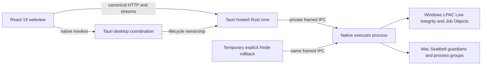

# JudgeDesk Rust core — migration architecture and overview

> Revised proposal: 2026-10-01. Adoption outstanding. This overview is planning, not implementation evidence.
> **2026-10-15 Synchronized Checkpoint (`HEAD = 488703a` + working tree):** Eight application version files are synchronized at **`1.5.5`** (`npm run release:check-version` PASS); `crates/judgedesk-core/Cargo.toml` remains at **`1.5.1`**;historical planning baseline was `1.5.0`/`1.5.1`; intended coordinated Pure-Rust Core cutover release remains **`1.6.0`** in `WP10.3`.
> 2026-10-02 limited adoption: Mon directly authorized N0; only N0 → WP0.6 ordering is adopted. N0 (`candidate06`) and WP0.6 remain `IN_PROGRESS` in [`STATUS.md`](verification/pure-rust-core/STATUS.md); other graph changes remain proposed. Working-tree Phase A (`Bước 1–5`) implementation and remaining gaps are recorded in [`docs/reports/pure-rust-core-progress-2026-10-14.md`](reports/pure-rust-core-progress-2026-10-14.md) and [`docs/pure-rust-core-next-steps-audit.md`](pure-rust-core-next-steps-audit.md).

Replace the Node SEA backend while preserving JudgeDesk's offline teacher/contest workflow, six languages, strict OS sandbox, exact verdict/score/rank, existing frontend contracts and Windows x64/macOS arm64 support. Keep Node default until approved cutover. Rollback and stabilization are product milestones; Node removal is a later separately approved milestone.

The [detailed plan](pure-rust-core-detailed-implementation-plan.md), [audit](verification/pure-rust-core/plan-rewrite-audit-20261001.md), [proposed mapped ledger](verification/pure-rust-core/proposed-ledger-20261001.md) and [DAG](verification/pure-rust-core/proposed-roadmap-20261001.json) supersede the original four-stage ordering as a **proposal**. [STATUS](verification/pure-rust-core/STATUS.md) retains actual implementation states; [WORKLOG](verification/pure-rust-core/WORKLOG.md) remains append-only.

## Target architecture

The four responsibility/trust tiers remain: frontend, desktop shell, backend orchestration, OS execution. Rust core embedding changes deployment, not permission to execute untrusted code in Tauri. [Accepted ADR 0001](adr/0001-rust-core-executor-boundary.md) selects the separate executor, existing framed-v1 protocol, generation/owner lease and native drain. Backend alternatives are exclusive per generation; no automatic fallback or public executor TCP service.

React uses current `/api/batch-judge` and cancel contracts, NDJSON events `metadata`, `progress`, `problem_completed`, `done`, `error` in captured Node order. OSD has its own stream contract. Stale prose endpoints/events, fixed port 3000, in-process executor alternatives and diagnostic-only success are not implementation instructions.

## Current reality (2026-10-15) & Historical checkpoint (2026-10-01/02)

- **Formal WP Ledger State (2026-10-15):** WP0.1–WP0.5 accepted foundations are retained. N0 is `IN_PROGRESS` (`candidate06`: Mac native interactive dual launch and R1/R2 OLE mapping repaired; 1024 MiB aggregate budget and logger-failure worker receipt/two-workspace items remain open); WP0.6 is `IN_PROGRESS` with source edits suspended and independent acceptance `NOT_RUN`. WP5.4 is `NOT_READY`; no phase gate is `DONE`. Current full gate is fast → Rust → server → static checker parity → version.
- **Observed Working-Tree Implementation (`crates/judgedesk-core` Phase A — Bước 1–5, 2026-10-14/15):** `crates/judgedesk-core` now decomposes `server/` into `auth`, `dto`, `os_integration`, `state`, and `routes/*`; enforces `DesktopApiBoundary` (`X-JudgeDesk-Session`, loopback `Host`, allowlisted `Origin`); uses `OwnedWorkspace` (`storage.rs`) and non-interpolated native directory/workbook openers; eliminates direct host `Command` spawns from `compiler.rs` and `runner.rs` (running all 6 languages, custom checkers, and interactive sessions through `ExecutorClient`); provides arbitrary-precision `BigUint` rationals; and returns truthful `501 Not Implemented` for unimplemented `/api/osd/*` and `/api/toolchains/prewarm` routes (`132/132` tests on Windows x64, `133/133` tests on macOS arm64 — see [`docs/reports/pure-rust-core-progress-2026-10-14.md`](reports/pure-rust-core-progress-2026-10-14.md)). Remaining gaps against Node `v1.5.5` (`ProblemCompileConfig`, end-to-end exact rational multipliers + `totalScore` scaling + `JE` zero-score, per-`jobId` cancel ownership, `FreezeRequired` production wiring, real `rescan`/install/certify, Universal PCH/prewarm, and OSD daemon) are detailed in [`docs/pure-rust-core-next-steps-audit.md`](pure-rust-core-next-steps-audit.md).
- **Historical Checkpoint Snapshot (2026-10-01/02):** The historical [WP0.6 diagnostic checkpoint](verification/pure-rust-core/artifacts/wp0.6/remediator-log0091-continuation-codex-20261001/remediation.md) recorded Windows 706/696 pass/0 fail/10 existing skips, Mac 706/697 pass/1 fail/8 existing skips (where Mac failed on the unchanged interactor AC oracle before N0 implemented Mac dual launch). At the time of the 2026-10-01 source inspection (prior to Phase A `Bước 1–5`), `crates/judgedesk-core` still had permissive HTTP/folder scripting, direct compiler/checker execution, incomplete source persistence/adapters/jobs/config/stream/OSD, and `i64`/`f64` approximate rational paths. Accepted executor/Node rational repairs must be reused; inspection or working-tree test PASS is not formal independent WP acceptance.

## Proposed product stages

| Stage | Contribution and completion evidence |
|---|---|
| 0 | Preserve accepted foundations; N0 repairs existing native Mac interactive baseline; separately accept WP0.6 identity; decompose once; independently close G0 |
| 1 | Supervised explicit backend, HTTP auth/origin/input, native dialogs, owned paths, truthful unavailable state, logs; exact scoring/checker primitives and early strict comparison harness |
| 2 | Revisioned preferences, signed receipts, bounded atomic install/uninstall/recovery, exact source resolver/Mac driver qualification and normalized exact config |
| 3 | N1 closes identified native strict runtime/role capabilities; one protected compiler, pinned leases, six real adapters and one contained custom-checker runner; G3 accepts components |
| 4 | Actual batch admission/IDs/tombstones, cancellation/native drain, frontend-compatible streams, complete metadata/workbook; G4 proves all six languages through real batch |
| 5 | Exact custom/testlib/Themis semantics and complete Rust interactive integration using accepted native baseline; G5 proves full judge semantics |
| 6 | Durable OSD parser/watcher/queue/events, workspace/config/Reload and archive/export/update ownership; every required product route works |
| 7 | Comparable baseline before PCH; exact cache identity/single-flight/atomic generation/safe same-compiler consumption/cancellable prewarm; measured budgets on both hosts |
| 8 | Final 100% Node/Rust corpus/API/event/disk/lifecycle parity with zero unexplained mismatches; early harness acceptance cannot discharge G8 |
| 9 | Verified Rust-only Windows launcher, full GUI matrix, live Mac platform/package checks and actual Mac GUI checklist; SSH cannot prove WKWebView/dialog/focus/install UX |
| 10 | Explicit readiness/cutover, eight-file 1.6.0 bump, actual release-candidate gates, separately authorized publication/rollout, stabilization/rollback then separately authorized Node decommission/G10 |

N0 is the directly authorized upstream native repair. It preserves the unchanged AC oracle and has separate independent safety acceptance before identity resumes. N0 and WP0.6 retain separate verification rounds and claims. A passing native AC case does not provide Rust job/event/exact-score integration or WP5.4 acceptance.

The direct N0 dispatch already superseded the earlier deferral for its bounded scope and adopted only the prerequisite ordering. Continue through the [current N0 handoff guide](pure-rust-core-antigravity-handoff.md) and [incident clarification](verification/pure-rust-core/n0-plan-conflict-resolution-20261002.md), without repeating that approval. Public framed IPC/sandbox authority stay fixed; required coordinated private native launcher/control/stdio changes belong to bounded N0. Guarded source work may proceed while concrete protected recovery is prepared, but unresolved preservation prevents VERIFYING. Other graph changes remain proposed; historical within-WP0.6/draft alternatives grant no scope or verdict.

## Invariants and release

No unapproved dependencies, skipped/deleted/weakened tests, suppressions, fake metrics/success, new compiler fallback, float score/rank math or sandbox relaxation. Compiler execution handling untrusted source is bounded/protected; trusted discovery is separately argument-safe/timeout-bounded. ResourceOnly is not zero-network/filesystem security for untrusted roles. Preserve all supported profile/source/role/platform rows, managed Python semantics and experimental profile hiding.

Benchmarks use comparable actual packaged inputs/hardware/toolchain/flags/SDK/cache states, >=3 warmups and >=20 measured samples, raw distributions/failures/noise. Retain PRD idle <150 MB, per-case overhead <50 ms and warm PCH compile <300 ms. Startup target/measurement interpretation needs adoption before optimization; no historical best sample proves a budget.

Milestone A: Rust default plus explicit packaged Node rollback, tested install/upgrade and bidirectional data compatibility. Minimum stabilization interval/releases and exit owner are agreed before cutover. Milestone B: separately remove complete Node backend/runtime/SEA/sidecar-only footprint, preserve historical regression oracles and frontend/build TypeScript, rebuild Core/Full on both hosts and validate installer-level rollback. Native Scratch runtime packaging is explicitly classified rather than silently deleting a required language runtime.

Release signing/install/update/anonymous updater/public asset integrity require actual artifact evidence. Publication/tags/uploads/keys are separate direct human authority. Eight app files are currently synchronized at `1.5.5` (following user-authorized `v1.5.2`–`v1.5.5` updates) and bump to `1.6.0` in `WP10.3`; the `crates/judgedesk-core` crate version (`1.5.1`) never becomes a ninth app authority without an approved policy change.

## Historical material preserved

The original authored overview is preserved byte-for-byte as [before-image](verification/pure-rust-core/artifacts/plan-rewrite-20261001/before-pure-rust-core-migration-plan.md). Its claimed Stage 1 “100% completed,” per-language Windows samples (494/162/46/436 ms compile and reported runtime/RAM), scoreboard bug narrative, Java/Pascal DLL/ResourceOnly and JDK cache/thread history remain historical claims/context. They are not current full-platform acceptance or permission to use ResourceOnly for untrusted work. No historical verdict/log was rewritten.

The old 10 s/50 MB compile recommendation is replaced by captured current Node 15 s/32 MiB submission and 60 s checker contracts. Old concurrent parity and early PCH order are superseded by sequential isolated parity and benchmark-after-correctness. Historical CLI/model/flag recommendations are retained in before-images only; use verified locally installed capabilities under direct authorization.
