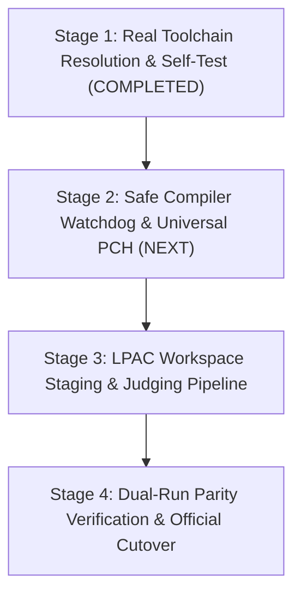

# JudgeDesk Pure Rust Native Core — Master Migration Architecture & Handover Plan

> **Author:** Antigravity (Google DeepMind)  
> **Audience:** Codex, Future AI Coding Agents & System Engineers  
> **Target System:** JudgeDesk (Competitive Programming & Contest Evaluation Desktop App)  
> **Released Baseline:** v1.5.0
> **Next Release Target:** v1.6.0
> **Version Policy:** Keep all eight authoritative version files at `1.5.0` during implementation; bump all eight together to `1.6.0` only at the final release-candidate gate.
> **Authoritative Specifications:** [`guidelines.md`](../guidelines.md), [`CONSTRAINTS.md`](../CONSTRAINTS.md)  
> **Repository Location:** `d:\Minh\Code\judgedesk`

---

## 1. Executive Summary & Mission Statement

JudgeDesk is currently transitioning from a 4-tier desktop architecture to a 3-tier **Pure Rust Native Core** integrated directly into the Tauri desktop executable:

### Architecture Evolution
```
[CURRENT 4-TIER ARCHITECTURE]
React 18 Frontend  ──(HTTP / NDJSON)──>  Node.js SEA Sidecar (server.exe)  ──(Win32 Pipe IPC)──>  Rust Native Executor (LPAC)
    └─ Port 3000 Loopback                     └─ Express + Node 24 V8 runtime                           └─ Windows Job Object + Low Integrity

                                                   ▼ MIGRATION IN PROGRESS

[TARGET 3-TIER PURE RUST ARCHITECTURE]
React 18 Frontend  ──(HTTP / NDJSON)──>  Tauri App + Embedded Axum Core  ──(In-process / Pipe)──>  Rust Native Executor (LPAC)
    └─ Port 3000 Loopback                     └─ crates/judgedesk-core (Rust 2021)                     └─ Zero Node.js runtime footprint
```

### Core Mandate: Zero Compromises, 100% Parity
- **NO Feature Loss**: Every feature (Contest management, Scoreboard, Real-time judging, Custom testlib checkers, Interactors, Scratch testing, Toolchain management, Auto-detection) MUST function identically.
- **NO UI Redesign / Tampering**: The React frontend must not be rewritten or regressed. All `/api/*` REST endpoints and NDJSON/SSE Server-Sent Events contracts must remain byte-compatible.
- **NO Quality Degradation**: Strictly respect `CONSTRAINTS.md` (zero `@ts-ignore`, zero fake stubs/mocks, rational scoring without float drift, fail-closed sandboxing).
- **Strangler Fig Pattern**: The production Node.js SEA backend (`server.exe`) remains the default runtime until dual-run parity is 100% proven across all 98 test suites. The Rust Core is toggled via `$env:JUDGEDESK_PURE_RUST_CORE="1"`.

---

## 2. Architectural Motivation ("The Why")

1. **Intellectual Property Protection & Anti-Tamper Hardening**:
   - The Node.js SEA (Single Executable Application) sidecar packages JavaScript source code into a V8 bundle snapshot inside a PE binary. Anyone with standard reverse-engineering tools (`sea-extract`, `un-sea`, `v8-decompiler`) can unpack the entire source code in seconds.
   - Transitioning the core to Rust compiles all business logic, evaluation rules, and security controls into native x86-64 machine code (`.exe` on Windows, Mach-O on macOS), completely eliminating script extraction vulnerabilities.
2. **Drastic Resource Footprint Reduction**:
   - The Node.js V8 runtime + Express server consumes ~250MB+ of idle RAM on student machines.
   - The embedded Pure Rust Native Core (`axum` + `tokio`) operates within ~20–35MB of RAM, leaving maximum physical memory available for contestant solutions.
3. **IPC Latency Elimination & Sub-Second Boot**:
   - Eliminates cross-process stdin/stdout pipe serialization between Tauri and Node.js.
   - Server boots instantly (<50ms vs ~2.5s for Node.js cold boot).
4. **Process Reliability & Lifecycle Safety**:
   - Prevents orphaned Node.js background processes (`server.exe`) that hold socket ports (`3000`) or file locks after unexpected desktop crashes.

---

## 3. Core Architectural Invariants (Non-Negotiable)

Every agent (including Codex) working on this codebase MUST uphold these non-negotiable invariants:

| Invariant | Description | Enforcement Mechanism |
| :--- | :--- | :--- |
| **1. Frontend Zero-Regression** | React components and hooks (`useJudgeSession.ts`, `useContest.ts`, etc.) must not undergo breaking changes. Rust Axum server reproduces identical JSON responses and streaming events. | TypeScript compile (`tsc --noEmit`), React test suites, UI tests. |
| **2. Rational Scoring Engine** | Never use IEEE 754 floating-point math (`f32`/`f64`) for scoring, fractions, or rankings. Exact rational fraction reduction (`rational.rs`) avoids precision drift. | `crates/judgedesk-core/tests/rational_test.rs`, `scoring_test.rs`. |
| **3. Fail-Closed OS Sandbox** | Untrusted code executes in zero-network Windows AppContainer (LPAC) + Low Integrity Job Objects, or macOS Seatbelt. Never weaken or bypass sandbox flags. | `native-executor/src/platform/windows.rs`, `native-executor/tests`. |
| **4. Zero-Tolerance Quality Floor** | Zero `@ts-ignore`, pure ESM import extensions (`.js`), no fake stubs/mocks, no deleted/skipped tests. | `node scripts/check-quality-gate.js`, `npm run check:fast`. |
| **5. 8-File Version Lockstep** | `v1.5.0` is the released baseline and all eight version files intentionally remain synchronized at `1.5.0` during migration. The work targets `v1.6.0`; bump all eight together only at the final release-candidate gate. Never bump one in isolation. | `npm run release:check-version`. |
| **6. Strangler Fig Coexistence** | Node.js SEA backend remains the default desktop runner until Phase 4 cutover. Rust Core is activated via `JUDGEDESK_PURE_RUST_CORE=1`. | `src-tauri/src/backend.rs`. |

---

## 4. Historical Diagnostics & Solved Bugs (Context for Codex)

During the current engineering session, multiple critical bugs across UI, Sandbox, and Runtimes were isolated, root-caused, and resolved. Codex must review these to prevent regressions:

### Bug A: Scoreboard Layout Thrashing & 60 FPS Jitter
- **Symptom**: With 18 contestants and 5 problems, the entire scoreboard shook violently at 60 FPS. Resizing made it worse.
- **Root Cause**: A bistable layout oscillation loop. Fractional column widths in Chromium WebView2 (`availableWidth / 5 = 185.6px`) rounded up by 1–2px, causing horizontal overflow. The horizontal scrollbar took 17px vertical height, clipping row 18, which spawned a vertical scrollbar. The vertical scrollbar shrank width, causing `ResizeObserver` on the scroll container to trigger React re-renders. At $N = 18$, the 1px row height formula flipped between 30px and 31px ($18 \times 1\text{px} = 18\text{px} > 17\text{px}$), creating an infinite loop.
- **Solution in [`Scoreboard.tsx`](file:///d:/Minh/Code/judgedesk/src/features/scoreboard/Scoreboard.tsx)**:
  1. Decoupled `ResizeObserver` from the scroll viewport to the outer `<main>` container (`overflow: hidden`).
  2. Enforced constant row height `ROW_HEIGHT = 34px`.
  3. Replaced fixed pixel table width with native responsive `width: 100%` (`w-full`) when problems fit, letting Chromium's fixed layout engine distribute columns subpixel-accurately without overflow.
  4. Truncated contestant names to single-line with tooltips.

### Bug B: Hardcoded Mock Metrics (`25ms, 2ms, 1024KB`) in Self-Test
- **Symptom**: User clicked Self-Test in Compilers & Runtimes Manager; all languages reported identical static numbers (`25ms compile, 2ms exec, 1024KB RAM`).
- **Root Cause**: A previous prototype had flipped the default backend to an incomplete Rust core that contained hardcoded mock JSON stubs in `crates/judgedesk-core/src/server/mod.rs`.
- **Solution**: Restored Node.js SEA as default in `backend.rs` (under Strangler Fig pattern), then engineered the genuine compilation and sandbox execution pipeline in `judgedesk-core`.

### Bug C: Free Pascal & Java Windows `STATUS_DLL_INIT_FAILED (0xC0000142)`
- **Symptom**: Pascal and Java probe executions failed in sandbox with exit code `-1073741502` (`0xC0000142`).
- **Root Cause**:
  1. Free Pascal RTL (`ppcx64.exe`) imports `CharUpperBuffW` from `user32.dll`.
  2. OpenJDK 21 (`jvm.dll`) imports `user32.dll`, `ws2_32.dll`, `powrprof.dll`.
  3. Windows AppContainer without Desktop Window Station UI capabilities terminates any process loading `user32.dll` with `STATUS_DLL_INIT_FAILED`.
  4. Furthermore, Windows kernel treats any executable located inside `AppData\Local\Packages\<package>\AC\` as an AppContainer binary, failing `user32.dll`'s `DllMain` even if launched without AppContainer security capabilities!
- **Solution**:
  1. Configured Pascal and Java to execute with `LocalToolchainIsolation::ResourceOnly` (Low Integrity + Windows Job Object resource limits, identical to Scratch).
  2. Relocated `executor_root` in [`native-executor/src/platform/windows.rs`](file:///d:/Minh/Code/judgedesk/native-executor/src/platform/windows.rs) from the virtualized `profile_root.join("LocalState")` (`\Packages\...\AC\LocalState`) to `%LOCALAPPDATA%\JudgeDesk\JudgeDeskExecutor`.

### Bug D: Temurin JDK 21 Build Metadata (`+`) in Cache ID
- **Symptom**: Java diagnostic failed with `"Sandbox validation error: toolchain cache ID contains invalid characters"`.
- **Root Cause**: Temurin JDK version string was `21.0.12+8`. The `+` character was rejected by `validate_toolchain_id` (which allows only `[a-z0-9._-]`).
- **Solution**: Created `managed_cache_id` in [`discovery.rs`](file:///d:/Minh/Code/judgedesk/crates/judgedesk-core/src/toolchains/discovery.rs) sanitizing non-alphanumeric characters to `_` (`temurin21-windows-x64_21.0.12_8`), matching `server/executor/workspace.ts`.

### Bug E: JVM `ThreadLimit` Termination
- **Symptom**: Java diagnostic killed with `ThreadLimit` (exit code `1245970434` / `0x4A440002`).
- **Root Cause**: OpenJDK 21 creates ~18–24 internal VM threads (GC, JIT compiler, Signal Dispatcher, Finalizer). The diagnostic limit was set to 16 threads.
- **Solution**: Raised `thread_count` to `64` for Java in `diagnostics.rs` (matching `server/executor/protocol.ts`).

---

## 5. Four-Stage Master Roadmap & Implementation Guide



---

### [COMPLETED] Stage 1: Real Toolchain Resolution & Genuine Self-Test Pipeline

- **Goal**: Eliminate all mock metrics; implement automated toolchain discovery and sandbox execution across all 6 languages.
- **Status**: **100% Completed & Verified**.
- **Delivered Files**:
  - [`crates/judgedesk-core/src/toolchains/discovery.rs`](file:///d:/Minh/Code/judgedesk/crates/judgedesk-core/src/toolchains/discovery.rs): Automated discovery in `%LOCALAPPDATA%\ThemisV2\toolchains` and system paths.
  - [`crates/judgedesk-core/src/toolchains/diagnostics.rs`](file:///d:/Minh/Code/judgedesk/crates/judgedesk-core/src/toolchains/diagnostics.rs): Real compile and sandbox execution measuring real wall-time, compile time, and peak memory.
  - [`crates/judgedesk-core/tests/toolchain_diagnose_test.rs`](file:///d:/Minh/Code/judgedesk/crates/judgedesk-core/tests/toolchain_diagnose_test.rs): Sequential test suite validating all 6 profiles.
- **Verified Metrics**:
  - C++: Compile 494ms, Exec 40ms, RAM 1808KB
  - C: Compile 162ms, Exec 39ms, RAM 1696KB
  - Python: Exec 79ms, RAM 7620KB
  - Pascal: Compile 46ms, Exec 37ms, RAM 2208KB
  - Java: Compile 436ms, Exec 132ms, RAM 95528KB
  - Scratch: Exec 175ms, RAM 60132KB

---

### [NEXT UP] Stage 2: Safe Compiler Watchdog & Universal PCH

- **Goal**: Bring instant C++ compilation (100–150ms) and asynchronous compiler timeout safety to the Rust Core.

#### 2.1. Universal PCH Engine (`crates/judgedesk-core/src/toolchains/pch.rs`)
- **Background**: Standard `<bits/stdc++.h>` in GCC requires parsing >100,000 lines of C++ standard headers on every compilation, taking 500ms–1500ms.
- **Implementation**:
  1. On toolchain initialization or background startup, compile `<bits/stdc++.h>` into `stdc++.h.gch` using the exact compiler flags (`-O2 -std=c++14 -static`).
  2. Store the `.gch` file in a protected directory inside `toolchains/pch/<compiler_hash>/`.
  3. When compiling C++ submissions, automatically inject `-include bits/stdc++.h` (or `-I<pch_dir>`) to utilize the precompiled header.
  4. Benchmark: Compilation time drops from ~500ms down to ~120ms.
  5. Fallback: If PCH generation fails or flags mismatch, cleanly fall back to direct header compilation without failing the submission.

#### 2.2. Async Compiler Watchdog (`crates/judgedesk-core/src/engine/compiler.rs`)
- **Problem**: Untrusted submissions can use C++ template bombs (e.g. recursive template instantiation) or infinite macros to hang the compiler indefinitely or exhaust disk space.
- **Implementation**:
  1. Spawn compiler asynchronously via `tokio::process::Command`.
  2. Enforce strict compilation timeout (10,000ms wall-clock) using `tokio::time::timeout`.
  3. If timeout expires, forcefully terminate the compiler process tree and return `CompilationError("Compilation timed out after 10.0s")`.
  4. Enforce binary size guard: Cap compiled output file at 50MB. If exceeded, delete executable and return compilation error.
  5. Atomic cleanup: Compilation artifacts staged in temporary workspace folders must be cleaned up on failure.

---

### Stage 3: LPAC Workspace Staging & Judging Pipeline

- **Goal**: Port the full judging loop and real-time streaming from Node.js `server/judge/session.ts` to Rust Core without hanging at `initializing`.

#### 3.1. Windows LPAC Staging & ACLs (`crates/judgedesk-core/src/engine/workspace.rs`)
- Prepare workspace folders with appropriate access rights.
- Ensure executable binaries and test input files inside `workspaces/<workspace_id>` are accessible by the sandbox worker (`ALL APPLICATION PACKAGES` / capability SIDs) without triggering `Access is denied (os error 5)`.

#### 3.2. Real-Time NDJSON / SSE Streaming (`crates/judgedesk-core/src/server/judge_session.rs`)
- Port `/api/judge/session` SSE endpoint.
- Emit real-time events matching `src/features/judging/useJudgeSession.ts`:
  - `metadata`: Total problems, contestants, testcases.
  - `progress`: Current contestant, current problem, test index, percentage.
  - `problem_completed`: Rational score for the problem, testcase verdicts.
  - `completed`: Batch evaluation finished, final scoreboard ready.
  - `error`: Diagnostic error on failure.

#### 3.3. Checkers & Interactors (`crates/judgedesk-core/src/checkers/`)
- Standard built-in checkers (C1: token, C2: integer, C3: precision float, C4: line, C5: yes/no, Polygon format).
- Custom testlib checkers (`checker.cpp` compiled into `checker.exe` and executed in sandbox).
- Interactive problems (two-way named pipe communication between submission and interactor).

---

### Stage 4: Dual-Run Parity Verification & Official Cutover

- **Goal**: Certify 100% equivalence before making Rust Core the default engine.

#### 4.1. Automated Dual-Run Parity Test Suite
- Develop integration harness (`scripts/dual-run-parity.js` or `crates/judgedesk-core/tests/dual_run_parity.rs`).
- Feed sample contest workloads (diverse submissions: AC, WA, TLE, MLE, CE, Presentation Error, Interactive).
- Execute concurrently against Node.js backend (Port 3000) and Rust Core (Port 3001).
- Assert 100% exact match on:
  - Every testcase verdict.
  - Exact rational points accumulated (zero floating-point drift).
  - Scoreboard rank ordering.

#### 4.2. Official Desktop Cutover
- In `src-tauri/src/backend.rs`, flip `use_pure_rust = true` as the default.
- Retain fallback `JUDGEDESK_LEGACY_NODE=1` flag for emergency rollback.
- Validate release packaging with `npm run release:check-version` and complete gate `npm run check:full`.

---

## 6. Verification & Testing Protocols (For Codex & Computer Use)

### A. Automated CLI Verification Commands
Execute these commands in Windows PowerShell:

```powershell
# 1. Fast Quality Gate (TypeScript types & invariant gate ~3s)
npm run check:fast

# 2. Rust Native Executor Tests (All 54 tests must pass)
cargo test --locked --manifest-path native-executor/Cargo.toml -- --test-threads=1

# 3. Rust Native Core Tests (All 36 tests must pass)
cargo test --manifest-path crates/judgedesk-core/Cargo.toml

# 4. Tauri Desktop Shell Tests (All 14 tests must pass)
cargo test --manifest-path src-tauri/Cargo.toml

# 5. Full Node.js Baseline Server Tests (All 542 tests must pass)
node scripts/run-all-tests.js

# 6. Version Lockstep Check (expect v1.5.0 during implementation; v1.6.0 only after the final coordinated bump)
npm run release:check-version
```

### B. Manual & Computer Use GUI Verification Protocol
To verify the desktop application visually or via Computer Use:

1. **Launch Desktop App with Pure Rust Core**:
   ```powershell
   $env:JUDGEDESK_PURE_RUST_CORE="1"
   npm run test:desktop
   ```
2. **Verify Compilers & Runtimes Manager**:
   - Navigate to Settings $\to$ **Compilers & Runtimes**.
   - Confirm all 6 languages are present: C++, C, Python, Pascal, Java, Scratch.
   - Click **Self-Test** on each language:
     - Verify green badge: `Operating normally`.
     - Verify dynamic metrics (e.g. C++: ~400ms compile, ~30ms exec, ~1800KB RAM; Java: ~400ms compile, ~130ms exec, ~95MB RAM).
     - Ensure NO mock static numbers (`25ms, 2ms, 1024KB`) appear.
3. **Verify Scoreboard Render Stability**:
   - Load a contest with multiple contestants (e.g. 18 or 72) and problems (5 or 20).
   - Resize window horizontally and vertically.
   - Confirm zero layout oscillation or continuous re-rendering.
4. **Verify Problem Configuration Modal**:
   - Open configuration for a problem.
   - Confirm total score input matches the exact rational sum of test points below.
   - Edit a test point, click **Save**, re-open to confirm persistence.

---

## 7. Key File Map & Code Locations

```
judgedesk/
├── crates/
│   └── judgedesk-core/               <-- Pure Rust Native Core crate
│       ├── Cargo.toml
│       ├── src/
│       │   ├── lib.rs
│       │   ├── rational.rs          <-- Rational fraction scoring math
│       │   ├── server/              <-- Embedded Axum server & SSE endpoints
│       │   │   └── mod.rs
│       │   ├── toolchains/          <-- Toolchain management & diagnostics
│       │   │   ├── discovery.rs     <-- Auto-detection & managed package imports
│       │   │   └── diagnostics.rs   <-- Genuine compile & sandbox self-test
│       │   ├── engine/              <-- Judging execution & runner
│       │   └── checkers/            <-- Built-in standard checkers
│       └── tests/
│           ├── toolchain_diagnose_test.rs  <-- Sequential all-language diagnostic test
│           ├── engine_execution_test.rs
│           ├── rational_test.rs
│           └── scoring_test.rs
├── native-executor/                  <-- OS Sandbox runner (LPAC / Low Integrity / Seatbelt)
│   ├── Cargo.toml
│   └── src/
│       ├── lib.rs
│       ├── protocol.rs              <-- RunSpec, RunLimits, LocalToolchainIsolation
│       ├── request_validation.rs    <-- Security validation of run requests
│       └── platform/
│           ├── windows.rs           <-- Windows AppContainer, LPAC, Job Objects
│           └── macos.rs             <-- macOS Seatbelt profiles
├── src-tauri/
│   ├── src/
│   │   ├── main.rs                  <-- Tauri entrypoint
│   │   └── backend.rs               <-- Sidecar spawner & Pure Rust Core toggle
├── server/                           <-- Node.js SEA sidecar (Ground Truth Baseline)
│   ├── judge/                       <-- Judging logic & rational scoring
│   ├── executor/                    <-- Pipe IPC client to native-executor
│   └── toolchains/                  <-- Node toolchain manager & self-test
└── src/                              <-- React 18 UI Frontend
    ├── App.tsx
    ├── features/
    │   ├── scoreboard/              <-- Scoreboard grid & layout
    │   ├── judging/                 <-- Batch judging & SSE progress hook
    │   └── toolchains/              <-- Compilers & Runtimes Manager UI
```

---

*This document represents the definitive architecture and handover specification for JudgeDesk's Pure Rust Native Core migration. Codex and future agents should execute subsequent stages in order without deviating from the prime invariants.*
