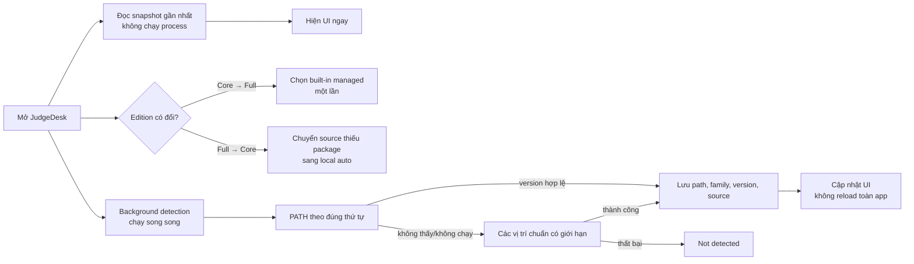

# JudgeDesk v1.3.1 — Toolchains, Help và khả năng portable

Trạng thái: **đã chốt quyết định 1–5; đã hoàn tất triển khai và nghiệm thu local trên Windows x64 cùng macOS ARM64**
Ngày khảo sát: 2026-08-02
Baseline: `judgedesk/release-v1.3.0` tại `96cb6e0`

## 1. Mục tiêu

1. Full mở lần đầu, hoặc ngay sau khi thay Core bằng Full, phải dùng ngay toàn bộ toolchain đi kèm mà không cần vào Manage Toolchains.
2. Core phát hiện nhanh toolchain đang có trên máy: ưu tiên thứ tự trong `PATH`, đọc version/vị trí; chỉ tìm các vị trí chuẩn khi `PATH` không có kết quả; nếu vẫn không có mới báo `Not detected`.
3. Việc phát hiện chạy nền mỗi lần mở app, không chặn cửa sổ hay API trạng thái, và không yêu cầu người dùng `Verify`/`Freeze`.
4. Thêm `Hướng dẫn / Help` ngay bên trái nút updater; Help và thông tin sản phẩm nằm trong cùng một nơi, hoạt động offline.
5. Cho phép chọn preset hoặc tự nhập tham số biên dịch **theo từng bài**, lưu trong `Config.cfg`, đồng thời giữ khả năng chấm lại contest cũ.
6. Audit khả năng chuyển sang artefact portable Full/Core trong một phiên bản sau; v1.3.1 vẫn chỉ hỗ trợ installer.

Không sửa hoặc phát hành lại tag/artefact v1.3.0 đã công bố. Thay đổi này thuộc nhánh và version mới `v1.3.1`.

## 2. Kết quả audit đã xác minh

### 2.1 Core: “detected” và “submission ready” đang là hai việc khác nhau

- Core mới mặc định C++, C và Python là `local_auto`; Pascal và Java là `none` (`server/languages/registry.ts`, `server/toolchains/storage.ts`).
- Discovery hiện gom candidate từ `PATH` và vị trí chuẩn, sau đó lưu snapshot; nó không chạy version command trong lúc scan và không scan lại mỗi lần mở. Resolver từ chối `local_auto` nếu có nhiều hơn một candidate thay vì ưu tiên thứ tự `PATH` (`server/toolchains/discovery.ts:191-309`, `server/toolchains/resolver.ts:895-934`).
- Máy thử hiện có 2 C++, 2 C và 3 Python. Vì vậy nhánh `AUTO_DETECT_AMBIGUOUS` là có thật, không chỉ là giả thuyết.
- Local Python chỉ được dùng khi là managed; Windows C/Pascal/Java local cũng bị `managed_only`; Windows C++ local bắt buộc certificate/snapshot (`server/toolchains/resolver.ts:350-399,1012-1094`).
- Nút `Verify and use` vẫn xuất hiện cho profile mà verify không thể làm ready. Đây là lỗi UX. Chỉ đổi nhãn/status mà không đổi preflight/compiler sẽ tạo trạng thái `Ready` giả.

### 2.2 Vì sao Freeze lâu rồi có vẻ không làm gì

- Certification sao chép toàn bộ compiler root trước khi hoàn tất identity/target checks (`server/toolchains/certification.ts:395-429`).
- Trên máy thử, Themis GCC có khoảng 2.075 file/301 MiB; MSYS2 UCRT64 có khoảng 33.188 file/922 MiB.
- Themis GCC 9.2 được discovery nhìn thấy nhưng certificate cố ý loại vì target 32-bit `mingw32`; policy chỉ chấp nhận GNU 14.2/16.1 target `x86_64-w64-mingw32` (`server/toolchains/certification.ts:43-49,172-182`).
- UI chỉ hiện spinner, sau lỗi thì fetch lại state cũ. Do đó người dùng chờ copy lớn rồi thấy không thay đổi (`src/features/toolchains/useToolchains.ts:342-353`).

### 2.3 Full: fresh install hiện đúng, Core → Full/upgrade còn sai với trải nghiệm mong muốn

- Source hiện có logic chọn mọi stable built-in package thành `managed` khi **không có preferences** (`server/toolchains/storage.ts:100-118`). Test fresh Full cũng xác nhận hành vi này.
- Bản Full đang cài trên máy chứa đủ GCC, Python, FPC và Temurin; API live hiện báo 5/5 profile `managed + submission_ready + built-in`.
- Tuy nhiên, Core và Full dùng chung app data. Khi Full thay Core hoặc nâng cấp từ cấu hình cũ, storage cố tình giữ `none/local_auto/local_path`, chỉ thêm profile bị thiếu và sửa một fingerprint RC rất hẹp (`server/toolchains/storage.ts:121-217,288-346`). Test hiện còn khóa hành vi “Full upgrade giữ lựa chọn cũ” (`server/toolchains/storage-v2.test.ts:98-138`).
- Vì vậy không nên kết luận fresh Full luôn lỗi. Lỗi chắc chắn nằm ở migration/transition; đây cũng khớp nhất với quy trình cài Core rồi Full trên cùng máy.

### 2.4 Khoảng 10 giây

- Managed Full không checksum toàn bộ package mỗi lần mở. Receipt-backed package dùng descriptor và component closure nhỏ, không launch từng compiler (`server/toolchains/resolver.ts:276-309`). API live sau warm-up mất khoảng 68–119 ms.
- Nhánh local chạy `execFileSync` với timeout 2 giây và có thể resolve lặp ở `/api/status` lẫn `/api/toolchains`; backend còn đợi secure-runner self-test trước khi listen (`server/toolchains/resolver.ts:86-125`, `server/platform/host-status.ts:15-23`, `server.ts:23-30`). Antivirus/cold process start hoặc timeout có thể cộng dồn gần 10 giây.
- Đây là giả thuyết có bằng chứng code, chưa phải benchmark cold-start đã tái hiện. Cần đo riêng window-visible, server-ready, cached-state và background-detection trước/sau thay đổi.

### 2.5 Baseline test

Đã chạy read-only các test storage/discovery/resolver/routes trên source hiện tại: 39/39 pass. Audit mở rộng thêm profile state đạt 41/41. Điều này cho thấy phần lớn hành vi đang gặp là policy được test khóa lại, không phải lỗi ngẫu nhiên.

## 3. Những gì nên học từ Themis

Tài liệu cục bộ `C:\Users\mon\Downloads\themis.html` và [blog chính thức của Themis](https://dsapblog.wordpress.com/2013/12/24/themis/) cho thấy:

- Full gồm compiler/runtime **và cấu hình sẵn**; Mini không có compiler và cho người dùng tự cấu hình.
- Có bản SFX/mini-SFX để bung ra chạy khi không có quyền administrator.
- Hướng dẫn nằm ngay trong ứng dụng; có mục Help chung và nút Help theo ngữ cảnh.
- “Online” của Themis chủ yếu dùng thư mục nhận bài (OSD); web interface là một chương trình Node tách rời.

JudgeDesk nên sao chép kết quả trải nghiệm, không sao chép nguyên kỹ thuật cũ:

- **Nên áp dụng:** Full mở lên chấm được; Core detect/manual override đơn giản; Help offline + deep-link theo màn hình. Portable archive và OSD bridge chỉ là hướng phát triển sau v1.3.1.
- **Không nên sao chép:** compiler/JDK/Python cũ, security model Windows XP/NTFS, flags 2011–2012, nội dung/logo/screenshot không có license rõ ràng, hoặc phụ thuộc trực tiếp vào [Themis Web Interface](https://github.com/natsukagami/themis-web-interface) đã archived.
- Themis không có bằng chứng chạy `g++ --version`/PATH scan mỗi startup. Đây là cải tiến riêng của JudgeDesk, không nên mô tả như hành vi của Themis.
- Có thể ghi “Lấy cảm hứng từ quy trình Themis”; không được tạo cảm giác JudgeDesk là sản phẩm được Bộ GDĐT bảo trợ. Claim về đặt hàng chỉ nên ghi là “theo tài liệu của Themis”.

## 4. Luồng toolchain mục tiêu



### 4.1 Data và migration

- Thêm marker có version, ví dụ `lastDistribution`, `autoConfiguredRevision`, `lastSeenAppVersion`.
- Khi chuyển sang Full: nếu package built-in có thật, đặt tất cả stable profile tương ứng thành `managed` **một lần**, sao lưu preferences cũ để chẩn đoán/rollback; sau bootstrap phải tôn trọng thay đổi thủ công.
- Khi chuyển sang Core: mọi lựa chọn `managed` không còn package chuyển sang `local_auto`, không để trạng thái nguồn bị treo.
- Snapshot discovery mới lưu `path`, `origin`, `PATH rank`, `family`, `version`, `target`, `lastSeenAt` và lỗi ngắn gọn; không lưu/so sánh hash cho local runtime.
- Version support chuyển từ exact allowlist sang capability/minimum warning. Một binary gọi được không đồng nghĩa tương thích mọi preset; UI phải tách `Detected`, `Ready (local compatibility)` và `Ready (managed)`.

Compile profile không phải preference toàn ứng dụng hoặc thuộc Toolchain Manager. Nó là dữ liệu của từng bài trong `Config.cfg`. File cũ không có trường compile phải normalize về `Tương thích Themis` mà không cần migration phá vỡ định dạng.

### 4.2 Discovery/performance

- Parse `PATH` theo đúng thứ tự hệ điều hành; với từng profile chọn executable đầu tiên có version command thành công.
- Chỉ chạy danh sách vị trí chuẩn có giới hạn nếu `PATH` thất bại. Không quét recursive ổ đĩa.
- Chạy profile song song với timeout cho từng command và deadline tổng; hủy process khi app đóng.
- API status chỉ đọc snapshot/session cache, tuyệt đối không spawn compiler/runtime.
- Trả snapshot cũ ngay rồi refresh nền. Trạng thái phải có `refreshing`/`last checked`, không biến toàn bộ toolbar thành loading.
- Giữ SHA/signature ở build/download/extract của package managed. Đây là kiểm tra supply-chain một lần, không phải nguyên nhân load 10 giây và không cần hiện như “Verify” cho người dùng.

Mục tiêu đo ban đầu:

- UI có cached toolchain state trong 300 ms sau khi backend sẵn sàng.
- Detection phổ biến hoàn tất dưới 1,5 giây nhưng không bao giờ chặn cửa sổ.
- Mỗi profile chỉ chạy một version probe trong một refresh; `/api/status` và `/api/toolchains` dùng chung kết quả.
- Timeout hoặc executable hỏng không làm tổng thời gian tăng tuyến tính theo 5 ngôn ngữ.

### 4.3 Local compatibility là thay đổi execution policy

Hiện preflight/compiler/native executor đều chặn local provenance. Muốn Core “detect là chấm được” phải thêm execution path thật, không chỉ đổi `submission_ready=true`.

Policy đã chốt:

- Full luôn ưu tiên managed, reproducible và sandbox đầy đủ.
- Core phát hiện C/C++/Python local bằng version/path nhanh, rồi chạy một compatibility probe nhỏ trong native executor. Probe này không hash, copy hay chứng nhận toàn bộ toolchain.
- Nếu strict probe đạt, C/C++/Python local được chạy với sandbox đầy đủ. Nếu strict probe không đạt, mặc định vẫn fail closed và hiển thị rõ `Đã phát hiện nhưng chưa sẵn sàng chấm`.
- Người dùng có thể chủ động bật công tắc Advanced `Cho phép toolchain cục bộ chạy với mức cô lập thấp hơn`. Khi bật, JudgeDesk vẫn áp dụng TLE, MLE và dọn process tree, nhưng không cam kết cô lập filesystem/network. Không được tự bật công tắc này khi upgrade.
- Pascal và Java local vẫn là managed-only trong v1.3.1; Full đi kèm gói managed của hai ngôn ngữ này. Phạm vi compatibility-local của Core là đúng ba profile vốn được tự phát hiện mặc định: C++, C và Python.
- Xóa `Verify and use` và `Freeze for contest` khỏi luồng chính; có thể giữ công cụ chẩn đoán sâu trong Advanced/Diagnostics trong một release chuyển tiếp, rồi bỏ khi telemetry/test đủ.

macOS cần nhánh riêng: Full không bundle C/C++. C/C++ dùng Apple Clang và macOS SDK từ Xcode Command Line Tools (hoặc Xcode); Full vẫn bundle Python, FPC và Temurin. Discovery ưu tiên compiler hợp lệ từ selected Developer root/xcrun và phải kiểm thử trên Apple Silicon. Vì vậy tài liệu/installer không được hứa “mọi ngôn ngữ hoàn toàn self-contained” trên Mac.

## 5. Compile profiles đề xuất

Không có một “bộ flags mới nhất” chung. [IOI 2025](https://ioi2025.obi.org.bo/grading-environment.html) và [IOI 2026](https://ioi2026.uz/grading-environment) dùng GCC 13.3+, GNU++20, `-O2 -pipe -static`; `-DEVAL` là macro grader riêng. [ICPC World Finals 2025](https://docs.icpc.global/worldfinals-programming-environment/) dùng GNU++20 cho C++ và GNU11 cho C, `-O2 -g -static`. Nguồn Bộ GDĐT công khai tìm được không nêu compiler command/flags cụ thể, nên không gọi preset là “chuẩn Bộ”.

### Preset

1. `Tương thích Themis` — **mặc định** cho contest mới và mọi contest cũ chưa có metadata compile profile:
   - giữ C++14/C11 và effective flags hiện tại để tránh làm thay đổi kết quả chấm.
2. `Hiện đại (tham khảo IOI/ICPC 2025)` — người dùng chủ động chọn:
   - C++: `gnu++20 -O2 -pipe`
   - C: `gnu17 -O2 -pipe`
3. `ICPC World Finals`:
   - C++: `gnu++20 -O2 -g`
   - C: `gnu11 -O2 -g`
4. `Tùy chỉnh` — người dùng tự nhập tham số biên dịch theo từng ngôn ngữ của **bài đang cấu hình**, có kiểm tra token nguy hiểm, xem trước lệnh thực tế và nút khôi phục mặc định.

Các lựa chọn này đặt trong màn hình `Cấu hình bài`, nhóm `Biên dịch`; không đặt trong `Quản lý bộ dịch`. Toolchain Manager chỉ quản lý compiler/runtime, version, path và nguồn local/managed. UI dùng tiếng Việt; không hiển thị `Legacy`, `Modern`, `Customize`, `Compiler flags` làm nhãn chính. Có thể giữ tên tiếng Anh nhỏ trong phần nguồn tham khảo nếu cần.

### Dữ liệu trong `Config.cfg`

Đề xuất thêm object có version, lưu cả preset nguồn và snapshot flags thực tế:

```json
{
  "compile": {
    "schemaVersion": 1,
    "profile": "themis",
    "flags": {
      "cpp": ["-std=c++14", "-O2", "-pipe"],
      "c": ["-std=c11", "-O2", "-pipe"]
    }
  }
}
```

- `profile`: `themis`, `modern_ioi_icpc_2025`, `icpc_world_finals` hoặc `custom`.
- `flags` là mảng argv theo ngôn ngữ, không phải command string chạy qua shell. UI vẫn cho gõ chuỗi quen thuộc nhưng parser phải tokenize và preview thành từng argument.
- JudgeDesk quản lý riêng source path, output path và các flag bắt buộc theo platform/sandbox; người dùng không được ghi đè `-o`, response file, compiler plugin, toolchain root hoặc output executable.
- Flags platform-independent nằm trong `Config.cfg`; `-static`, Windows stack và macOS compatibility include được adapter ghép theo OS. Nhờ vậy cùng một bài có thể chuyển giữa Windows/macOS.
- Khi chọn preset, flags snapshot được ghi vào file. Update JudgeDesk sau này không âm thầm đổi lệnh của bài đã lưu.
- Khi đổi profile/flags của bài đã có điểm, dùng chính confirmation hiện tại để xóa kết quả/log của bài đó; không được giữ điểm tạo bởi lệnh biên dịch cũ.

Quy tắc platform:

- Windows managed MinGW: giữ `-static` và stack 63 MiB; `-lm` chỉ cho C và đặt cuối lệnh.
- macOS Apple Clang: không dùng `-static`, `-s`, GNU `--stack` hoặc `-lm`.
- Bỏ `-s` khỏi mặc định chung; không thêm `-DEVAL` cho submission thường.
- Không mặc định C++23/O3 khi IOI và ICPC World Finals ổn định vẫn dùng C++20/O2.
- Custom checker migrate riêng sau regression tests, không gộp với migration submission.
- Mỗi bài đã lưu giữ nguyên profile/effective flags trong `Config.cfg`. Bài cũ chưa có trường `compile` dùng `Tương thích Themis`; không có một lựa chọn universal làm thay đổi đồng loạt mọi bài.

## 6. Help Center và About

- Thêm một nút có chữ/icon `Hướng dẫn` ngay bên trái updater trong `src/components/AppToolbar.tsx`; phím `F1` mở cùng nơi.
- Mở modal/drawer rộng, hoạt động offline, có tìm kiếm và mục lục trái.
- Các phần ban đầu:
  1. Bắt đầu nhanh và cấu trúc thư mục contest.
  2. Nạp bài/nạp thí sinh, Reload và selection semantics.
  3. Cấu hình bài, checker, giới hạn, preset/tham số biên dịch theo từng bài, chấm và kết quả.
  4. Ngôn ngữ, Core/Full/portable và ý nghĩa từng trạng thái.
  5. Khắc phục lỗi toolchain; hiển thị version/path/last checked và copy diagnostics.
  6. Save/Open/Export, FAQ và phím tắt.
  7. About: version/build/channel, edition, OS/arch, data/toolchain paths, license/third-party notices, release/support links, credit “inspired by Themis”.
- Manage Toolchains và các màn hình cấu hình có nút `?` mở đúng anchor thay vì bắt người dùng tự tìm.
- Help phải có mục `Tham số biên dịch theo từng bài`: giải thích ba preset và `Tùy chỉnh`, vị trí lưu trong `Config.cfg`, ví dụ JSON, lệnh thực tế theo Windows/macOS, cách khôi phục `Tương thích Themis`, và cảnh báo rằng đổi flags sẽ xóa kết quả cũ của bài.
- Không nhúng nguyên `themis.html`; viết lại nội dung bằng tiếng Việt/Anh cho JudgeDesk và chỉ dùng tài sản có license rõ ràng.

## 7. Portable và online — phạm vi sau luồng toolchain

### Portable

- Windows: phát hành ZIP đã ký/kiểm chứng chứa app + resources thay vì SFX `.exe`; tránh thêm cảnh báo AV/SmartScreen không cần thiết. Cần quyết định WebView2 fixed runtime hay prerequisite.
- macOS: DMG hiện tại và tùy chọn ZIP của signed/notarized `.app`; không dùng SFX.
- Có hai semantics cần chọn:
  - `install-free`: app chạy từ thư mục bất kỳ nhưng data vẫn ở LocalAppData/Application Support;
  - `true portable`: có `portable.flag`, data/log/config nằm cạnh app để mang trên USB.
- Build cả Core và Full từ cùng manifest/lock; Full đã bung toolchains sẵn trong resource tree. Test đường dẫn có khoảng trắng/Unicode, máy sạch không admin, update/replace, antivirus và dung lượng.

### Online

- Không nhúng web interface Themis cũ. Repo tham khảo đã archived và release tự cảnh báo beta.
- Phase độc lập có thể làm `Watch submission folder` tương thích ý tưởng OSD của Themis, sau đó mới thêm local service/API có auth, database và scoreboard.
- Không quảng bá Online trong Help như tính năng hiện có trước khi backend và threat model được duyệt.

## 8. Trình tự triển khai

### Phase 1 — sửa Full transition, không đổi security

- Thêm distribution marker/migration và auto-select built-in packages một lần.
- Test clean Full, clean Core, Core → Full, Full → Core, nâng cấp từ preference v1/v2, package bị thiếu/hỏng, và giữ lựa chọn thủ công sau bootstrap.

### Phase 2 — discovery nhanh và UI status

- Discovery v2 PATH-first + version/location + fallback bounded; chạy nền mỗi launch.
- Hợp nhất cache cho status/toolchains; bỏ synchronous process khỏi GET.
- Thay primary UX Verify/Freeze bằng Rescan/Choose path và trạng thái dễ hiểu.
- Instrument cold/warm timings trước và sau.

### Phase 3 — compatibility-local execution

- Thêm mode/provenance vào preflight, compiler và executor.
- C/C++ local compile qua native executor; executable kết quả tiếp tục chạy trong secure executor.
- Python local dùng strict probe mặc định. Công tắc resource-only là opt-in rõ ràng, vẫn giữ TLE/MLE/process cleanup nhưng không cô lập filesystem/network.
- Pascal/Java local giữ managed-only trong v1.3.1; Full cung cấp package managed.
- Regression TLE, MLE, cancel, child process, file/network access, Unicode/path spaces và malicious source.

### Phase 4 — compile profile migration

- Mở rộng `ProblemConfig`/normalizer/repository/UI để lưu compile profile và flags của từng bài trong `Config.cfg`.
- Thêm `Tương thích Themis`/`Hiện đại`/`ICPC World Finals`/`Tùy chỉnh` bằng nhãn tiếng Việt; file không có trường mới mặc định `Tương thích Themis`.
- Parser custom flags tạo argv trực tiếp, chặn output/source/toolchain/plugin overrides và hiển thị effective command theo platform.
- Chạy corpus C/C++ và checker trên Windows GCC 14.2, MSYS2 local, Apple Clang ARM64; kiểm tra static linking và stack riêng từng OS.

### Phase 5 — Help/About

- Implement Help Center offline, F1, contextual anchors, product diagnostics và EN/VI.
- Test keyboard/focus/accessibility, màn hình nhỏ, link offline/online và copy diagnostics.

### Phase 6 — chỉ kiểm tra khả năng portable; Online/OSD là project sau

- Không tạo hoặc phát hành ZIP portable trong v1.3.1; installer vẫn là artefact duy nhất được hỗ trợ.
- Audit để bảo đảm resource paths, app-data resolution, sidecar discovery và updater không khóa kiến trúc vào installer; ghi lại các blocker cho một version portable tương lai.
- Có thể tạo prototype nội bộ để chạy clean-machine/no-admin/Apple Silicon, nhưng không đưa vào release assets.
- Tách OSD/web bridge khỏi v1.3.1 nếu chưa có threat model và test contest nhiều máy.

## 9. Ma trận nghiệm thu tối thiểu

- Windows 10/11: clean Core, clean Full, Core → Full cùng app data, Full → Core, PATH có nhiều GCC/Python, PATH hỏng, path Unicode/space, offline.
- macOS ARM64: Xcode-only, Xcode + Homebrew, không compiler, Full managed runtimes, Gatekeeper/codesign/notarization.
- Năm ngôn ngữ: compile success/error, run AC/WA/TLE/MLE/RE, cancel, child-process cleanup; local và managed nơi được hỗ trợ.
- Persist/restart: thay PATH giữa hai lần mở, xóa runtime, đổi edition, giữ manual selection sau bootstrap; mỗi bài giữ profile/flags riêng qua Reload, Save/Open contest và restart.
- Config compatibility: file cũ không có `compile`, preset cho hai bài khác nhau trong cùng contest, custom flags có quote/Unicode, token bị cấm, thay flags sau khi đã có điểm, và cùng `Config.cfg` trên Windows/macOS.
- Performance: window-visible, server-ready, first cached state, detection complete, từng probe timeout; không chỉ đo một request warm.
- Release: structure/hash/signature/architecture/anonymous download; không thay tag v1.3.0.

## 10. Nhật ký quyết định

1. **Toolchain local — đã chốt:** strict compatibility probe là mặc định. Có công tắc Advanced cho resource-only, nhưng phải do người dùng chủ động bật sau cảnh báo; xem giải thích dưới đây.
2. **Core → Full — đã chốt:** ghi đè mọi lựa chọn cũ sang built-in managed đúng một lần khi edition chuyển sang Full. Sau bootstrap, các thay đổi thủ công mới được tôn trọng.
3. **Tham số biên dịch — đã chốt và hiệu chỉnh:** `Tương thích Themis` là mặc định, nhưng lựa chọn không universal. Người dùng cấu hình riêng từng bài tại `Cấu hình bài`; profile/flags được lưu trong `Config.cfg`. Có thể chọn `Hiện đại (tham khảo IOI/ICPC 2025)`, `ICPC World Finals` hoặc `Tùy chỉnh`. Toàn bộ nhãn chính phải là tiếng Việt và Help phải hướng dẫn phần này.
4. **Portable — đã chốt:** v1.3.1 vẫn chỉ hỗ trợ bản cài đặt. Chỉ audit/prototype khả năng portable, không tạo artefact portable để phát hành.
5. **Full trên macOS — đã chốt:** bundle Python, FPC và Temurin; C/C++ dùng Apple Clang cùng macOS SDK từ Xcode Command Line Tools hoặc Xcode. Help, README và changelog phải nói rõ đây là prerequisite, không quảng bá Full trên Mac là hoàn toàn self-contained.

### Giải thích và kết quả quyết định 1

`Không kiểm tra tính toàn vẹn toolchain` chỉ có nghĩa JudgeDesk không hash/copy/chứng nhận toàn bộ Python/JDK local. Nó không tự quyết định bài nộp được phép đọc file hay dùng mạng.

- Với C/C++, compiler local chỉ tạo executable. JudgeDesk có thể compile bằng process được giám sát rồi vẫn chạy executable trong secure executor hiện tại.
- Với Python, interpreter chính là process chạy bài nộp. Sandbox phải được cấp quyền đọc runtime/standard library đang nằm trong thư mục cài đặt local.

Ba phương án đã được cân nhắc:

1. **Tương thích nhanh:** chạy Python local ngoài sandbox chặt, vẫn giới hạn thời gian/bộ nhớ và dọn process con. Đơn giản nhưng source có thể đọc/ghi file hoặc truy cập mạng bằng quyền của JudgeDesk.
2. **Managed-only:** vẫn detect và hiển thị version/path local, nhưng chỉ package do JudgeDesk quản lý được dùng để chấm. An toàn nhất nhưng Core không đạt trải nghiệm “cài Python/JDK sẵn là chấm ngay”.
3. **Hybrid an toàn — khuyến nghị:** luôn detect version/path; sau đó chạy một probe tương thích rất nhỏ trong sandbox, không hash/copy cả toolchain. Nếu pass thì đánh dấu ready. Nếu fail thì báo `Đã phát hiện nhưng chưa thể dùng để chấm an toàn` và đề nghị gói managed; không âm thầm chạy ngoài sandbox.

Audit protocol cho thấy phương án 3 cần thay đổi executor thật, không chỉ resolver:

- Executor hiện chỉ cho chạy executable trong workspace/artifact cache hoặc managed toolchain cache, và toolchain grant phải khớp package receipt/digest (`native-executor/src/request_validation.rs`).
- macOS có thể mở rộng Seatbelt bằng exact runtime root read/execute sau canonicalization; network và mọi root khác vẫn deny.
- Windows khó hơn: Python/JDK trong `Program Files` có thể đã đọc được từ regular AppContainer, nhưng runtime trong user `AppData` thường không có ACL phù hợp. JudgeDesk không nên tự sửa ACL recursive của thư mục cài đặt người dùng. Probe phải fail closed; nếu muốn luôn chạy được thì cần package managed hoặc người dùng bật riêng phương án 1.

Quyết định cuối cùng là phương án 3 mặc định, kèm toggle Advanced `Cho phép toolchain cục bộ chạy với mức cô lập thấp hơn` để cung cấp phương án 1 theo cơ chế opt-in. Toggle áp dụng cho C/C++/Python local trong v1.3.1; Pascal/Java local vẫn managed-only. Help phải nói chính xác rằng resource-only vẫn giới hạn thời gian, bộ nhớ và process tree, nhưng không cô lập filesystem/network.

## 11. Kết quả triển khai và kiểm thử hiện tại

Đã hoàn tất trên nhánh làm việc v1.3.1:

- Full bootstrap tự chọn toàn bộ package built-in phù hợp đúng một lần; Core → Full ghi đè lựa chọn cũ ở lần chuyển edition đầu tiên, sau đó giữ các thay đổi thủ công. Windows có đủ năm package managed; macOS dùng ba package managed cùng Apple Clang cho C/C++.
- Discovery C/C++/Python chạy PATH-first, fallback có giới hạn, cache version/path và refresh nền; API trạng thái không còn chờ probe đồng bộ dài.
- Strict local compatibility là mặc định; công tắc resource-only có cảnh báo rõ ràng và không thay đổi giới hạn TLE/MLE/process-tree cleanup.
- C/C++/Python local được truyền grant thực tế vào preflight/compiler/runtime; Pascal/Java local vẫn managed-only.
- Compile profile và snapshot argv được lưu theo từng bài trong `Config.cfg`; custom flags không chạy qua shell và chặn ghi đè source/output/toolchain/plugin/platform flags.
- Help Center offline EN/VI, F1, nút cạnh updater, About, hướng dẫn Core/Full/macOS CLT/resource-only/compile theo từng bài.
- Audit portable được lưu riêng tại `docs/portable-compatibility-v1.3.1.md`; v1.3.1 vẫn chỉ phát hành installer/DMG.

Bằng chứng Windows ngày 2026-08-08:

- `npm run lint`: đạt.
- `npm run test:server`: 370 test, 360 đạt, 10 skip có chủ đích, 0 fail.
- `npm run build:frontend` và `npm run build:server`: đạt; cảnh báo chunk size/dynamic import và cảnh báo chữ ký SEA dev là cảnh báo đã biết, không phải lỗi build.
- Native executor: `cargo fmt --check`, 47 unit test và 3 integration test đạt. Tauri Rust: `cargo fmt --check`, 12 test đạt, 3 helper test ignored có chủ đích.
- E2E Core trên Windows phát hiện GCC 16.1.0 và Python 3.12.10 từ PATH; strict fail closed trên host này, bật resource-only làm C/C++/Python chuyển `submission_ready`, tắt lại thành công.
- E2E Core → Full dùng resource của bản cài v1.3.0: lần mở Full đầu tiên cả năm ngôn ngữ là managed/ready; đổi Python về local rồi khởi động lại Full vẫn giữ lựa chọn thủ công.
- QA giao diện trực tiếp xác nhận Help/F1/toolbar, Manager 5/5 managed ready, cảnh báo resource-only, bốn profile theo từng bài, custom argv và lỗi cờ bị cấm đã Việt hóa; không lưu thay đổi vào corpus stress-test.

Cập nhật nghiệm thu macOS ARM64 ngày 2026-08-08:

- Máy MacBook Air ARM64 chạy macOS 26.5.2, Xcode/Apple Clang 17.0.0 và Node 22.23.1. Checkout QA cô lập được tạo riêng; checkout làm việc sẵn có trên Mac không bị thay đổi.
- `npm run lint`, `npm run test:server` và `npm run build:frontend` đạt. Server suite có 370 test: 363 đạt, 7 skip theo platform, 0 fail.
- Native executor có 72 unit test + 3 client test đạt. Security integration có 16 đạt, 1 skip Windows-only, 0 fail; bao gồm Seatbelt, sibling workspace/artifact isolation, TLE/MLE lặp 20 vòng, process/thread/output bomb và cancellation.
- Tauri Rust đạt 11 test, 1 helper ignored có chủ đích. Production sidecar ARM64 được build, ký ad-hoc và kiểm tra kiến trúc thành công. Hai warning `unused variable` riêng theo platform đã được dọn mà không đổi hành vi.
- Benchmark 5.000 lần chạy đạt trên M1: dispatch p50 11,059 ms, p95 12,024 ms; security setup p50 0,310 ms, p95 0,342 ms; tăng bộ nhớ 0 MiB. Đối chiếu cùng máy cho thấy v1.3.0 cũng ở khoảng 11,09/12,61 ms, nên ngưỡng dispatch macOS cũ 5/10 ms là không thực tế chứ không phải hồi quy v1.3.1. Ngưỡng Windows và ngưỡng security setup không đổi.
- Benchmark và smoke script nay chờ đúng trạng thái discovery/strict probe chạy nền thay vì gửi lệnh quá sớm; resolver/API vẫn bất đồng bộ và không quay lại chặn startup.
- Core và Full đều build thành công thành `JudgeDesk.app`/DMG ARM64 local. Kiểm tra bundle đạt cho kiến trúc arm64, hardened runtime, entitlement JIT, sidecar đóng gói và Apple Clang. Đây là artefact ký ad-hoc phục vụ QA, chưa phải bản notarized để phát hành.
- Full đóng gói Python, FPC và Temurin; C/C++ dùng Apple Clang 17 từ Xcode. API toolchain xác nhận cả năm profile submission-ready sau khi discovery hoàn tất.
- Process-supervisor gate đạt trên cả Core và Full. Packaged checker/cancellation gate đạt; gate biên dịch/chạy thật đạt cho C, C++, Pascal, Java và Python; custom checker C++/Python cùng kiểm tra ranh giới filesystem/network cũng đạt.
- Không còn tiến trình app/server/executor sống sót sau các gate. Checkout làm việc có sẵn trên Mac không bị sửa; toàn bộ QA chạy trong checkout cô lập.

Ngoài phạm vi nghiệm thu hiện tại:

- Chưa tạo artefact portable; tài liệu mới chỉ audit khả năng tương thích để làm sau v1.3.1.
- Chưa chạy quy trình release production, ký Developer ID/notarization, staging hoặc thay đổi tag/assets v1.3.0.
