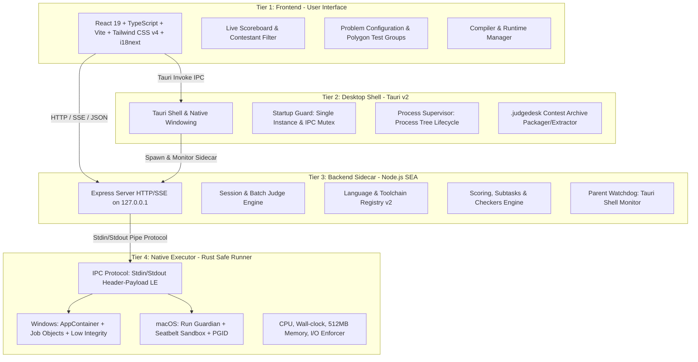
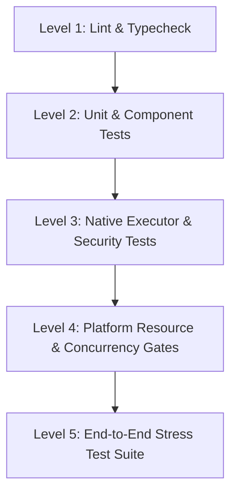
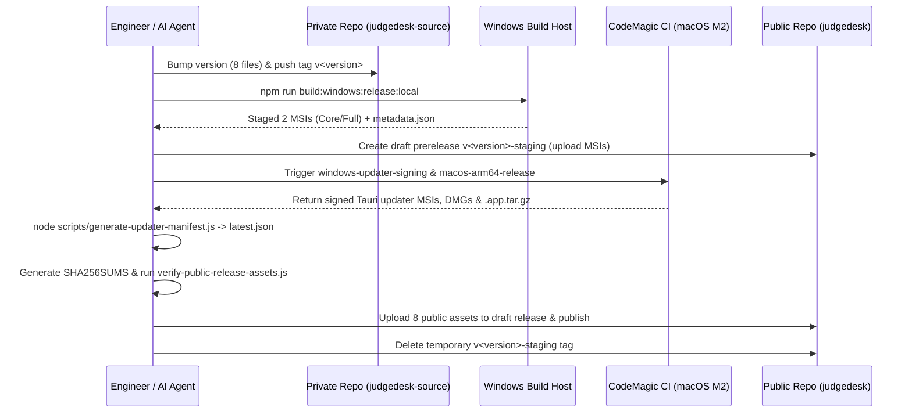

# JudgeDesk — Comprehensive Software Engineering Guidelines

This document provides a complete reference for the architectural blueprint, engineering standards, development workflows, testing strategies, packaging pipelines, and release procedures for **JudgeDesk**. It is tailored for onboarding software engineers, open-source contributors, and **AI Agents** to develop features, fix bugs, and operate the project safely, accurately, and consistently.

---

## 1. Project Overview & Architectural Blueprint

### 1.1. Introduction
**JudgeDesk** (historically codenamed *ThemisV2*) is a standalone, offline desktop automated grading application designed for competitive programming contests, computer science classrooms, and training clubs. It runs natively on **Windows x64** and **macOS Apple Silicon (ARM64)** without requiring any cloud or external network services during judging.

### 1.2. 4-Tier Architecture



- **Tier 1: Frontend (React 19 + TypeScript + Vite + Tailwind CSS v4)**: Fluid, responsive desktop UI supporting Light/Dark themes, bilingual interface (Vietnamese `vi.json` and English `en.json`), real-time judging progress streaming via Server-Sent Events (SSE).
- **Tier 2: Desktop Shell (Tauri v2 / Rust)**: Manages native OS windows, enforces the single-instance invariant (`startup_guard.rs`), supervises orphan process tree cleanup (`process_supervisor.rs`), coordinates update handoffs (`prepare_for_update`), and handles `.judgedesk` zip contest containers.
- **Tier 3: Backend Sidecar (Node.js 24.19.0 SEA - Single Executable Application)**: Bundled with `esbuild` and injected via `postject` into a standalone binary (`server-<target>`). Hosts the core judging logic, compiler orchestration, testcase discovery, scoring algorithms, standard/custom checkers, and toolchain distribution management. Protected by bootstrap tokens and parent process watchdogs.
- **Tier 4: Native Executor (Rust Binary - `judgedesk-native-executor`)**: Executes untrusted contestant submissions within strictly isolated OS sandbox environments. Utilizes Windows AppContainer + Job Objects on Windows, and Run Guardian + Seatbelt Sandbox policies + Process Groups on macOS.

### 1.3. Project Invariants & Identifiers
All code changes must preserve the following identity invariants to guarantee backward compatibility, data persistence, and in-place upgrades:
1. **Application Identifier**: `com.themisv2.judge`
2. **Windows MSI UpgradeCode**: `4ac645a9-f719-5210-85be-f03f49c33869`
3. **User Application Data Directory**:
   - Windows: `%LOCALAPPDATA%\ThemisV2\`
   - macOS: `~/Library/Application Support/ThemisV2/`
4. **Dual-Repository Model**:
   - Private source repository: `ducminh25/judgedesk-source` (contains source code, tags, CI workflows).
   - Public distribution repository: `ducminh25/judgedesk` (contains public releases, installers, SHA256SUMS, `latest.json` updater manifest, and public documentation).
5. **8-File Version Synchronization Rule**:
   Every version bump must be synchronized across exactly 8 files:
   - `package.json` (`version`)
   - `package-lock.json` (`version` & `packages[""].version`)
   - `src/version.ts` (`APP_VERSION`)
   - `src-tauri/Cargo.toml` (`package.version`)
   - `src-tauri/Cargo.lock` (`judgedesk-desktop` version)
   - `src-tauri/tauri.conf.json` (`version`)
   - `native-executor/Cargo.toml` (`package.version`)
   - `native-executor/Cargo.lock` (`judgedesk-native-executor` version)
   *(Enforced via: `npm run release:check-version`)*.

---

## 2. Standard Development Environment & Prerequisites

To ensure build reproducibility and prevent toolchain divergence, the development environment must use the pinned toolchain versions:

| Tool / Dependency | Exact Pinned Version | Notes |
| :--- | :--- | :--- |
| **Node.js** | `24.19.0` LTS | Enforced by `.nvmrc`, `package.json`, and Volta. |
| **npm** | `11.17.0` | Bundled with Node.js 24.19.0. |
| **Rust** | `1.97.1` (with `rustfmt`, `clippy`) | Enforced by `rust-toolchain.toml`. |
| **Windows Toolchain** | Visual Studio Build Tools (C++ x64) | Requires *Desktop development with C++* workload and WebView2 Runtime. |
| **macOS Toolchain** | Xcode Command Line Tools | Installed via `xcode-select --install` (Apple Silicon ARM64 only). |
| **Tauri CLI v2** | Managed via lockfile (`package-lock.json`) | **Never install a global Tauri CLI copy.** |

### 2.1. Initial Setup
```powershell
# 1. Clone the repository
git clone https://github.com/ducminh25/judgedesk-source.git
cd judgedesk-source

# 2. Clean install dependencies from lockfile
npm ci

# 3. Verify environment and versions
npm run release:check-version
npm run lint
```

---

## 3. Directory Structure & Codebase Map

```text
judgedesk/
├── src/                          # Frontend React 19 SPA
│   ├── components/               # Shared UI components (Toolbar, Dialogs, Modals, DiffViewer)
│   ├── contexts/                 # React Contexts (ThemeContext, etc.)
│   ├── features/                 # Feature-driven modular architecture
│   │   ├── contest/              # .judgedesk contest file handling, dirty state, archive models
│   │   ├── desktop/              # Browser lifecycle & Tauri desktop shell bridge
│   │   ├── export/               # Excel score workbook generation (exceljs)
│   │   ├── help/                 # Help Center modal, documentation in VI/EN
│   │   ├── judging/              # Judging session coordination, verdict mapping, scheduler
│   │   ├── preferences/          # User preferences management, LocalStorage sync
│   │   ├── problem-config/       # Problem config editor, time/memory limits, Polygon subtasks
│   │   ├── scoreboard/           # Real-time scoreboard, contestant filtering, ranking table
│   │   ├── toolchains/           # Compiler/runtime manager UI, download/install/verify flow
│   │   ├── updates/              # Core/Full update check dialogs and download handoff
│   │   └── workspace/            # Workspace path selection, path memory, validation
│   ├── locales/                  # Internationalization JSON dictionaries (en.json, vi.json)
│   ├── App.tsx                   # Main root application view
│   └── index.css                 # Core CSS design tokens & Tailwind v4
│
├── server/                       # Backend Node.js Engine
│   ├── executor/                 # IPC Client communicating with Native Executor via Stdin/Stdout
│   ├── export/               # Excel workbook export logic
│   ├── judge/                    # Core judging engine:
│   │   ├── compiler.ts           # Compilers for C++, C, Pascal, Java, and Python syntax check
│   │   ├── testcase-runner.ts    # Single testcase execution runner via sandbox
│   │   ├── standard-checkers.ts  # Built-in standard checkers (wcmp, lcmp, fcmp, yesno, floats...)
│   │   ├── custom-checker-runner.ts # Custom checker compiler and runner (testlib.h / Python)
│   │   ├── scoring.ts            # Subtask, test group, and weighted scoring algorithms
│   │   ├── submission-discovery.ts # Contestant directory and file discovery
│   │   └── testcase-discovery.ts # Test directory discovery (Themis / Polygon formats)
│   ├── languages/                # Language registry and policy contracts (contracts.ts, registry.ts)
│   ├── platform/                 # Platform integration (Parent Watchdog, Directory Picker, Lifecycle)
│   ├── problems/                 # Problem configuration repository and normalization
│   ├── routes/                   # REST API routes for frontend communication
│   ├── toolchains/               # Toolchains v2 subsystem:
│   │   ├── manifest.ts           # Ed25519 signature verification for toolchain manifests
│   │   ├── installer.ts          # Download, SHA-256 validation, and atomic archive extraction
│   │   ├── discovery.ts          # Host system compiler auto-detection (PATH / standard paths)
│   │   └── resolver.ts           # Configured toolchain resolution and fallback prevention
│   ├── jobs.ts                   # Job queue state and active batch judge session lifecycle
│   ├── runtime.ts                # APP_ROOT, RESOURCE_ROOT, and DATA_DIR resolution
│   └── server.ts                 # Express server startup entry point
│
├── native-executor/              # Native Safe Runner (Rust)
│   ├── Cargo.toml                # Standalone Rust crate configuration
│   └── src/
│       ├── main.rs               # Binary entrypoint, frame protocol reader/writer, dispatcher
│       ├── platform/
│       │   ├── windows.rs        # AppContainer, Job Objects, Resource Limits (Windows)
│       │   └── macos.rs          # Run Guardian, Seatbelt Sandbox, Process Groups (macOS)
│       ├── macos_run_guardian.rs # Process supervision and group teardown guardian on macOS
│       ├── macos_launcher.rs     # Isolated process launcher helper on macOS
│       ├── request_validation.rs # Strict input parameter and path validation
│       ├── tree_guard.rs         # Process tree cleanup and generation barrier enforcement
│       └── protocol.rs           # JSON IPC wire protocol models
│
├── src-tauri/                    # Tauri Desktop Shell (Rust)
│   ├── src/
│   │   ├── main.rs               # Desktop binary entry point
│   │   ├── lib.rs                # Tauri App setup and command handlers
│   │   ├── backend.rs            # Spawn and monitor Node.js SEA sidecar process
│   │   ├── startup_guard.rs      # Single-instance lock and primary window focus coordinator
│   │   ├── process_supervisor.rs # Process tree supervisor on Windows
│   │   ├── process_supervisor_macos.rs # Process tree supervisor on macOS
│   │   └── contest_archive.rs    # .judgedesk archive packaging and extraction
│   ├── Cargo.toml                # Tauri shell crate dependencies
│   └── tauri.*.conf.json         # Platform and distribution build configurations
│
├── shared/                       # Shared TypeScript types and contracts (frontend & backend)
├── judgers/                      # Bundled testlib.h library for C++ custom checkers
├── scripts/                      # Build, packaging, stress test, and security gate scripts
└── docs/                         # In-depth architectural designs and release checkpoints
```

---

## 4. Daily Development Workflow

### 4.1. Common Development Commands

#### 1. Frontend Development (Browser-only with Fast Hot-Reload)
Starts the Vite dev server:
```powershell
npm run dev:frontend
```
Open `http://127.0.0.1:5173` in your browser. *(Note: Native features such as OS file pickers, automatic updaters, and `.judgedesk` archives require the Tauri desktop window).*

#### 2. Standalone Backend Development
Runs the Express backend server with `tsx`:
```powershell
npm run dev
```
Server listens at `http://127.0.0.1:3000`.

#### 3. Full Desktop Development (Recommended for Full-Stack Development)
Rebuilds the SEA sidecar, launches Vite HMR, and opens a live Tauri / WebView2 window:
```powershell
npm run test:desktop
```
*(Tip: When making frontend-only edits in `src/` after an initial sidecar build, you can use `npx tauri dev` for faster restarts).*

### 4.2. Building Individual Components
- **Build Native Executor**:
  ```powershell
  npm run build:executor
  ```
  Compiles `native-executor` in release mode and stages the binary under `src-tauri/binaries/`.
- **Build Server Sidecar**:
  ```powershell
  npm run build:server
  ```
  Bundles `server.ts` with `esbuild`, generates the SEA blob, and injects it into Node.js via `postject`.
- **Build Production Frontend**:
  ```powershell
  npm run build:frontend
  ```
- **Clean Build Artifacts**:
  ```powershell
  npm run clean
  ```

---

## 5. Judging Engine & Toolchains Subsystem (Toolchains v2)

### 5.1. Supported Languages & Toolchains (v1.4.x Scope)

| Language | Extensions | Windows x64 | macOS Apple Silicon (ARM64) |
| :--- | :--- | :--- | :--- |
| **C++** | `.cpp` | GCC 14.2.0 (Managed / Local) | Apple Clang (Xcode Command Line Tools) |
| **C** | `.c` | GCC 14.2.0 (Managed / Local) | Apple Clang (Xcode Command Line Tools) |
| **Python** | `.py` | CPython 3.12.13 (Managed) | CPython 3.12.13 (Managed) |
| **Pascal / FPC** | `.pas`, `.pp` | Free Pascal 3.2.2 (Managed) | Free Pascal 3.2.2 (Managed) |
| **Java** | `.java` | Eclipse Temurin OpenJDK 21.0.12+8 (Managed) | Eclipse Temurin OpenJDK 21.0.12+8 (Managed) |
| **Scratch** | `.sb3`, `.sb2`, `.sb` | TurboWarp VM / scratch-run 0.1.7 (Managed) | TurboWarp VM / scratch-run 0.1.7 (Managed) |

> [!NOTE]
> Future languages (Go, Rust, JavaScript/Node.js, C#/.NET) have registered declarative schemas in `server/languages/registry.ts`, but are marked `experimental` and disabled in official production releases.

### 5.2. Distribution Editions: Core vs Full
1. **Full Edition**: Pre-bundles all managed compilers and runtimes directly inside the installer.
   - Windows Full: Includes GCC (C/C++), CPython, FPC, Temurin Java, Scratch VM, and the offline WebView2 Runtime.
   - macOS Full: Includes CPython, FPC, Temurin Java, Scratch VM; C/C++ uses the host Apple Clang.
   - Ideal for: Offline contest labs, classroom computers without internet access.
2. **Core Edition**: Lightweight distribution containing only the core judging application. Users can download signed toolchains on demand or configure pre-existing local compilers.

### 5.3. Four Toolchain Configuration Modes
Users configure the toolchain source independently for each language:
1. `None`: Language disabled (submissions will be ignored).
2. `Managed`: Uses official JudgeDesk packages verified via Ed25519 signatures and SHA-256 hashes.
3. `Local (auto-detect)`: Automatically detects host compilers from standard installation locations and `PATH`.
4. `Local (path)`: Uses a manually specified executable path verified against security compatibility tests.

### 5.4. Toolchains v2 Security Policies
- **Ed25519 Signature Verification**: The `toolchains-manifest.json` manifest is digitally signed using an Ed25519 private key. The backend validates the signature before downloading or extracting any package.
- **Fail-Closed Verification**: If an archive's SHA-256 hash or byte size deviates from the signed manifest, the installation aborts immediately.
- **Active Judging Mutex**: When a judging session is running, any API request attempting to modify preferences, initiate toolchain discovery, download, or uninstall returns `HTTP 409 Conflict`.

### 5.5. Standard Compilation Flags
- **C++ (C++14)**: `-pipe -O2 -s -static -lm -x c++` (on Windows, stack reserve is set to `66060288` bytes $\approx 63\text{ MiB}$).
- **C (C11)**: `-pipe -O2 -s -static -lm -x c` (stack reserve `66060288` bytes on Windows).
- **Pascal**: `-O2 -XS -Sg -Cs66060288`.
- **Java**: Compiled via `javac` into an isolated output folder; executed via main class.
- **Python**: Syntax pre-checked (`py_compile`) before direct execution under the isolated interpreter.

### 5.6. Checkers & Scoring Models
- **Standard Checkers**: Built-in implementations for `wcmp` (word-by-word), `lcmp` (line-by-line), `fcmp` (exact file), `yesno` (case-insensitive YES/NO), `floats` (floating-point with $\epsilon$ precision), `token`, `huge_int`, and `ncmp`.
- **Custom Checkers**:
  - C++ Checkers: Built using `testlib.h` (bundled directly in the distribution).
  - Python Checkers: Executed as isolated Python scripts.
- **Contest Packaging (`.judgedesk`)**: ZIP-based format containing `manifest.json`, `contestants/`, and `problems/`. Preserves scores, subtask configurations, test weights, and execution results.

---

## 6. Security & Native Sandbox Internals

JudgeDesk enforces strict defense-in-depth isolation against hostile contestant code (fork bombs, memory exhaustion, file system tampering, network exfiltration).

### 6.1. Windows Sandbox Architecture
1. **AppContainer Isolation**:
   - Each submission process executes under a dedicated AppContainer profile with Low Integrity tokens.
   - Network access is completely blocked (`networkBlocked = true`).
   - File system access is restricted exclusively to the allocated temporary run workspace.
2. **Windows Job Objects**:
   - **Memory Cap**: Each child job is capped at **512 MiB**. This guarantees that the combined peak working set of the entire process tree (App + WebView2 + Backend + Executor + Child) stays comfortably under the **1,024 MiB** release gate.
   - **CPU Affinity & Priority**: Each test is pinned to **1 logical processor** and runs at `BELOW_NORMAL_PRIORITY_CLASS` to prevent system freezes on low-spec teacher PCs.
   - **Kill on Job Close**: Closing the Job Object handle automatically terminates all descendant processes.

### 6.2. macOS Sandbox Architecture
1. **Run Guardian (`macos_run_guardian.rs`) & Seatbelt Sandbox**:
   - Applies strict kernel-level Seatbelt sandbox profiles to deny unauthorized file system access and block all network sockets.
2. **Process Groups & RLIMITs**:
   - Isolates the submission process tree in its own Process Group ID (`setpgid`).
   - Enforces `RLIMIT_NPROC` and `RLIMIT_AS` to contain fork bombs and memory allocation bursts.
   - Blocks `posix_spawn` group escape vectors.
3. **Generation Barrier & Tree Guard (`tree_guard.rs`)**:
   - Ensures all processes from the preceding generation have exited before admitting subsequent runs.

### 6.3. Cancellation Drain Protocol
When a user clicks "Cancel Judging":
1. Backend sends a `cancel` request with `runId` to the Native Executor.
2. The Executor initiates process termination and enters a **Drain Loop** (timeout: 20 seconds).
3. The Executor returns `cancelled: true` only after verifying that the process container/group is **completely empty**.
4. If a process fails to drain before the timeout, the Executor enters a terminal exit state to force OS-level cleanup, refusing to accept new runs on an unverified environment.

---

## 7. Comprehensive Testing Pyramid & Quality Gates

All pull requests and release candidates must pass every tier of the testing pyramid:



### 7.1. Test Command Suite

#### 1. Typecheck & Code Style
```powershell
npm run lint
cargo fmt --check --manifest-path src-tauri/Cargo.toml
cargo fmt --check --manifest-path native-executor/Cargo.toml
```

#### 2. Server & Feature Unit Tests
```powershell
npm run test:server
npm run test:update-ui
```
*(Executes 470+ automated tests covering submission parsing, scoring logic, custom checkers, toolchain preferences, Scratch runtime, and multi-language gates).*

#### 3. Native Executor Tests (Rust)
```powershell
npm run test:executor
```

#### 4. Security Integration Tests
```powershell
npm run test:security
```
*(Validates sandbox resistance against unauthorized file reads, file overwrites, socket creation, fork bombs, thread bombs, memory over-allocation MLE, and output spam OLE).*

#### 5. Windows Resource & Single-Instance Gates (Windows)
```powershell
# Verify combined process tree stays below 1024 MiB peak
npm run test:windows-resources

# Verify single-instance lock and secondary activation
npm run test:windows-single-instance
```

#### 6. macOS Platform Gates (macOS)
```bash
npm run test:macos-process-supervisor
npm run test:macos-packaged-checkers
```

#### 7. Performance Benchmarks
```powershell
npm run benchmark:executor -- --enforce
```

### 7.2. End-to-End Stress Testing (`stress_test_judge`)
The cross-platform stress test suite is located at `d:\Minh\Code\stress_test_judge`:
```powershell
$env:STRESS_TEST_ROOT='D:\Minh\Code\stress_test_judge'
npm run test:stress
```
The stress test suite validates:
- **Smoke**: Baseline AC submissions for C++ and Python.
- **Verdicts**: Exact CE, WA, RE, TLE, MLE, and OLE outcomes on problem `A_plus_B`.
- **I/O Modes**: File I/O (`freopen`), Standard I/O, and mixed configurations.
- **Checkers**: Floating-point (`Float_Check`), large integers (`Huge_Int`), Yes/No, Binary, Custom C++, and Custom Python.
- **Scoring**: Polygon subtask groupings and partial scoring.
- **Security**: Malicious contestants (`Sec_*` and `ZZ_DANGEROUS_*`) to ensure zero containment escapes.

---

## 8. Build, Packaging & Release Pipeline

### 8.1. 8 Public Release Assets Allowlist
Every official release `<version>` uploaded to the public GitHub repository (`ducminh25/judgedesk`) must contain **exactly these 8 assets**:

```text
1. JudgeDesk_<version>_core_x64_en-US.msi      # Windows Core MSI Installer
2. JudgeDesk_<version>_full_x64_en-US.msi      # Windows Full MSI Installer
3. JudgeDesk_<version>_core_aarch64.dmg        # macOS Core Disk Image
4. JudgeDesk_<version>_full_aarch64.dmg        # macOS Full Disk Image
5. JudgeDesk_<version>_core_aarch64.app.tar.gz # macOS Core Auto-Updater Payload
6. JudgeDesk_<version>_full_aarch64.app.tar.gz # macOS Full Auto-Updater Payload
7. SHA256SUMS                                  # SHA-256 Checksums covering the 7 assets above
8. latest.json                                 # 4-Target Tauri Updater Manifest
```

### 8.2. 4-Target Updater Manifest (`latest.json`)
The `latest.json` file must contain exactly 4 signed platform targets:
- `windows-x86_64-core`
- `windows-x86_64-full`
- `darwin-aarch64-core`
- `darwin-aarch64-full`

Each target embeds the download URL, Ed25519 updater signature (`signature`), download size (`downloadSizeBytes`), and extracted install size (`installedSizeBytes`).

### 8.3. Step-by-Step Release Procedure



#### Step 1: Version Synchronization
Ensure identical version numbers across all 8 files. Verify with:
```powershell
npm run release:check-version
```

#### Step 2: Build Windows Installers
Run on a verified Windows build host:
```powershell
npm run build:windows:release:local
```
This builds `JudgeDesk_<version>_core_x64_en-US.msi` and `JudgeDesk_<version>_full_x64_en-US.msi` inside `release-assets-windows/`.

#### Step 3: CodeMagic macOS Build & Windows Signing
- Trigger `macos-arm64-release` on CodeMagic against the tagged commit.
- Trigger `windows-updater-signing` on CodeMagic to generate Tauri updater signatures for the Windows MSIs.

#### Step 4: Generate Manifest & Verify Public Assets
Generate `latest.json` from signed assets and verify compliance:
```powershell
node scripts/generate-updater-manifest.js
node scripts/verify-public-release-assets.js public-release-assets v<version>
```

#### Step 5: Publish Public Release
Create a draft release on `ducminh25/judgedesk`, attach the 8 allowed assets, perform anonymous download verification, and publish.

---

## 9. Coding Conventions & AI Agent Guidelines

All engineers and AI Agents contributing code must strictly adhere to the following conventions:

### 9.1. C++ Guidelines (Competitive Programming & Custom Checkers)
- **Headers**: Use `#include <bits/stdc++.h>`.
- **Namespace**: Use `using namespace std;`.
- **Fast I/O**: Include `ios_base::sync_with_stdio(false); cin.tie(0); cout.tie(0);`.
- **Indentation & Braces**: 4 spaces, K&R style (opening brace `{` on the same line).
- **Naming Conventions**: `camelCase` for functions and methods, `snake_case` for local and global variables.
- **Loops**: Use pre-increment `++i`.
- **Modularity**: Structure logic cleanly into helper functions (e.g., `void input()`, `void solve()`), keeping `int main()` concise.

### 9.2. TypeScript / Node.js Guidelines
- **Module System**: Pure ES Modules (`"type": "module"`). All relative imports must include the explicit `.js` extension (e.g., `import { ... } from "./runtime.js";`).
- **Strict Typing**: Avoid `any`. Use `readonly` arrays/objects for immutable state and `satisfies` for compile-time schema validation.
- **Atomic File Operations**: Never overwrite critical files directly in place. Write to a temporary file in the same directory (`.tmp`), call `fsync` if needed, and perform an atomic `fs.renameSync`.
- **Fail-Closed Security**: Reject and throw immediately upon encountering corrupted data, signature mismatches, or path traversal attempts. Never fallback to insecure defaults silently.

### 9.3. Rust Guidelines (Tauri Shell & Native Executor)
- **Safety**: Minimize `unsafe` blocks. Every `unsafe` block must include a comment justifying safety invariants.
- **Error Handling**: Avoid `unwrap()` and `expect()` in runtime server/executor paths. Always propagate errors using `Result<T, E>`.
- **Formatting & Linting**: Code must pass `cargo fmt --check` and `cargo clippy -- -D warnings`.
- **Resource Management**: Use RAII handles to ensure automatic cleanup of OS handles, Job Objects, and process groups upon leaving scope.

### 9.4. Internationalization (i18n) & UI Styling
- **No Hardcoded Strings**: All user-facing UI text must be defined in both `src/locales/en.json` and `src/locales/vi.json`.
- **Tailwind CSS**: Use Tailwind CSS v4 design tokens and CSS variables in `src/index.css` to ensure seamless Dark/Light theme switching.

---

## 10. Quick Command Cheatsheet

| Goal | Command |
| :--- | :--- |
| **Install Dependencies** | `npm ci` |
| **Typecheck & Lint** | `npm run lint` |
| **Run Server Unit Tests** | `npm run test:server` |
| **Launch Desktop App in Dev Mode** | `npm run test:desktop` |
| **Launch Frontend in Browser** | `npm run dev:frontend` |
| **Build Native Executor Binary** | `npm run build:executor` |
| **Build Node.js SEA Sidecar** | `npm run build:server` |
| **Run Security Integration Tests** | `npm run test:security` |
| **Run Judging Stress Tests** | `$env:STRESS_TEST_ROOT='D:\Minh\Code\stress_test_judge'; npm run test:stress` |
| **Verify Windows Memory Envelope (<1024MB)** | `npm run test:windows-resources` |
| **Verify Windows Single-Instance Guard** | `npm run test:windows-single-instance` |
| **Verify 8-File Version Synchronization** | `npm run release:check-version` |
| **Build Windows Local Core & Full MSIs** | `npm run build:windows:release:local` |
| **Verify Public Release Asset Allowlist** | `npm run release:verify-public-assets -- public-release-assets v<version>` |

---

*This document serves as the living engineering guide for JudgeDesk. Whenever architectural modifications, security policies, or supported languages change, keep this document synchronized.*
